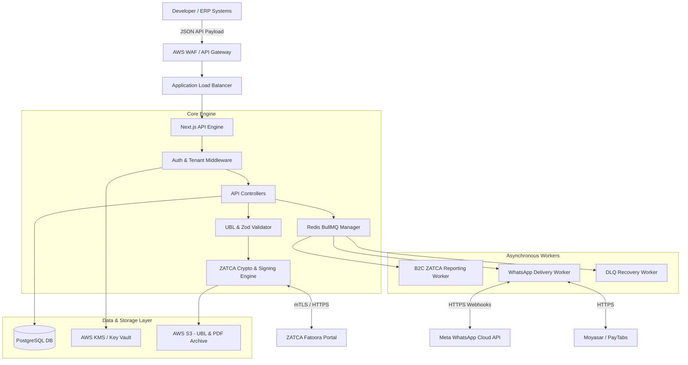

# System Architecture Document

**Project:** ZATCA Phase 2 & WhatsApp Middleware API Engine
**Version:** 2.0 (Production-Ready Architecture)
**Target Environment:** AWS Riyadh (me-central-1)

---

## 1. High Level Architecture

The ZATCA-WhatsApp Middleware Engine acts as a bridge between ERPs/POS systems and the ZATCA Fatoora Portal, abstracting complex UBL 2.1 XML generation, cryptographic hashing, and ECDSA signing. It subsequently orchestrates B2C and B2B WhatsApp invoice deliveries via Meta's Cloud API.



---

## 2. Low Level Architecture

At the low level, the system relies on the **Service Locator Pattern** combined with **Dependency Injection**. The application logic is highly decoupled from external APIs to allow for seamless transition between Sandbox/Mock environments and Production.

- **Invoice Intake:** When `POST /api/v1/invoices` is called, the payload undergoes strict Zod validation (e.g., enforcing 15-digit Saudi VAT numbers starting/ending with '3').
- **Cryptographic Pipeline:** The JSON is canonicalized into UBL 2.1 XML, validated locally against ZATCA XSD schemas, hashed via SHA-256 (chained with the previous invoice hash), and signed using `secp256k1` ECDSA keys retrieved securely from AWS KMS.
- **Queue Mechanism:** B2B Standard invoices are cleared synchronously via ZATCA mTLS endpoints. B2C Simplified invoices are pushed to Redis (BullMQ) for asynchronous batch reporting within 24 hours.

---

## 3. Module Breakdown

### 3.1 ZATCA Phase 2 Cryptographic Engine
- **XML Canonicalization & XSD Validator:** Locally validates generated XML to prevent ZATCA portal bans for malformed requests.
- **Crypto Signer:** Handles SHA-256 hashing, previous hash chaining, and ECDSA signing with CSID integration.
- **QR Code Generator:** Produces Base64 TLV strings encoding Seller, VAT, Date, Totals, Hash, and Signature.

### 3.2 Meta WhatsApp Cloud API Engine
- **Template Manager:** Manages bilingual (Arabic/English) templates.
- **Dynamic Link Injector:** Generates short URLs pointing to PDF/A-3 invoices stored in S3.
- **Interactive Payments:** Embeds Click-to-Pay links to Moyasar/PayTabs, listening to webhooks to dispatch "Paid" receipt templates.

### 3.3 Multi-Tenant Agency Management (White-Label)
- **Tenant Isolation:** Enforces Row-Level Security (RLS) in PostgreSQL so sub-tenants cannot view other agencies' logs.
- **Custom Domains & Branding:** Agencies can map custom subdomains and upload their own logos for PDF rendering.

### 3.4 Automated CSID Onboarding
- **Automated Pipeline:** Captures OTPs, runs ZATCA compliance suites, and automatically requests/renews Production CSIDs.

---

## 4. Folder Structure (Next.js App Router)

```text
├── src/
│   ├── app/
│   │   ├── api/v1/
│   │   │   ├── auth/             # API Key Generation & Verification
│   │   │   ├── invoices/         # Unified ZATCA/WA Submission Endpoints
│   │   │   ├── csid/             # CSID Onboarding & Renewals
│   │   │   └── webhooks/         # Meta WA & Payment Gateway Webhooks
│   │   └── (dashboard)/          # White-Label UI for Agencies
│   ├── components/               # UI Components (ThemeProvider, Stats, Charts)
│   ├── lib/
│   │   ├── crypto/               # UBL 2.1, XSD Validator, SHA-256, ECDSA
│   │   ├── services/             # Core Service Interfaces & Locator
│   │   ├── db/                   # Prisma Client & RLS Middleware
│   │   ├── queue/                # BullMQ Worker Definitions
│   │   └── whatsapp/             # Meta API Client
│   ├── types/                    # Zod Schemas (Saudi VAT Strict Validation)
│   └── utils/                    # PDF/A-3 Generators, Base64 TLV encoders
```

---

## 5. API Boundary

The API operates over RESTful principles using JSON.
- **Endpoint Design:** API endpoints strictly return standardized JSON envelopes: `{ success: boolean, data: {}, error: {} }`.
- **Validation:** Deep Zod validation at the boundary. Invalid payloads immediately return HTTP 400 with a detailed error array.
- **Rate Limiting:** IP-based and Tenant-based rate limiting (e.g., 500 req/sec) using Redis. HTTP 429 is returned upon threshold breach.

---

## 6. Authentication Flow

1. **Agency API Key:** ERP developers generate API keys via the Agency Dashboard.
2. **Middleware Verification:** Incoming API requests include `Authorization: Bearer <API_KEY>`.
3. **Tenant Lookup:** The middleware looks up the hashed key in PostgreSQL, verifies the tenant status, and extracts the associated `tenant_id`.
4. **Context Injection:** The `tenant_id` is injected into the Next.js request context.
5. **RLS Enforcement:** Prisma uses the `tenant_id` to scope all subsequent database read/writes to that specific tenant.
6. **Key Vaulting:** The tenant's private ECDSA key is never passed directly; the signing module requests the signature from AWS KMS using the tenant's IAM context.

---

## 7. Deployment Architecture

To comply with the Saudi Cloud Computing Regulatory Framework (CCRF):
- **Cloud Provider:** AWS Region `me-central-1` (Riyadh).
- **Compute:** ECS Fargate containers running the Next.js production build for zero-downtime rolling deployments.
- **Database:** Amazon RDS for PostgreSQL (Multi-AZ) for transactional data.
- **Cache & Queues:** Amazon ElastiCache (Redis) for session state, rate limiting, and BullMQ task queues.
- **Storage:** Amazon S3 (Standard-IA) for 6-year archival of UBL 2.1 XML and PDF/A-3 invoices.
- **Security:** AWS KMS for securing Private Keys, AWS WAF for DDoS protection.

---

## 8. Scalability Plan

- **Horizontal Scaling:** Next.js API instances will autoscale horizontally behind an Application Load Balancer based on CPU/Memory metrics.
- **Asynchronous Decoupling:** Heavy operations (PDF generation, B2C Reporting, WhatsApp delivery) are strictly offloaded to BullMQ worker nodes to keep the main API thread unblocked.
- **Database Read Replicas:** As the agency volume grows, read-heavy operations (e.g., Dashboard Analytics) will be routed to PostgreSQL Read Replicas to preserve primary DB write performance.

---

## 9. Caching Strategy

- **Static Lookups:** Tenant API configurations, webhook URLs, and WhatsApp templates are cached in Redis for 15 minutes to reduce database hits on every request.
- **Cache Invalidation:** Updating settings from the Agency Dashboard instantly triggers a Redis cache purge for that specific `tenant_id`.
- **Next.js Caching:** The Next.js App Router Data Cache is utilized for non-dynamic dashboard components.

---

## 10. Logging Strategy

- **Audit Logging:** Every interaction with ZATCA (Clearance, Reporting, Compliance) is logged in PostgreSQL with request/response payloads for auditing.
- **Error & Exception Handling:** 
  - *ZATCA Errors:* Handled gracefully. If ZATCA rejects an invoice (e.g., timestamp mismatch), the error is logged, and the WhatsApp sequence is halted.
  - *WhatsApp Errors:* If Meta rejects a template, the error is isolated and does not affect the ZATCA clearance status.
- **Dead Letter Queues (DLQ):** Failed asynchronous tasks are sent to a BullMQ DLQ.
- **System Health Alerts:** Critical errors (e.g., ZATCA downtime, 5xx errors, WhatsApp delivery drops below 99.5%) trigger high-priority alerts to Super Admins via Slack/Email. Log aggregation is handled via Datadog or AWS CloudWatch.
