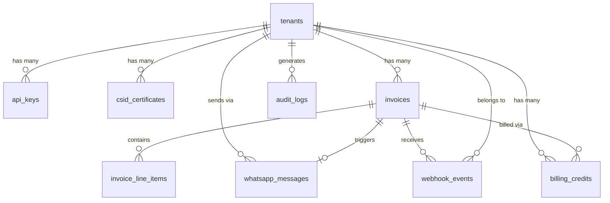
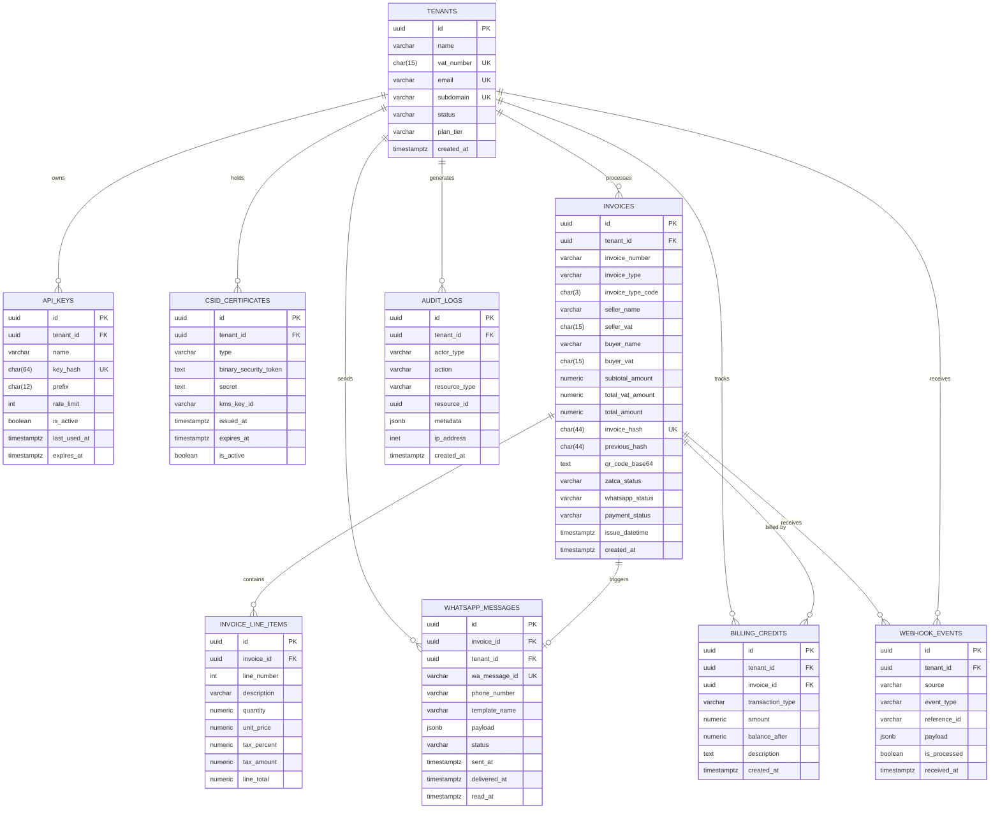

# Database Design Document

**Project:** ZATCA Phase 2 & WhatsApp Middleware API Engine
**Database:** PostgreSQL (Primary) + Redis (Cache/Queue)
**ORM:** Drizzle ORM (Primary)
**Version:** 2.0 (Drizzle Architecture Update)

---

## 1. Collection (Table) List

| # | Table Name | Description | Engine |
| :--- | :--- | :--- | :--- |
| 1 | `tenants` | Registered agencies and their configuration | PostgreSQL |
| 2 | `api_keys` | Hashed API keys linked to tenants | PostgreSQL |
| 3 | `csid_certificates` | ZATCA CSID compliance and production certificates | PostgreSQL |
| 4 | `invoices` | Master invoice records with ZATCA and WA status | PostgreSQL |
| 5 | `invoice_line_items` | Individual line items per invoice | PostgreSQL |
| 6 | `whatsapp_messages` | WhatsApp delivery log per invoice | PostgreSQL |
| 7 | `webhook_events` | Inbound webhook events from Meta and Payment Gateways | PostgreSQL |
| 8 | `billing_credits` | Prepaid credit balances per tenant | PostgreSQL |
| 9 | `audit_logs` | Immutable audit trail for all sensitive operations | PostgreSQL |
| 10 | `task_queue` | BullMQ job definitions (B2C, WA Delivery) | Redis |
| 11 | `rate_limit_counters` | Per-tenant sliding window rate limit counters | Redis |

---

## 2. Schema (Full Table Definitions)

### 2.1 `tenants`
```sql
CREATE TABLE tenants (
  id              UUID PRIMARY KEY DEFAULT gen_random_uuid(),
  name            VARCHAR(255) NOT NULL,
  vat_number      CHAR(15) NOT NULL CHECK (vat_number ~ '^3[0-9]{13}3$'),
  email           VARCHAR(255) UNIQUE NOT NULL,
  subdomain       VARCHAR(100) UNIQUE,
  logo_url        TEXT,
  status          VARCHAR(20) NOT NULL DEFAULT 'ACTIVE'
                  CHECK (status IN ('ACTIVE','SUSPENDED','PENDING')),
  plan_tier       VARCHAR(20) NOT NULL DEFAULT 'STARTER'
                  CHECK (plan_tier IN ('STARTER','PROFESSIONAL','ENTERPRISE')),
  whatsapp_number VARCHAR(20),
  created_at      TIMESTAMPTZ NOT NULL DEFAULT NOW(),
  updated_at      TIMESTAMPTZ NOT NULL DEFAULT NOW()
);

-- Auto-update trigger for updated_at (reusable for all tables with updated_at)
CREATE OR REPLACE FUNCTION trigger_set_updated_at()
RETURNS TRIGGER AS $$
BEGIN
  NEW.updated_at = NOW();
  RETURN NEW;
END;
$$ LANGUAGE plpgsql;

CREATE TRIGGER set_tenants_updated_at
  BEFORE UPDATE ON tenants
  FOR EACH ROW EXECUTE FUNCTION trigger_set_updated_at();
```

### 2.2 `api_keys`
```sql
CREATE TABLE api_keys (
  id              UUID PRIMARY KEY DEFAULT gen_random_uuid(),
  tenant_id       UUID NOT NULL REFERENCES tenants(id) ON DELETE CASCADE,
  name            VARCHAR(100) NOT NULL,
  key_hash        CHAR(64) NOT NULL UNIQUE,  -- SHA-256 of raw key
  prefix          CHAR(12) NOT NULL,          -- First 12 chars for display
  rate_limit      INTEGER NOT NULL DEFAULT 500,
  last_used_at    TIMESTAMPTZ,
  expires_at      TIMESTAMPTZ,
  is_active       BOOLEAN NOT NULL DEFAULT TRUE,
  created_at      TIMESTAMPTZ NOT NULL DEFAULT NOW()
);
```

### 2.3 `csid_certificates`
```sql
CREATE TABLE csid_certificates (
  id                    UUID PRIMARY KEY DEFAULT gen_random_uuid(),
  tenant_id             UUID NOT NULL REFERENCES tenants(id) ON DELETE CASCADE,
  type                  VARCHAR(20) NOT NULL CHECK (type IN ('COMPLIANCE','PRODUCTION')),
  compliance_request_id VARCHAR(255),
  binary_security_token TEXT NOT NULL,         -- Base64 CSID token
  secret                TEXT NOT NULL,         -- Encrypted with AES-256
  kms_key_id            VARCHAR(255),          -- AWS KMS Key reference
  issued_at             TIMESTAMPTZ NOT NULL,
  expires_at            TIMESTAMPTZ NOT NULL,
  is_active             BOOLEAN NOT NULL DEFAULT TRUE,
  created_at            TIMESTAMPTZ NOT NULL DEFAULT NOW()
);
```

### 2.4 `invoices`
```sql
CREATE TABLE invoices (
  id                    UUID PRIMARY KEY DEFAULT gen_random_uuid(),
  tenant_id             UUID NOT NULL REFERENCES tenants(id),
  invoice_number        VARCHAR(100) NOT NULL,
  invoice_type          VARCHAR(20) NOT NULL CHECK (invoice_type IN ('STANDARD','SIMPLIFIED')),
  invoice_type_code     CHAR(3) NOT NULL DEFAULT '388'
                        CHECK (invoice_type_code IN ('388','381','383')),
  -- Seller Info
  seller_name           VARCHAR(255) NOT NULL,
  seller_vat            CHAR(15) NOT NULL CHECK (seller_vat ~ '^3[0-9]{13}3$'),
  seller_address        TEXT NOT NULL,
  -- Buyer Info
  buyer_name            VARCHAR(255),
  buyer_vat             CHAR(15),
  buyer_address         TEXT,
  -- Totals (subtotal CHECK relaxed for Credit Notes type_code 381)
  subtotal_amount       NUMERIC(18,2) NOT NULL,
  total_vat_amount      NUMERIC(18,2) NOT NULL,
  total_amount          NUMERIC(18,2) NOT NULL,
  currency_code         CHAR(3) NOT NULL DEFAULT 'SAR',
  -- ZATCA Fields
  issue_datetime        TIMESTAMPTZ NOT NULL,
  invoice_hash          CHAR(44),             -- SHA-256 Base64
  previous_hash         CHAR(44),             -- PIH Chain
  ubl_xml_s3_key        TEXT,                 -- S3 path to UBL file
  pdf_s3_key            TEXT,                 -- S3 path to PDF/A-3
  qr_code_base64        TEXT,                 -- TLV QR Code
  -- ZATCA Status
  zatca_status          VARCHAR(20) NOT NULL DEFAULT 'PENDING'
                        CHECK (zatca_status IN ('PENDING','CLEARED','REPORTED','FAILED','QUEUED')),
  zatca_warnings        JSONB,
  zatca_errors          JSONB,
  zatca_cleared_at      TIMESTAMPTZ,
  -- WhatsApp Status
  whatsapp_status       VARCHAR(20) NOT NULL DEFAULT 'PENDING'
                        CHECK (whatsapp_status IN ('PENDING','QUEUED','SENT','DELIVERED','READ','FAILED')),
  -- Payment Status
  payment_status        VARCHAR(20) NOT NULL DEFAULT 'UNPAID'
                        CHECK (payment_status IN ('UNPAID','PAID','REFUNDED','PARTIAL')),
  payment_gateway       VARCHAR(50),
  paid_at               TIMESTAMPTZ,
  created_at            TIMESTAMPTZ NOT NULL DEFAULT NOW(),
  updated_at            TIMESTAMPTZ NOT NULL DEFAULT NOW(),
  -- Composite unique: one invoice number per tenant
  CONSTRAINT uq_tenant_invoice_number UNIQUE (tenant_id, invoice_number)
);

CREATE TRIGGER set_invoices_updated_at
  BEFORE UPDATE ON invoices
  FOR EACH ROW EXECUTE FUNCTION trigger_set_updated_at();
```

### 2.5 `invoice_line_items`
```sql
CREATE TABLE invoice_line_items (
  id              UUID PRIMARY KEY DEFAULT gen_random_uuid(),
  invoice_id      UUID NOT NULL REFERENCES invoices(id) ON DELETE CASCADE,
  line_number     INTEGER NOT NULL,
  description     VARCHAR(500) NOT NULL,
  quantity        NUMERIC(12,4) NOT NULL CHECK (quantity > 0),
  unit_code       VARCHAR(10) NOT NULL DEFAULT 'PCE',
  unit_price      NUMERIC(18,4) NOT NULL CHECK (unit_price >= 0),
  discount_amount NUMERIC(18,2) NOT NULL DEFAULT 0,
  tax_percent     NUMERIC(5,2) NOT NULL DEFAULT 15.00,
  tax_amount      NUMERIC(18,2) NOT NULL,
  line_total      NUMERIC(18,2) NOT NULL,
  created_at      TIMESTAMPTZ NOT NULL DEFAULT NOW()
);
```

### 2.6 `whatsapp_messages`
```sql
CREATE TABLE whatsapp_messages (
  id              UUID PRIMARY KEY DEFAULT gen_random_uuid(),
  invoice_id      UUID NOT NULL REFERENCES invoices(id),
  tenant_id       UUID NOT NULL REFERENCES tenants(id),
  wa_message_id   VARCHAR(255) UNIQUE,        -- wamid.xxx from Meta
  phone_number    VARCHAR(20) NOT NULL,
  template_name   VARCHAR(100) NOT NULL,
  payload         JSONB NOT NULL,              -- Full template payload sent
  status          VARCHAR(20) NOT NULL DEFAULT 'QUEUED'
                  CHECK (status IN ('QUEUED','SENT','DELIVERED','READ','FAILED')),
  error_code      VARCHAR(50),
  error_message   TEXT,
  sent_at         TIMESTAMPTZ,
  delivered_at    TIMESTAMPTZ,
  read_at         TIMESTAMPTZ,
  failed_at       TIMESTAMPTZ,
  created_at      TIMESTAMPTZ NOT NULL DEFAULT NOW()
);
```

### 2.7 `webhook_events`
```sql
CREATE TABLE webhook_events (
  id              UUID PRIMARY KEY DEFAULT gen_random_uuid(),
  tenant_id       UUID REFERENCES tenants(id),
  source          VARCHAR(30) NOT NULL CHECK (source IN ('META','MOYASAR','PAYTABS','ZATCA')),
  event_type      VARCHAR(50) NOT NULL,
  reference_id    VARCHAR(255),               -- wamid / invoice_id / order_id
  payload         JSONB NOT NULL,
  is_processed    BOOLEAN NOT NULL DEFAULT FALSE,
  processed_at    TIMESTAMPTZ,
  error_message   TEXT,
  received_at     TIMESTAMPTZ NOT NULL DEFAULT NOW()
);
```

### 2.8 `billing_credits`
```sql
CREATE TABLE billing_credits (
  id              UUID PRIMARY KEY DEFAULT gen_random_uuid(),
  tenant_id       UUID NOT NULL REFERENCES tenants(id),
  transaction_type VARCHAR(20) NOT NULL CHECK (transaction_type IN ('TOPUP','DEDUCT','REFUND')),
  amount          NUMERIC(12,4) NOT NULL,
  balance_after   NUMERIC(12,4) NOT NULL,
  description     TEXT,
  invoice_id      UUID REFERENCES invoices(id),
  created_at      TIMESTAMPTZ NOT NULL DEFAULT NOW()
);
```

### 2.9 `audit_logs`
```sql
CREATE TABLE audit_logs (
  id              UUID PRIMARY KEY DEFAULT gen_random_uuid(),
  tenant_id       UUID REFERENCES tenants(id),
  actor_type      VARCHAR(20) NOT NULL CHECK (actor_type IN ('TENANT','ADMIN','SYSTEM')),
  action          VARCHAR(100) NOT NULL,
  resource_type   VARCHAR(50),
  resource_id     UUID,
  metadata        JSONB,
  ip_address      INET,
  created_at      TIMESTAMPTZ NOT NULL DEFAULT NOW()
);
```

---

## 3. Relationships



### Relationship Summary

| Parent Table | Child Table | Type | Foreign Key | On Delete |
| :--- | :--- | :--- | :--- | :--- |
| `tenants` | `api_keys` | One-to-Many | `api_keys.tenant_id` | CASCADE |
| `tenants` | `csid_certificates` | One-to-Many | `csid_certificates.tenant_id` | CASCADE |
| `tenants` | `invoices` | One-to-Many | `invoices.tenant_id` | RESTRICT |
| `tenants` | `billing_credits` | One-to-Many | `billing_credits.tenant_id` | RESTRICT |
| `tenants` | `audit_logs` | One-to-Many | `audit_logs.tenant_id` | SET NULL |
| `invoices` | `invoice_line_items` | One-to-Many | `invoice_line_items.invoice_id` | CASCADE |
| `invoices` | `whatsapp_messages` | One-to-Many | `whatsapp_messages.invoice_id` | RESTRICT | *(Multiple WA messages possible due to retries)* |
| `invoices` | `webhook_events` | One-to-Many | `webhook_events.reference_id` | SET NULL |

---

## 4. Indexes

```sql
-- tenants
CREATE UNIQUE INDEX idx_tenants_vat         ON tenants(vat_number);
CREATE UNIQUE INDEX idx_tenants_subdomain   ON tenants(subdomain);
CREATE INDEX        idx_tenants_status      ON tenants(status);

-- api_keys
CREATE UNIQUE INDEX idx_apikeys_hash        ON api_keys(key_hash);
CREATE INDEX        idx_apikeys_tenant      ON api_keys(tenant_id);
CREATE INDEX        idx_apikeys_active      ON api_keys(tenant_id) WHERE is_active = TRUE;

-- csid_certificates
CREATE INDEX        idx_csid_tenant         ON csid_certificates(tenant_id);
CREATE INDEX        idx_csid_active         ON csid_certificates(tenant_id, type) WHERE is_active = TRUE;

-- invoices
CREATE INDEX        idx_invoices_tenant     ON invoices(tenant_id);
CREATE INDEX        idx_invoices_number     ON invoices(tenant_id, invoice_number);
CREATE INDEX        idx_invoices_zatca      ON invoices(zatca_status);
CREATE INDEX        idx_invoices_wa         ON invoices(whatsapp_status);
CREATE INDEX        idx_invoices_payment    ON invoices(payment_status);
CREATE INDEX        idx_invoices_created    ON invoices(tenant_id, created_at DESC);
CREATE UNIQUE INDEX idx_invoices_hash       ON invoices(invoice_hash) WHERE invoice_hash IS NOT NULL;

-- invoice_line_items
CREATE INDEX        idx_lineitems_invoice   ON invoice_line_items(invoice_id);

-- whatsapp_messages
CREATE UNIQUE INDEX idx_wa_wamid            ON whatsapp_messages(wa_message_id);
CREATE INDEX        idx_wa_invoice          ON whatsapp_messages(invoice_id);
CREATE INDEX        idx_wa_status           ON whatsapp_messages(status);

-- webhook_events
CREATE INDEX        idx_webhooks_source     ON webhook_events(source, event_type);
CREATE INDEX        idx_webhooks_processed  ON webhook_events(is_processed, received_at);
CREATE INDEX        idx_webhooks_ref        ON webhook_events(reference_id);

-- audit_logs
CREATE INDEX        idx_audit_tenant        ON audit_logs(tenant_id, created_at DESC);
CREATE INDEX        idx_audit_resource      ON audit_logs(resource_type, resource_id);

-- billing_credits
CREATE INDEX        idx_billing_tenant      ON billing_credits(tenant_id, created_at DESC);
```

---

## 5. Validation Rules

| Table | Column | Rule | Implementation |
| :--- | :--- | :--- | :--- |
| `tenants` | `vat_number` | Must be 15 digits, start and end with `3` | SQL CHECK + Zod `.regex(/^3[0-9]{13}3$/)` |
| `tenants` | `status` | Only `ACTIVE`, `SUSPENDED`, `PENDING` | SQL CHECK ENUM |
| `invoices` | `invoice_type_code` | `388` (Standard), `381` (Credit Note), `383` (Debit Note) | SQL CHECK ENUM |
| `invoices` | `subtotal_amount` | Must be ≥ 0 | SQL CHECK |
| `invoices` | `invoice_hash` | SHA-256 Base64, exactly 44 chars | SQL CHAR(44) + App-level |
| `invoices` | `previous_hash` | Must reference prior cleared invoice | App-level (PIH chain validation) |
| `invoice_line_items` | `quantity` | Must be > 0 | SQL CHECK |
| `invoice_line_items` | `tax_percent` | Must be 0%, 5%, or 15% (ZATCA-defined rates) | Zod `.refine()` |
| `api_keys` | `rate_limit` | Must be between 1 and 10,000 | Zod `.min(1).max(10000)` |
| `whatsapp_messages` | `phone_number` | E.164 format with country code | Zod `.regex(/^\+[1-9]\d{7,14}$/)` |
| `csid_certificates` | `expires_at` | Must be after `issued_at` | App-level date comparison |

---

## 6. Aggregation Queries

### 6.1 Invoice Clearance Rate per Tenant (Last 30 Days)
```sql
SELECT
  t.name AS tenant_name,
  COUNT(*) AS total_invoices,
  COUNT(*) FILTER (WHERE i.zatca_status = 'CLEARED') AS cleared,
  COUNT(*) FILTER (WHERE i.zatca_status = 'REPORTED') AS reported,
  COUNT(*) FILTER (WHERE i.zatca_status = 'FAILED') AS failed,
  ROUND(
    100.0 * COUNT(*) FILTER (WHERE i.zatca_status IN ('CLEARED','REPORTED')) / COUNT(*),
    2
  ) AS pass_rate_percent
FROM invoices i
JOIN tenants t ON t.id = i.tenant_id
WHERE i.created_at >= NOW() - INTERVAL '30 days'
GROUP BY t.id, t.name
ORDER BY total_invoices DESC;
```

### 6.2 WhatsApp Delivery Rate per Tenant
```sql
SELECT
  t.name AS tenant_name,
  COUNT(w.*) AS total_sent,
  COUNT(w.*) FILTER (WHERE w.status IN ('DELIVERED','READ')) AS delivered,
  ROUND(
    100.0 * COUNT(w.*) FILTER (WHERE w.status IN ('DELIVERED','READ')) / NULLIF(COUNT(w.*), 0),
    2
  ) AS delivery_rate_percent
FROM whatsapp_messages w
JOIN tenants t ON t.id = w.tenant_id
WHERE w.created_at >= NOW() - INTERVAL '7 days'
GROUP BY t.id, t.name
ORDER BY delivery_rate_percent DESC;
```

### 6.3 Daily Invoice Volume (Time Series for Dashboard Chart)
```sql
SELECT
  DATE_TRUNC('day', created_at) AS day,
  COUNT(*) AS total,
  COUNT(*) FILTER (WHERE invoice_type = 'STANDARD') AS b2b_count,
  COUNT(*) FILTER (WHERE invoice_type = 'SIMPLIFIED') AS b2c_count,
  SUM(total_amount) AS total_value
FROM invoices
WHERE tenant_id = $1
  AND created_at >= NOW() - INTERVAL '30 days'
GROUP BY day
ORDER BY day ASC;
```

### 6.4 Credit Balance per Tenant
```sql
SELECT
  tenant_id,
  SUM(CASE WHEN transaction_type = 'TOPUP' THEN amount
           WHEN transaction_type = 'REFUND' THEN amount
           WHEN transaction_type = 'DEDUCT' THEN -amount
           ELSE 0 END) AS current_balance
FROM billing_credits
GROUP BY tenant_id;
```

### 6.5 Top Failing Invoices (DLQ Monitor)
```sql
SELECT
  i.invoice_number,
  t.name AS tenant,
  i.zatca_status,
  i.zatca_errors,
  i.created_at
FROM invoices i
JOIN tenants t ON t.id = i.tenant_id
WHERE i.zatca_status = 'FAILED'
ORDER BY i.created_at DESC
LIMIT 50;
```

---

## 7. Transactions

### 7.1 Atomic Invoice Creation with Line Items
```typescript
// Drizzle ORM Transaction — ensures Invoice + LineItems are created atomically
const result = await db.transaction(async (tx) => {
  const [invoice] = await tx.insert(invoices).values({
    tenantId: payload.tenantId,
    invoiceNumber: payload.invoiceNumber,
    invoiceType: payload.type,
    sellerName: payload.seller.name,
    sellerVat: payload.seller.vatNumber,
    sellerAddress: payload.seller.address,
    totalAmount: payload.totalAmountWithTax,
    subtotalAmount: payload.subtotalAmount,
    totalVatAmount: payload.totalVatAmount,
    issueDatetime: new Date(),
  }).returning();

  await tx.insert(invoiceLineItems).values(
    payload.lineItems.map((item, i) => ({
      invoiceId: invoice.id,
      lineNumber: i + 1,
      description: item.name,
      quantity: item.quantity,
      unitPrice: item.unitPrice,
      taxPercent: item.taxPercent,
      taxAmount: item.quantity * item.unitPrice * (item.taxPercent / 100),
      lineTotal: item.totalAmount,
    }))
  );

  return invoice;
});
```

### 7.2 Atomic ZATCA Status Update + PIH Chain Write
```typescript
// Ensures clearance status and PIH chain are always consistent
await prisma.$transaction(async (tx) => {
  const updated = await tx.invoice.update({
    where: { id: invoiceId },
    data: {
      zatcaStatus: 'CLEARED',
      invoiceHash: newHash,
      qrCodeBase64: qrCode,
      ubl_xml_s3_key: s3XmlKey,
      pdf_s3_key: s3PdfKey,
      zatcaClearedAt: new Date(),
    },
  });

  await tx.auditLog.create({
    data: {
      tenantId: tenantId,
      actorType: 'SYSTEM',
      action: 'INVOICE_CLEARED',
      resourceType: 'invoice',
      resourceId: invoiceId,
      metadata: { hash: newHash, warnings: zatcaResponse.warnings },
    },
  });

  return updated;
});
```

### 7.3 Atomic Credit Deduction
```typescript
// Deduct billing credit and verify non-negative balance in one transaction
// Uses SERIALIZABLE isolation + advisory lock to prevent race conditions
await prisma.$transaction(async (tx) => {
  // Advisory lock per tenant to prevent concurrent credit deduction race
  await tx.$executeRaw`SELECT pg_advisory_xact_lock(hashtext(${tenantId}::text))`;

  const latest = await tx.billingCredit.findFirst({
    where: { tenantId },
    orderBy: { createdAt: 'desc' },
  });

  const newBalance = (latest?.balanceAfter ?? 0) - INVOICE_COST;
  if (newBalance < 0) throw new Error('INSUFFICIENT_CREDITS');

  await tx.billingCredit.create({
    data: {
      tenantId,
      transactionType: 'DEDUCT',
      amount: INVOICE_COST,
      balanceAfter: newBalance,
      description: `Invoice processing fee for ${invoiceNumber}`,
      invoiceId,
    },
  });
}, {
  isolationLevel: Prisma.TransactionIsolationLevel.Serializable,
});
```

---

## 8. Sample Data

### Tenants
```json
[
  {
    "id": "a1b2c3d4-1234-5678-abcd-ef0123456789",
    "name": "Saudi Tech Agency",
    "vatNumber": "310122393500003",
    "email": "admin@saudtechagency.sa",
    "subdomain": "saudtech",
    "status": "ACTIVE",
    "planTier": "PROFESSIONAL",
    "whatsappNumber": "+966501234567",
    "createdAt": "2026-01-15T08:00:00Z"
  }
]
```

### Invoices
```json
[
  {
    "id": "inv-uuid-001",
    "tenantId": "a1b2c3d4-1234-5678-abcd-ef0123456789",
    "invoiceNumber": "INV-2027-001",
    "invoiceType": "STANDARD",
    "invoiceTypeCode": "388",
    "sellerName": "Saudi Tech Agency",
    "sellerVat": "310122393500003",
    "buyerName": "Acme Corp KSA",
    "buyerVat": "310299887600003",
    "subtotalAmount": 1000.00,
    "totalVatAmount": 150.00,
    "totalAmount": 1150.00,
    "currencyCode": "SAR",
    "issueDatetime": "2027-01-15T10:30:00+03:00",
    "invoiceHash": "dGVzdGhhc2hfU0hBMjU2X2Jhc2U2NF9mb3JfZXhhbXBsZQ==",
    "zatcaStatus": "CLEARED",
    "whatsappStatus": "DELIVERED",
    "paymentStatus": "PAID",
    "createdAt": "2027-01-15T10:30:00Z"
  },
  {
    "id": "inv-uuid-002",
    "tenantId": "a1b2c3d4-1234-5678-abcd-ef0123456789",
    "invoiceNumber": "INV-2027-002",
    "invoiceType": "SIMPLIFIED",
    "invoiceTypeCode": "388",
    "sellerName": "Saudi Tech Agency",
    "sellerVat": "310122393500003",
    "buyerName": "Ahmed Ali",
    "subtotalAmount": 200.00,
    "totalVatAmount": 30.00,
    "totalAmount": 230.00,
    "currencyCode": "SAR",
    "zatcaStatus": "REPORTED",
    "whatsappStatus": "READ",
    "paymentStatus": "UNPAID"
  }
]
```

### Invoice Line Items
```json
[
  {
    "invoiceId": "inv-uuid-001",
    "lineNumber": 1,
    "description": "Cloud Hosting Service - Annual Plan",
    "quantity": 1,
    "unitCode": "MON",
    "unitPrice": 500.00,
    "taxPercent": 15.00,
    "taxAmount": 75.00,
    "lineTotal": 575.00
  },
  {
    "invoiceId": "inv-uuid-001",
    "lineNumber": 2,
    "description": "API Integration License",
    "quantity": 2,
    "unitCode": "LIC",
    "unitPrice": 250.00,
    "taxPercent": 15.00,
    "taxAmount": 75.00,
    "lineTotal": 575.00
  }
]
```

---

## 9. Mongoose Schema (MongoDB Alternative)

> [!NOTE]
> The primary database is **PostgreSQL via Prisma**. These Mongoose schemas are provided as a reference if you choose MongoDB for specific modules (e.g., webhook event storage).

### Tenant Schema
```typescript
import { Schema, model, Document } from 'mongoose';

interface ITenant extends Document {
  name: string;
  vatNumber: string;
  email: string;
  subdomain?: string;
  status: 'ACTIVE' | 'SUSPENDED' | 'PENDING';
  planTier: 'STARTER' | 'PROFESSIONAL' | 'ENTERPRISE';
  whatsappNumber?: string;
  createdAt: Date;
}

const TenantSchema = new Schema<ITenant>({
  name:            { type: String, required: true, trim: true },
  vatNumber:       { type: String, required: true, unique: true, match: /^3[0-9]{13}3$/ },
  email:           { type: String, required: true, unique: true, lowercase: true },
  subdomain:       { type: String, unique: true, sparse: true },
  status:          { type: String, enum: ['ACTIVE','SUSPENDED','PENDING'], default: 'ACTIVE' },
  planTier:        { type: String, enum: ['STARTER','PROFESSIONAL','ENTERPRISE'], default: 'STARTER' },
  whatsappNumber:  { type: String, match: /^\+[1-9]\d{7,14}$/ },
}, { timestamps: true });

export const Tenant = model<ITenant>('Tenant', TenantSchema);
```

### Invoice Schema
```typescript
import { Schema, model, Document, Types } from 'mongoose';

interface IInvoice extends Document {
  tenantId: Types.ObjectId;
  invoiceNumber: string;
  invoiceType: 'STANDARD' | 'SIMPLIFIED';
  seller: { name: string; vatNumber: string; address: string };
  buyer?: { name?: string; vatNumber?: string; address?: string };
  lineItems: Array<{
    lineNumber: number;
    description: string;
    quantity: number;
    unitPrice: number;
    taxPercent: number;
    taxAmount: number;
    lineTotal: number;
  }>;
  totalAmount: number;
  totalVatAmount: number;
  invoiceHash?: string;
  previousHash?: string;
  qrCodeBase64?: string;
  zatcaStatus: 'PENDING' | 'CLEARED' | 'REPORTED' | 'FAILED' | 'QUEUED';
  whatsappStatus: 'PENDING' | 'QUEUED' | 'SENT' | 'DELIVERED' | 'READ' | 'FAILED';
  paymentStatus: 'UNPAID' | 'PAID' | 'REFUNDED';
}

const InvoiceSchema = new Schema<IInvoice>({
  tenantId:     { type: Schema.Types.ObjectId, ref: 'Tenant', required: true },
  invoiceNumber:{ type: String, required: true },
  invoiceType:  { type: String, enum: ['STANDARD','SIMPLIFIED'], required: true },
  seller: {
    name:       { type: String, required: true },
    vatNumber:  { type: String, required: true, match: /^3[0-9]{13}3$/ },
    address:    { type: String, required: true },
  },
  buyer: {
    name:       String,
    vatNumber:  { type: String, match: /^3[0-9]{13}3$/ },
    address:    String,
  },
  lineItems: [{
    lineNumber:  { type: Number, required: true },
    description: { type: String, required: true },
    quantity:    { type: Number, required: true, min: 0.0001 },
    unitPrice:   { type: Number, required: true, min: 0 },
    taxPercent:  { type: Number, required: true, enum: [0, 5, 15] },
    taxAmount:   { type: Number, required: true, min: 0 },
    lineTotal:   { type: Number, required: true },
  }],
  totalAmount:    { type: Number, required: true },
  totalVatAmount: { type: Number, required: true },
  invoiceHash:    { type: String, length: 44 },
  previousHash:   { type: String, length: 44 },
  qrCodeBase64:   String,
  zatcaStatus:    { type: String, enum: ['PENDING','CLEARED','REPORTED','FAILED','QUEUED'], default: 'PENDING' },
  whatsappStatus: { type: String, enum: ['PENDING','QUEUED','SENT','DELIVERED','READ','FAILED'], default: 'PENDING' },
  paymentStatus:  { type: String, enum: ['UNPAID','PAID','REFUNDED'], default: 'UNPAID' },
}, { timestamps: true });

InvoiceSchema.index({ tenantId: 1, invoiceNumber: 1 }, { unique: true });
InvoiceSchema.index({ tenantId: 1, zatcaStatus: 1 });
InvoiceSchema.index({ tenantId: 1, createdAt: -1 });

export const Invoice = model<IInvoice>('Invoice', InvoiceSchema);
```

---

## 10. ERD (Entity Relationship Diagram)


