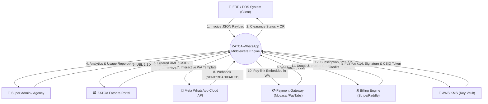
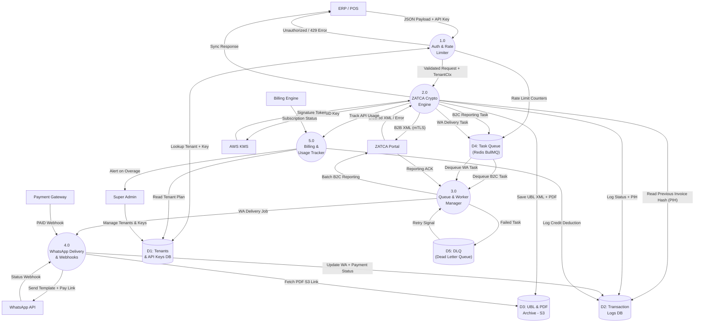
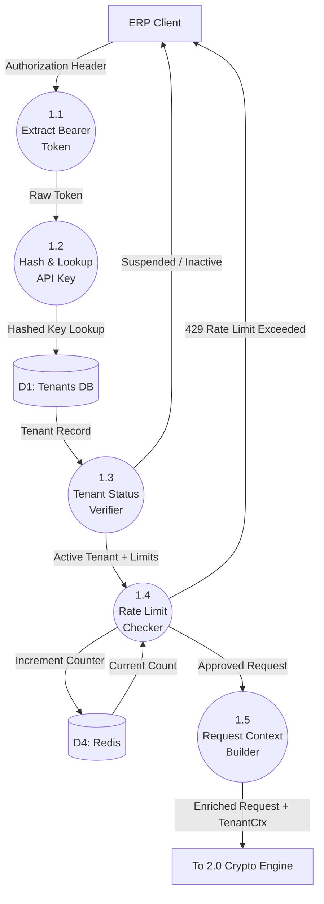
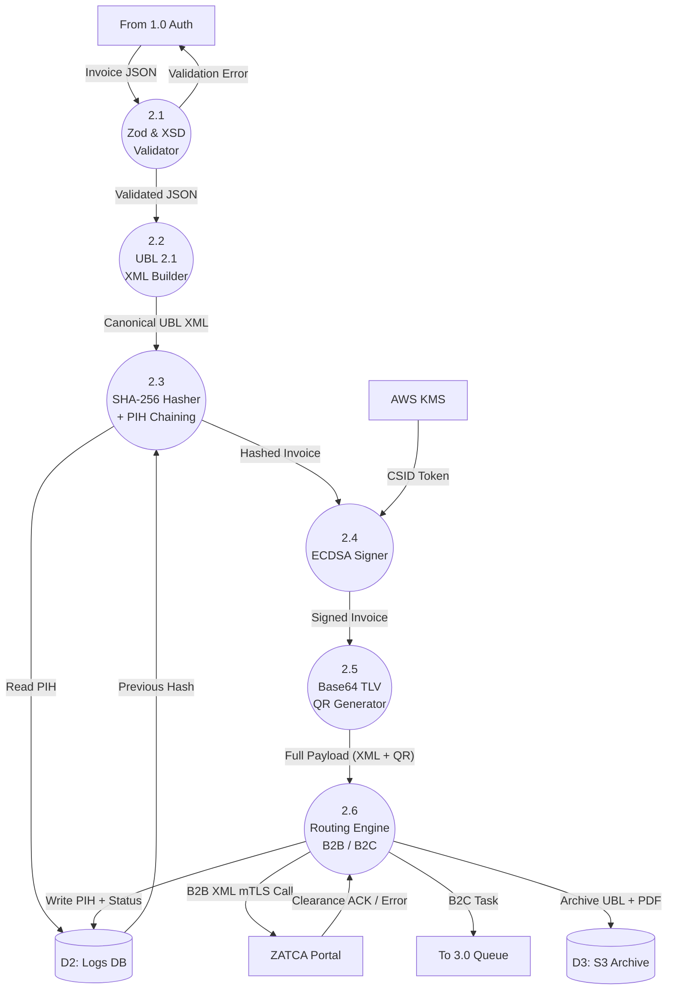
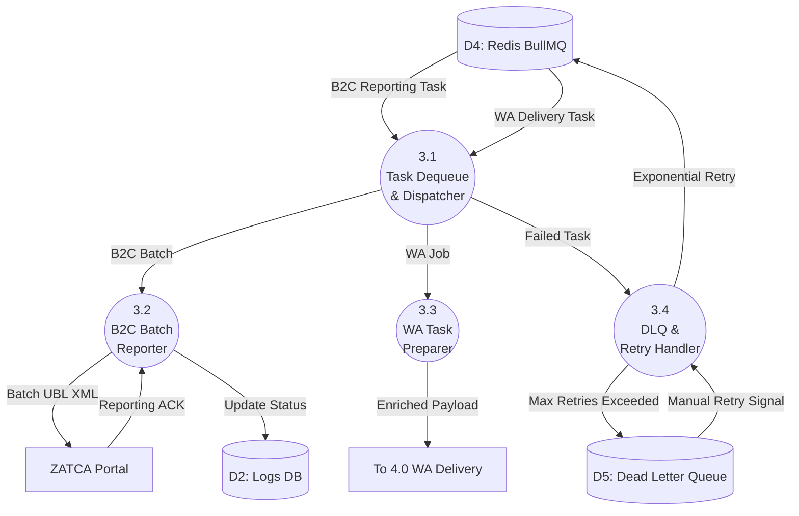
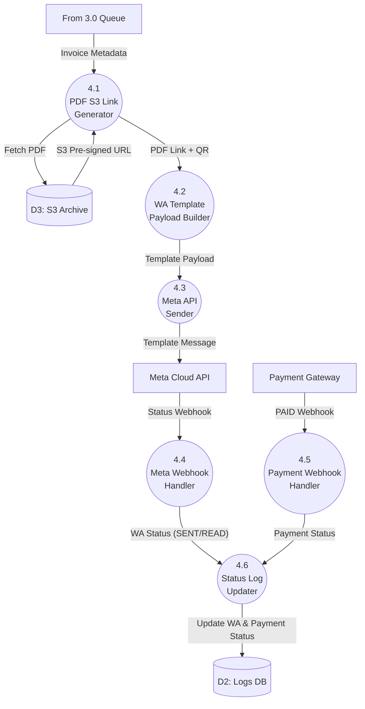
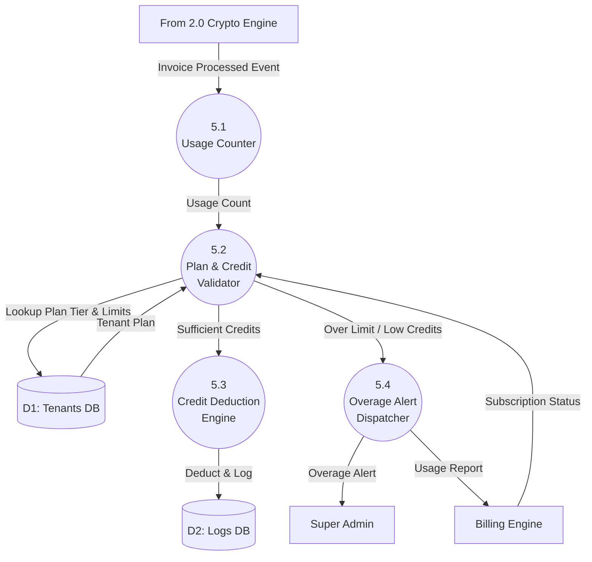

# Data Flow Diagram (DFD) Documentation

**Project:** ZATCA Phase 2 & WhatsApp Middleware API Engine
**Version:** 2.0 (Full Expansion)

---

## 1. Context Diagram (Level 0)

The Context Diagram shows the entire Middleware Engine as a single process interacting with all external entities, including Admin Portal, Billing, and DLQ Recovery.

### Mermaid Visualization



> [!NOTE]
> The **Dead Letter Queue (DLQ)** is intentionally excluded from the Context Diagram because it is an internal data store (D5), not an external entity. It appears correctly in the Level 1 DFD.

---

## 2. Level 1 DFD

The Level 1 DFD breaks down the main system into 5 major subsystems with all their data flows, stores, and external entity interactions.

### Mermaid Visualization



---

## 3. Level 2 DFDs (All Processes Expanded)

### Level 2 — Process 1.0: Auth & Rate Limiter



---

### Level 2 — Process 2.0: ZATCA Crypto Engine



---

### Level 2 — Process 3.0: Queue & Worker Manager



---

### Level 2 — Process 4.0: WhatsApp Delivery & Webhooks



---

### Level 2 — Process 5.0: Billing & Usage Tracker



---

## 4. Data Dictionary (Full Expansion)

| Data Element | Description | Format / Type | Size / Constraint | Source | Destination |
| :--- | :--- | :--- | :--- | :--- | :--- |
| `InvoiceJSON` | Raw invoice data: Seller, Buyer, Line Items, VAT breakdown, Totals. | JSON Object | Max 256KB | ERP Client | 1.0 Auth |
| `API_Key` | Bearer token identifying a tenant's integration. | String (Header) | 64 chars, alphanumeric | ERP Client | 1.0 Auth |
| `TenantContext` | Active tenant metadata including rate limits and CSID key ID. | Object | — | D1: Tenants DB | 2.0 Crypto Engine |
| `CanonicalXML` | Invoice JSON canonicalized to ZATCA UBL 2.1 XML format. | String (XML) | Max 1MB | 2.1 XML Builder | 2.2 SHA-256 Hasher |
| `PIH` | **Previous Invoice Hash** — SHA-256 hash of the last accepted invoice, linked for chain integrity. | Base64 (44 chars) | Exactly 44 chars | D2: Logs DB | 2.3 SHA-256 Hasher |
| `InvoiceHash` | SHA-256 hash of the canonical XML for the current invoice. | Base64 (44 chars) | Exactly 44 chars | 2.3 SHA-256 Hasher | 2.4 ECDSA Signer |
| `CSID` | **Cryptographic Stamp Identifier** — X.509 Production certificate issued by ZATCA to certify device. | Base64 Binary | Variable | AWS KMS | 2.4 ECDSA Signer |
| `ECDSASignature` | Digital signature of the invoice hash using secp256k1 private key. | Base64 String | 88 chars | 2.4 ECDSA Signer | 2.5 QR Generator |
| `Base64QR` | **TLV-encoded QR** — contains: Seller Name (Tag1), VAT No (Tag2), Timestamp (Tag3), Invoice Total (Tag4), VAT Total (Tag5), Invoice Hash (Tag6), ECDSA Sig (Tag7), Public Key (Tag8). | Base64 String | Variable | 2.5 QR Generator | 2.6 Routing Engine |
| `ClearedXML` | ZATCA-cleared and stamped UBL 2.1 XML returned after B2B clearance. | String (XML) | Max 1MB | ZATCA Portal | 2.6 Routing Engine |
| `TemplatePayload` | Bilingual (AR/EN) WhatsApp interactive template with injected QR, PDF URL, invoice total, and Pay button. | JSON | Max 4096 chars | 4.2 Template Builder | Meta Cloud API |
| `S3PreSignedURL` | Temporary secure URL linking to the stored PDF/A-3 file on S3. | HTTPS URL | 1024 chars, TTL 1hr | D3: S3 Archive | 4.2 Template Builder |
| `WebhookStatus` | Status event received from Meta (`SENT`, `DELIVERED`, `READ`, `FAILED`) or Payment Gateway (`PAID`, `REFUNDED`). | JSON Enum | — | Meta / Payment | 4.4/4.5 Webhook Handler |
| `BullMQJob` | Serialized job payload pushed to the Redis BullMQ queue for async processing. | JSON | Max 100KB | 2.0 Crypto Engine | D4: Redis |
| `DLQEntry` | Failed job record after max retries, stored for manual intervention or alerting. | JSON | — | 3.4 DLQ Handler | D5: DLQ Store |

---

## 5. Data Flow Table (Full Expansion)

| # | Data Flow Name | Source | Destination | Data Transported | Protocol |
| :--- | :--- | :--- | :--- | :--- | :--- |
| 1 | Submit Invoice | ERP Client | 1.0 Auth | `InvoiceJSON`, `API_Key` | HTTPS REST |
| 2 | Auth Response (Error) | 1.0 Auth | ERP Client | HTTP 401 / 429 JSON Error | HTTPS REST |
| 3 | Tenant Lookup | 1.0 Auth | D1: Tenants DB | Hashed `API_Key` | SQL Query |
| 4 | Tenant Record | D1: Tenants DB | 1.0 Auth | `TenantContext` | SQL Result |
| 5 | Rate Limit Counter | 1.0 Auth | D4: Redis | Tenant ID + Counter Key | Redis INCR |
| 6 | Validated Request | 1.0 Auth | 2.0 Crypto Engine | `InvoiceJSON`, `TenantContext` | In-process |
| 7 | PIH Read | 2.0 Crypto Engine | D2: Logs DB | Tenant ID, Last Invoice | SQL Query |
| 8 | CSID/Key Request | 2.0 Crypto Engine | AWS KMS | Key ID Reference | AWS SDK |
| 9 | Signature Token | AWS KMS | 2.0 Crypto Engine | `CSID`, `ECDSASignature` | AWS SDK |
| 10 | B2B Clearance | 2.0 Crypto Engine | ZATCA Portal | Signed UBL XML, CSID | mTLS HTTPS |
| 11 | Clearance Result | ZATCA Portal | 2.0 Crypto Engine | `ClearedXML`, Warnings | mTLS HTTPS |
| 12 | Archive UBL + PDF | 2.0 Crypto Engine | D3: S3 Archive | XML, PDF/A-3 binary | AWS S3 SDK |
| 13 | Write PIH + Status | 2.0 Crypto Engine | D2: Logs DB | `PIH`, `clearanceStatus` | SQL Write |
| 14 | B2C Async Task | 2.0 Crypto Engine | D4: Redis | `BullMQJob` (B2C) | Redis LPUSH |
| 15 | WA Delivery Task | 2.0 Crypto Engine | D4: Redis | `BullMQJob` (WA) | Redis LPUSH |
| 16 | Sync API Response | 2.0 Crypto Engine | ERP Client | Status, QR, Invoice ID | HTTPS REST |
| 17 | Dequeue B2C Task | D4: Redis | 3.0 Queue Manager | `BullMQJob` (B2C) | Redis BRPOP |
| 18 | Batch B2C Report | 3.0 Queue Manager | ZATCA Portal | Batch UBL XML | mTLS HTTPS |
| 19 | Reporting ACK | ZATCA Portal | 3.0 Queue Manager | Report Status | mTLS HTTPS |
| 20 | Failed Task to DLQ | 3.0 Queue Manager | D5: DLQ | `DLQEntry` | Redis LPUSH |
| 21 | WA Job Dispatch | 3.0 Queue Manager | 4.0 WA Delivery | Invoice Metadata | In-process |
| 22 | Fetch S3 PDF URL | 4.0 WA Delivery | D3: S3 Archive | Tenant ID, Invoice ID | AWS S3 SDK |
| 23 | Send WA Template | 4.0 WA Delivery | Meta Cloud API | `TemplatePayload` | HTTPS REST |
| 24 | Delivery Webhook | Meta Cloud API | 4.0 WA Delivery | `WebhookStatus` | HTTPS POST |
| 25 | Payment Webhook | Payment Gateway | 4.0 WA Delivery | `WebhookStatus` (PAID) | HTTPS POST |
| 26 | Update Status | 4.0 WA Delivery | D2: Logs DB | WA Status, Payment Status | SQL Write |
| 27 | Usage Log | 2.0 Crypto Engine | 5.0 Billing Tracker | Invoice Count, Tenant ID | In-process |
| 28 | Billing Alert | 5.0 Billing Tracker | Super Admin | Usage Overage Notification | Email/Slack |
| 29 | Manage Keys | Super Admin | D1: Tenants DB | API Key CRUD Operations | Dashboard UI |
| 30 | Subscription Sync | Billing Engine | 5.0 Billing Tracker | Subscription Tier, Credit Balance | HTTPS Webhook |
| 31 | Plan Lookup | 5.0 Billing Tracker | D1: Tenants DB | Tenant ID | SQL Query |
| 32 | Credit Log Write | 5.0 Billing Tracker | D2: Logs DB | Credit Deduction Record | SQL Write |

---

## 6. Process Table (Full Expansion)

| Process ID | Process Name | Description | Inputs | Outputs | Error Handling |
| :--- | :--- | :--- | :--- | :--- | :--- |
| **1.0** | Auth & Rate Limiter | Validates `API_Key` via DB lookup. Checks tenant status and rate limits. | `InvoiceJSON`, `API_Key` | `ValidatedRequest`, `TenantContext` | HTTP 401 (bad key), 429 (rate exceeded) |
| **1.1** | Extract Bearer Token | Parses the `Authorization` header for the Bearer token. | HTTP Request Header | Raw Token String | HTTP 400 (missing header) |
| **1.2** | Hash & Lookup API Key | SHA-256 hashes the token and looks up the tenant in D1. | Raw Token | Tenant Record | HTTP 401 (not found) |
| **1.3** | Tenant Status Verifier | Verifies tenant is Active (not suspended or over-limit). | Tenant Record | Active Tenant | HTTP 403 (suspended) |
| **1.4** | Rate Limit Checker | Increments Redis counter, rejects if over threshold. | Tenant ID, Limit Config | Approved / Denied | HTTP 429 (over limit) |
| **1.5** | Request Context Builder | Attaches `TenantContext` to request for downstream use. | Active Tenant, JSON | Enriched Request | — |
| **2.0** | ZATCA Crypto Engine | Full cryptographic pipeline: Zod+XSD validation → UBL XML → SHA-256+PIH → ECDSA Sign → QR → Route. | `ValidatedRequest` | `ClearedXML`, `Base64QR`, Status | HTTP 422 (Zod fail), 502 (ZATCA error) |
| **2.1** | Zod & XSD Validator | Validates JSON fields (15-digit VAT, dates, positive totals) and XSD-validates generated XML. | `InvoiceJSON` | Validated JSON | HTTP 400 with field errors |
| **2.2** | UBL 2.1 XML Builder | Transforms validated JSON into canonicalized ZATCA-compliant UBL 2.1 XML. | Validated JSON | `CanonicalXML` | Throws on missing fields |
| **2.3** | SHA-256 Hasher + PIH Chaining | Computes SHA-256 hash of XML and chains with previous invoice hash from DB. | `CanonicalXML`, `PIH` | `InvoiceHash` | Throws on DB read error |
| **2.4** | ECDSA Signer | Signs the `InvoiceHash` using tenant CSID private key via AWS KMS. | `InvoiceHash`, `CSID` | `ECDSASignature` | Throws on KMS failure |
| **2.5** | Base64 TLV QR Generator | Encodes 8 TLV tags into a ZATCA-compliant Base64 QR string. | `InvoiceHash`, `ECDSASignature`, Invoice fields | `Base64QR` | Throws on encoding error |
| **2.6** | Routing Engine (B2B/B2C) | Sends B2B to ZATCA synchronously or pushes B2C task to queue. | `CanonicalXML` + `Base64QR` | `ClearedXML` or Queue ACK | DLQ on ZATCA downtime |
| **3.0** | Queue & Worker Manager | Redis BullMQ worker that dequeues B2C reporting and WA delivery jobs. Handles DLQ. | `BullMQJob` from D4 | Dispatched Jobs, DLQ Entries | Exponential backoff, DLQ after 5 retries |
| **3.1** | Task Dequeue & Dispatcher | Pulls jobs from Redis and routes to correct handler. | `BullMQJob` | B2C / WA sub-tasks | Re-queues on timeout |
| **3.2** | B2C Batch Reporter | Groups B2C invoices and batch-reports them to ZATCA within 24hr. | B2C Job Array | ZATCA ACK | DLQ on ZATCA failure |
| **3.3** | WA Task Preparer | Enriches WA delivery job with PDF link and template data. | WA Job | Enriched WA Payload | Throws on S3 fetch error |
| **3.4** | DLQ & Retry Handler | Reads from DLQ, retries with exponential backoff, alerts admin. | `DLQEntry` | Retry attempt or Alert | Admin Slack/Email alert |
| **4.0** | WhatsApp Delivery & Webhooks | Sends Meta templates, handles Meta and Payment webhook callbacks. | `TemplatePayload` | WA Message, DB Updates | Log FAILED status, no cascading |
| **4.1** | PDF S3 Link Generator | Generates S3 Pre-signed URL for the PDF/A-3 file. | Invoice ID, Tenant ID | `S3PreSignedURL` | Throws on S3 access error |
| **4.2** | WA Template Payload Builder | Injects QR, PDF link, totals, and pay button into the WA template. | Invoice Metadata | `TemplatePayload` | Throws on template not found |
| **4.3** | Meta API Sender | Calls Meta Cloud API endpoint to dispatch the message. | `TemplatePayload` | Meta Message ID | Logs FAILED on Meta rejection |
| **4.4** | Meta Webhook Handler | Receives and parses `SENT/DELIVERED/READ/FAILED` events from Meta. | Meta POST Webhook | `WebhookStatus` | Ignores unknown statuses |
| **4.5** | Payment Webhook Handler | Receives `PAID/REFUNDED` events from payment gateways. | Payment POST Webhook | `WebhookStatus` | Logs unknown payment events |
| **4.6** | Status Log Updater | Writes final WA and payment statuses to D2: Logs DB. | `WebhookStatus` | Updated DB Record | Retry on DB write failure |
| **5.0** | Billing & Usage Tracker | Tracks per-invoice API usage, deducts credits, and alerts on overages. | Invoice Count, Tenant ID | Billing Event | Alert admin on credit depletion |

---

## 7. Data Store Table (Full Expansion)

| Store ID | Store Name | Technology | Data Stored | Retention | Access Pattern | Security |
| :--- | :--- | :--- | :--- | :--- | :--- | :--- |
| **D1** | Tenants & API Keys DB | PostgreSQL (Prisma + RLS) | Agency profiles, API key hashes, CSID key references, Rate limits, Subscription tiers. | Indefinite | High Read, Low Write | AES-256 at rest, RLS enforced |
| **D2** | Transaction Logs DB | PostgreSQL (Prisma) | Invoice IDs, PIH chains, ZATCA clearance status, WhatsApp delivery status, Payment status, Timestamps. | 6 Years (ZATCA CCRF) | High Read, High Write | AES-256, Tenant-scoped RLS |
| **D3** | UBL & PDF Archive | AWS S3 (Standard-IA / Glacier) | Raw UBL 2.1 XML invoices, PDF/A-3 binary files, S3 pre-signed access logs. | 6 Years (ZATCA CCRF) | Low Read, High Write | S3 SSE-KMS encryption, Private bucket |
| **D4** | Task Queue | Redis (AWS ElastiCache) | BullMQ B2C reporting tasks, WhatsApp delivery jobs, Rate limit counters. | TTL: 24 hours | Very High Read/Write | In-VPC only, no public access |
| **D5** | Dead Letter Queue | Redis or PostgreSQL | Failed job payloads after max retries, with error logs and timestamps. | 30 Days | Low Read, Low Write | In-VPC, Admin-only access |

---

## 8. Draw.io XML (Full Level 1 DFD)

Copy and import this XML into [app.diagrams.net](https://app.diagrams.net) via **Extras → Edit Diagram**:

```xml
<mxGraphModel dx="1422" dy="794" grid="1" gridSize="10" guides="1" tooltips="1" connect="1" arrows="1" fold="1" page="1" pageScale="1" pageWidth="1169" pageHeight="827" math="0" shadow="0">
  <root>
    <mxCell id="0" />
    <mxCell id="1" parent="0" />

    <!-- External Entities -->
    <mxCell id="ERP" value="ERP / POS Client" style="rounded=0;whiteSpace=wrap;html=1;fillColor=#d5e8d4;strokeColor=#82b366;fontStyle=1;fontSize=11;" vertex="1" parent="1">
      <mxGeometry x="40" y="320" width="130" height="60" as="geometry" />
    </mxCell>
    <mxCell id="ZATCA" value="ZATCA Fatoora Portal" style="rounded=0;whiteSpace=wrap;html=1;fillColor=#ffe6cc;strokeColor=#d79b00;fontStyle=1;fontSize=11;" vertex="1" parent="1">
      <mxGeometry x="900" y="100" width="140" height="60" as="geometry" />
    </mxCell>
    <mxCell id="Meta" value="Meta WhatsApp API" style="rounded=0;whiteSpace=wrap;html=1;fillColor=#e1d5e7;strokeColor=#9673a6;fontStyle=1;fontSize=11;" vertex="1" parent="1">
      <mxGeometry x="900" y="540" width="140" height="60" as="geometry" />
    </mxCell>
    <mxCell id="Payment" value="Payment Gateway" style="rounded=0;whiteSpace=wrap;html=1;fillColor=#f8cecc;strokeColor=#b85450;fontStyle=1;fontSize=11;" vertex="1" parent="1">
      <mxGeometry x="900" y="660" width="140" height="60" as="geometry" />
    </mxCell>
    <mxCell id="KMS" value="AWS KMS" style="rounded=0;whiteSpace=wrap;html=1;fillColor=#fff2cc;strokeColor=#d6b656;fontStyle=1;fontSize=11;" vertex="1" parent="1">
      <mxGeometry x="40" y="160" width="130" height="60" as="geometry" />
    </mxCell>
    <mxCell id="Admin" value="Super Admin" style="rounded=0;whiteSpace=wrap;html=1;fillColor=#dae8fc;strokeColor=#6c8ebf;fontStyle=1;fontSize=11;" vertex="1" parent="1">
      <mxGeometry x="40" y="480" width="130" height="60" as="geometry" />
    </mxCell>

    <!-- Processes -->
    <mxCell id="P1" value="1.0&#xa;Auth &amp; Rate Limiter" style="ellipse;whiteSpace=wrap;html=1;fillColor=#f5f5f5;strokeColor=#666666;fontStyle=1;fontSize=11;" vertex="1" parent="1">
      <mxGeometry x="270" y="310" width="150" height="80" as="geometry" />
    </mxCell>
    <mxCell id="P2" value="2.0&#xa;ZATCA Crypto Engine" style="ellipse;whiteSpace=wrap;html=1;fillColor=#ffe6cc;strokeColor=#d79b00;fontStyle=1;fontSize=11;" vertex="1" parent="1">
      <mxGeometry x="500" y="160" width="160" height="80" as="geometry" />
    </mxCell>
    <mxCell id="P3" value="3.0&#xa;Queue &amp; Worker Manager" style="ellipse;whiteSpace=wrap;html=1;fillColor=#fff2cc;strokeColor=#d6b656;fontStyle=1;fontSize=11;" vertex="1" parent="1">
      <mxGeometry x="500" y="360" width="160" height="80" as="geometry" />
    </mxCell>
    <mxCell id="P4" value="4.0&#xa;WhatsApp Delivery&#xa;&amp; Webhooks" style="ellipse;whiteSpace=wrap;html=1;fillColor=#e1d5e7;strokeColor=#9673a6;fontStyle=1;fontSize=11;" vertex="1" parent="1">
      <mxGeometry x="500" y="540" width="160" height="80" as="geometry" />
    </mxCell>

    <!-- Data Stores -->
    <mxCell id="D1" value="D1: Tenants &amp; API Keys DB" style="shape=datastore;whiteSpace=wrap;html=1;fillColor=#dae8fc;strokeColor=#6c8ebf;fontSize=10;" vertex="1" parent="1">
      <mxGeometry x="270" y="160" width="160" height="60" as="geometry" />
    </mxCell>
    <mxCell id="D2" value="D2: Transaction Logs DB" style="shape=datastore;whiteSpace=wrap;html=1;fillColor=#d5e8d4;strokeColor=#82b366;fontSize=10;" vertex="1" parent="1">
      <mxGeometry x="270" y="480" width="160" height="60" as="geometry" />
    </mxCell>
    <mxCell id="D3" value="D3: UBL &amp; PDF Archive (S3)" style="shape=datastore;whiteSpace=wrap;html=1;fillColor=#ffe6cc;strokeColor=#d79b00;fontSize=10;" vertex="1" parent="1">
      <mxGeometry x="700" y="280" width="160" height="60" as="geometry" />
    </mxCell>
    <mxCell id="D4" value="D4: Task Queue (Redis)" style="shape=datastore;whiteSpace=wrap;html=1;fillColor=#fff2cc;strokeColor=#d6b656;fontSize=10;" vertex="1" parent="1">
      <mxGeometry x="700" y="400" width="160" height="60" as="geometry" />
    </mxCell>

    <!-- Edges -->
    <mxCell id="E1" value="JSON Payload + API Key" style="edgeStyle=orthogonalEdgeStyle;" edge="1" parent="1" source="ERP" target="P1">
      <mxGeometry relative="1" as="geometry" />
    </mxCell>
    <mxCell id="E2" value="Tenant Lookup" style="edgeStyle=orthogonalEdgeStyle;" edge="1" parent="1" source="P1" target="D1">
      <mxGeometry relative="1" as="geometry" />
    </mxCell>
    <mxCell id="E3" value="Validated Request" style="edgeStyle=orthogonalEdgeStyle;" edge="1" parent="1" source="P1" target="P2">
      <mxGeometry relative="1" as="geometry" />
    </mxCell>
    <mxCell id="E4" value="CSID Key Request" style="edgeStyle=orthogonalEdgeStyle;" edge="1" parent="1" source="KMS" target="P2">
      <mxGeometry relative="1" as="geometry" />
    </mxCell>
    <mxCell id="E5" value="B2B Clearance (mTLS)" style="edgeStyle=orthogonalEdgeStyle;" edge="1" parent="1" source="P2" target="ZATCA">
      <mxGeometry relative="1" as="geometry" />
    </mxCell>
    <mxCell id="E6" value="Save UBL + PDF" style="edgeStyle=orthogonalEdgeStyle;" edge="1" parent="1" source="P2" target="D3">
      <mxGeometry relative="1" as="geometry" />
    </mxCell>
    <mxCell id="E7" value="Async Tasks" style="edgeStyle=orthogonalEdgeStyle;" edge="1" parent="1" source="P2" target="D4">
      <mxGeometry relative="1" as="geometry" />
    </mxCell>
    <mxCell id="E8" value="Dequeue Jobs" style="edgeStyle=orthogonalEdgeStyle;" edge="1" parent="1" source="D4" target="P3">
      <mxGeometry relative="1" as="geometry" />
    </mxCell>
    <mxCell id="E9" value="Batch Reporting" style="edgeStyle=orthogonalEdgeStyle;" edge="1" parent="1" source="P3" target="ZATCA">
      <mxGeometry relative="1" as="geometry" />
    </mxCell>
    <mxCell id="E10" value="WA Job" style="edgeStyle=orthogonalEdgeStyle;" edge="1" parent="1" source="P3" target="P4">
      <mxGeometry relative="1" as="geometry" />
    </mxCell>
    <mxCell id="E11" value="Send WA Template" style="edgeStyle=orthogonalEdgeStyle;" edge="1" parent="1" source="P4" target="Meta">
      <mxGeometry relative="1" as="geometry" />
    </mxCell>
    <mxCell id="E12" value="Delivery Webhook" style="edgeStyle=orthogonalEdgeStyle;dashed=1;" edge="1" parent="1" source="Meta" target="P4">
      <mxGeometry relative="1" as="geometry" />
    </mxCell>
    <mxCell id="E13" value="Payment Webhook" style="edgeStyle=orthogonalEdgeStyle;dashed=1;" edge="1" parent="1" source="Payment" target="P4">
      <mxGeometry relative="1" as="geometry" />
    </mxCell>
    <mxCell id="E14" value="Update Status" style="edgeStyle=orthogonalEdgeStyle;" edge="1" parent="1" source="P4" target="D2">
      <mxGeometry relative="1" as="geometry" />
    </mxCell>
    <mxCell id="E15" value="Write PIH + Status" style="edgeStyle=orthogonalEdgeStyle;" edge="1" parent="1" source="P2" target="D2">
      <mxGeometry relative="1" as="geometry" />
    </mxCell>
    <mxCell id="E16" value="Sync API Response" style="edgeStyle=orthogonalEdgeStyle;" edge="1" parent="1" source="P2" target="ERP">
      <mxGeometry relative="1" as="geometry" />
    </mxCell>
  </root>
</mxGraphModel>
```

---

## 9. Validation Report (Full + ZATCA Compliance)

| # | Validation Criteria | Status | Detail |
| :--- | :--- | :--- | :--- |
| **1** | **Completeness** | ✅ Passed | All 7 external entities (ERP, ZATCA, Meta, Payment, Admin, Billing, KMS) are represented in the Context Diagram. DLQ correctly modeled as internal D5. |
| **2** | **Consistency** | ✅ Passed | All 5 data stores (D1–D5) are consistently read/written by corresponding processes. No orphaned stores. |
| **3** | **Leveling / Decomposition** | ✅ Passed | All 5 core processes (1.0–5.0) are fully decomposed to Level 2 sub-processes. |
| **4** | **Black Hole Prevention** | ✅ Passed | Every process has at least one input and one output. No data black holes or miracles. |
| **5** | **Requirement Traceability** | ✅ Passed | All PRD Modules (A: Crypto, B: WA, C: Dashboard, D: CSID, E: Billing) are covered. |
| **6** | **ZATCA: PIH Chain Integrity** | ✅ Passed | Process 2.3 correctly reads PIH from D2 and chains it before hashing, ensuring invoice sequence integrity. |
| **7** | **ZATCA: XSD Pre-validation** | ✅ Passed | Process 2.1 locally validates against XSD before making any call to the ZATCA portal. |
| **8** | **ZATCA: 24hr B2C SLA** | ✅ Passed | B2C invoices are pushed to D4 (Redis BullMQ) and processed by 3.2 within the ZATCA 24-hour batch reporting window. |
| **9** | **ZATCA: DLQ Failover** | ✅ Passed | Process 3.4 implements exponential backoff (max 5 retries) before moving failed tasks to D5 (DLQ). |
| **10** | **ZATCA: 6-Year Archiving** | ✅ Passed | D3 (S3 Standard-IA/Glacier) stores all UBL 2.1 and PDF/A-3 invoices with 6-year retention policy. |
| **11** | **Security: Key Isolation** | ✅ Passed | Private ECDSA keys are never stored directly in the app. All signing is delegated to AWS KMS (Process 2.4). |
| **12** | **Security: Tenant RLS** | ✅ Passed | D1 and D2 enforce Row-Level Security, ensuring strict tenant data isolation. |
| **13** | **Error Isolation** | ✅ Passed | ZATCA rejection errors do not cascade to WhatsApp delivery. Errors are logged independently per module. |
| **14** | **DFD Boundary Integrity** | ✅ Passed | All external entities are truly external. Internal stores (D5: DLQ) are not misrepresented as entities. |
