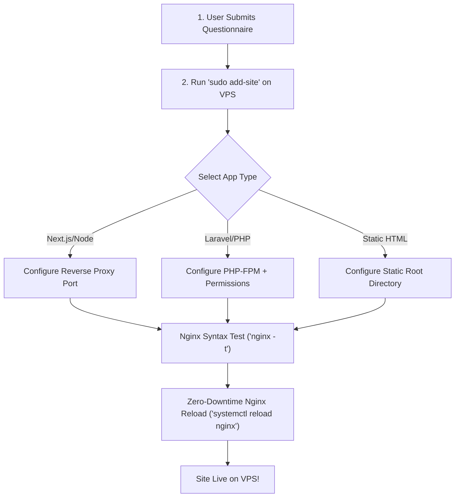

# Automated VPS Domain Hosting & Deployment Plan

This guide outlines an **automated workflow** for hosting and deploying new domains and subdomains on your Nginx VPS (`165.73.244.224`).

---

## 1. Information Collection Checklist (Questionnaire)

Before hosting any new domain or application, collect the following details:

| Question | Options / Example | Description |
| :--- | :--- | :--- |
| **1. Domain Name** | `app.example.com` | Exact domain or subdomain name |
| **2. Application Type** | `Next.js` / `Laravel` / `Static` | Determines Nginx template selection |
| **3. Internal Port or Directory** | Port `3001` or `/var/www/site` | Node.js port or document root path |
| **4. PHP Version** *(if PHP)* | `8.1`, `8.2`, `8.3` | Matches PHP-FPM socket |
| **5. SSL Requirement** | `Yes` (Certbot) / `No` | Free HTTPS certificate setup |
| **6. Database Required** | `PostgreSQL` / `MySQL` / `None` | Database setup needs |

---

## 2. Automated VPS Hosting Script (`add-site.sh`)

You can create an automated Bash script on your VPS (`/usr/local/bin/add-site`) that creates Nginx configs, sets permissions, and reloads Nginx automatically without manual editing.

### Create Script File on VPS:

```bash
sudo nano /usr/local/bin/add-site
sudo chmod +x /usr/local/bin/add-site
```

### Script Content:

```bash
#!/bin/bash
# Automated Nginx Domain Deployment Script
# Usage: sudo add-site

set -e

echo "=========================================="
echo "      VPS Automated Domain Provisioner    "
echo "=========================================="

read -p "Enter Domain Name (e.g. app.mydomain.com): " DOMAIN
read -p "Select App Type [1: Next.js/Node, 2: PHP/Laravel, 3: Static HTML]: " TYPE

if [ "$TYPE" == "1" ]; then
    read -p "Enter Node.js App Port (e.g. 3000): " PORT
    CONFIG="/etc/nginx/sites-available/$DOMAIN.conf"
    
    cat <<EOF | sudo tee $CONFIG > /dev/null
server {
    listen 80;
    server_name $DOMAIN www.$DOMAIN;

    location / {
        proxy_pass http://127.0.0.1:$PORT;
        proxy_http_version 1.1;
        proxy_set_header Upgrade \$http_upgrade;
        proxy_set_header Connection 'upgrade';
        proxy_set_header Host \$host;
        proxy_set_header X-Real-IP \$remote_addr;
        proxy_set_header X-Forwarded-For \$proxy_add_x_forwarded_for;
        proxy_set_header X-Forwarded-Proto \$scheme;
    }
}
EOF

elif [ "$TYPE" == "2" ]; then
    read -p "Enter Full Project Directory (e.g. /home/domain/public_html): " SITE_PATH
    read -p "Enter PHP Version (e.g. 8.1, 8.2, 8.3): " PHP_VER
    CONFIG="/etc/nginx/sites-available/$DOMAIN.conf"
    
    # Ensure permissions
    sudo chown -R www-data:www-data "$SITE_PATH/storage" "$SITE_PATH/bootstrap/cache" 2>/dev/null || true
    sudo chmod -R 775 "$SITE_PATH/storage" "$SITE_PATH/bootstrap/cache" 2>/dev/null || true

    cat <<EOF | sudo tee $CONFIG > /dev/null
server {
    listen 80;
    server_name $DOMAIN www.$DOMAIN;
    root $SITE_PATH/public;
    index index.php index.html;

    charset utf-8;

    location / {
        try_files \$uri \$uri/ /index.php?\$query_string;
    }

    location ~ \.php$ {
        fastcgi_pass unix:/var/run/php/php${PHP_VER}-fpm.sock;
        fastcgi_param SCRIPT_FILENAME \$realpath_root\$fastcgi_script_name;
        include fastcgi_params;
    }

    location ~ /\.(?!well-known).* {
        deny all;
    }
}
EOF

elif [ "$TYPE" == "3" ]; then
    read -p "Enter Static Directory Path (e.g. /var/www/$DOMAIN): " SITE_PATH
    sudo mkdir -p "$SITE_PATH"
    CONFIG="/etc/nginx/sites-available/$DOMAIN.conf"

    cat <<EOF | sudo tee $CONFIG > /dev/null
server {
    listen 80;
    server_name $DOMAIN www.$DOMAIN;
    root $SITE_PATH;
    index index.html;

    location / {
        try_files \$uri \$uri/ /index.html;
    }
}
EOF
fi

# Link and test Nginx
sudo ln -sf "$CONFIG" "/etc/nginx/sites-enabled/"
echo "Testing Nginx configuration..."
sudo nginx -t

echo "Reloading Nginx gracefully..."
sudo systemctl reload nginx

echo "------------------------------------------"
echo " SUCCESS: $DOMAIN has been hosted successfully!"
echo "------------------------------------------"
```

---

## 3. Step-by-Step Deployment Workflow



---

## 4. Automated SSL Setup (Certbot)

To issue free HTTPS certificates automatically for any newly added domain:

```bash
sudo certbot --nginx -d app.mydomain.com -d www.app.mydomain.com --non-interactive --agree-tos -m admin@intelligentdive.com
```
