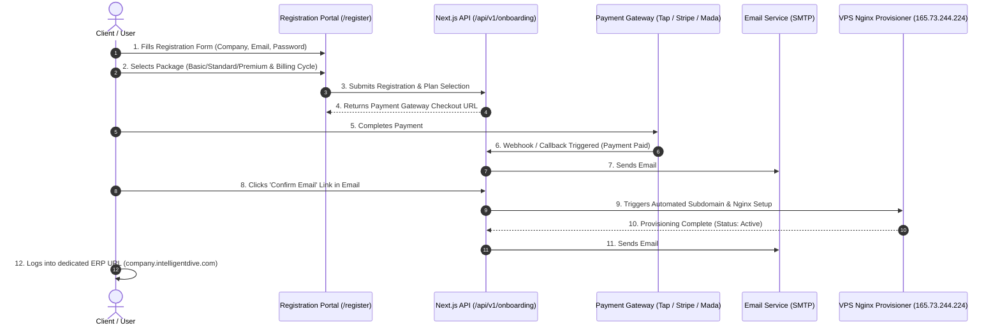

# Automated Client Onboarding & VPS Provisioning Journey

This document defines the complete end-to-end user journey for **Client Registration**, **Package Selection**, **Payment Processing**, **Email Confirmation**, and **Automated VPS Instance Activation**.

---

## 1. End-to-End User Journey Diagram

---

## 2. Information Required at Registration

| Field | Input Type | Description |
| :--- | :--- | :--- |
| **Company Name** | Text | Used for tenant setup and subdomain slug generation |
| **User Email** | Email | Primary admin email for receipts & activation |
| **Password** | Password | Client password for accessing their ERP instance |
| **Package Plan** | Dropdown | `Basic` (SAR 1800/yr), `Standard` (SAR 6000/yr), `Premium` |
| **Billing Cycle** | Radio | `Annual`, `6 Months`, `Monthly` |
| **Subdomain Slug** | Auto-generated | e.g., `company-name.intelligentdive.com` |

---

## 3. Email Templates Workflow

### Email #1: Email Confirmation & Payment Receipt
- **Subject**: `[Action Required] Confirm your email to activate Intelligent ERP`
- **Body Content**:
  - Payment Receipt details (Plan, Amount Paid, Transaction ID).
  - Prominent Button: **[Confirm Email & Activate My Instance]**.
  - Expiry: Link valid for 24 hours.

### Email #2: Welcome Credentials & Dedicated ERP URL
- **Subject**: `🎉 Your Intelligent ERP Instance is Live!`
- **Body Content**:
  - Dedicated Client Portal URL: `https://company-name.intelligentdive.com`
  - Admin Username: `client-email@domain.com`
  - Temporary Password / Direct Access Link
  - Quick Start Guide link

---

## 4. Implementation Steps Roadmap

### Step 1: Database Schema (`onboarding_subscriptions`)
Add table to track registration progress, payment confirmation tokens, email verification tokens, and VPS setup status.

### Step 2: Onboarding API Routes
- `POST /api/v1/onboarding/register`: Initiates registration & returns payment gateway link.
- `POST /api/v1/onboarding/payment-callback`: Handles payment confirmation & sends Email #1.
- `GET /api/v1/onboarding/verify-email`: Validates email token, calls `add-site-cli` on VPS, and sends Email #2.

### Step 3: Registration Portal UI (`/register`)
Multi-step onboarding wizard:
1. **Step 1**: Account Info (Company, Email, Password).
2. **Step 2**: Plan Selection (Basic, Standard, Premium).
3. **Step 3**: Payment Checkout Screen.
4. **Step 4**: "Check Your Email" Confirmation Notice.
