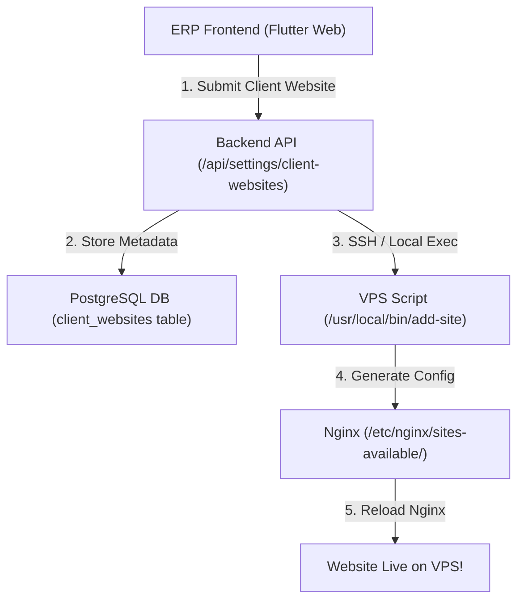

# ERP Implementation Plan: Client Websites Management

This document details the complete step-by-step implementation for adding **General Settings > Client Websites > Manage Websites** to the Intelligent ERP system.

---

## 1. Architecture Overview



---

## 2. Step-by-Step Implementation Roadmap

### Phase 1: Database Schema (`client_websites` Table)

Add the `client_websites` table in Drizzle schema (`backend/src/db/schema.ts`):

```typescript
import { pgTable, uuid, varchar, integer, boolean, timestamp } from "drizzle-orm/pg-core";

export const clientWebsites = pgTable("client_websites", {
  id: uuid("id").primaryKey().defaultRandom(),
  tenantId: uuid("tenant_id").notNull(),
  clientId: uuid("client_id"), // Optional client association
  domainName: varchar("domain_name", { length: 255 }).notNull().unique(),
  appType: varchar("app_type", { length: 50 }).notNull(), // 'nextjs', 'laravel', 'static'
  appPort: integer("app_port"), // e.g. 3001, 3002
  documentRoot: varchar("document_root", { length: 500 }), // e.g. /home/client/public_html
  phpVersion: varchar("php_version", { length: 10 }), // e.g. '8.2'
  status: varchar("status", { length: 20 }).default("pending").notNull(), // 'pending', 'active', 'error'
  sslActive: boolean("ssl_active").default(false).notNull(),
  createdAt: timestamp("created_at").defaultNow().notNull(),
  updatedAt: timestamp("updated_at").defaultNow().notNull(),
});
```

---

### Phase 2: Backend API Route (`backend/src/app/api/settings/client-websites/route.ts`)

Create API endpoints to list, create, and trigger automated VPS provisioning:

```typescript
import { NextResponse } from "next/server";
import { db } from "@/db";
import { clientWebsites } from "@/db/schema";
import { exec } from "child_process";
import { promisify } from "util";

const execAsync = promisify(exec);

// GET: List all client websites
export async function GET() {
  try {
    const websites = await db.select().from(clientWebsites);
    return NextResponse.json({ success: true, data: websites });
  } catch (error: any) {
    return NextResponse.json({ success: false, error: error.message }, { status: 500 });
  }
}

// POST: Add new website & Provision on VPS
export async function POST(req: Request) {
  try {
    const body = await req.json();
    const { domainName, appType, appPort, documentRoot, phpVersion } = body;

    // 1. Save to Database
    const [newSite] = await db.insert(clientWebsites).values({
      tenantId: body.tenantId || "default-tenant",
      domainName,
      appType,
      appPort,
      documentRoot,
      phpVersion,
      status: "pending",
    }).returning();

    // 2. Trigger VPS Auto-Provisioner Script
    let cmd = "";
    if (appType === "nextjs") {
      cmd = `sudo /usr/local/bin/add-site-cli "${domainName}" 1 "${appPort}"`;
    } else if (appType === "laravel") {
      cmd = `sudo /usr/local/bin/add-site-cli "${domainName}" 2 "${documentRoot}" "${phpVersion || '8.1'}"`;
    } else {
      cmd = `sudo /usr/local/bin/add-site-cli "${domainName}" 3 "${documentRoot}"`;
    }

    try {
      await execAsync(cmd);
      // Update status to active
      await db.update(clientWebsites).set({ status: "active" }).where(clientWebsites.id === newSite.id);
      newSite.status = "active";
    } catch (cmdError: any) {
      console.error("VPS Provisioning error:", cmdError);
      await db.update(clientWebsites).set({ status: "error" }).where(clientWebsites.id === newSite.id);
      newSite.status = "error";
    }

    return NextResponse.json({ success: true, data: newSite });
  } catch (error: any) {
    return NextResponse.json({ success: false, error: error.message }, { status: 500 });
  }
}
```

---

### Phase 3: Frontend Menu Navigation & Screen (Flutter ERP)

#### 1. Navigation Menu Entry:
Add under **General Settings**:
- `General Settings` -> `Client Websites` -> `Manage Websites`

#### 2. Flutter Screen Component (`manage_websites_screen.dart`):

```dart
// Location: erp-frontend/lib/screens/settings/manage_websites_screen.dart
import 'package:flutter/material.dart';

class ManageWebsitesScreen extends StatefulWidget {
  const ManageWebsitesScreen({Key? key}) : super(key: key);

  @override
  _ManageWebsitesScreenState createState() => _ManageWebsitesScreenState();
}

class _ManageWebsitesScreenState extends State<ManageWebsitesScreen> {
  List<dynamic> _websites = [];
  bool _isLoading = true;

  @override
  void initState() {
    super.initState();
    _fetchWebsites();
  }

  Future<void> _fetchWebsites() async {
    // API Call to /api/settings/client-websites
    setState(() => _isLoading = false);
  }

  void _showAddWebsiteModal() {
    // Modal dialog to enter Domain, App Type, Port / Directory Path
  }

  @override
  Widget build(BuildContext context) {
    return Scaffold(
      appBar: AppBar(
        title: const Text('Manage Client Websites'),
        actions: [
          ElevatedButton.icon(
            onPressed: _showAddWebsiteModal,
            icon: const Icon(Icons.add),
            label: const Text('Add Website'),
          ),
        ],
      ),
      body: _isLoading
          ? const Center(child: CircularProgressIndicator())
          : DataTable(
              columns: const [
                DataColumn(label: Text('Domain Name')),
                DataColumn(label: Text('Type')),
                DataColumn(label: Text('Port / Path')),
                DataColumn(label: Text('Status')),
                DataColumn(label: Text('Actions')),
              ],
              rows: _websites.map((site) => DataRow(cells: [
                DataCell(Text(site['domainName'])),
                DataCell(Chip(label: Text(site['appType']))),
                DataCell(Text(site['appPort']?.toString() ?? site['documentRoot'] ?? '-')),
                DataCell(Chip(
                  avatar: Icon(site['status'] == 'active' ? Icons.check_circle : Icons.error, color: Colors.white),
                  label: Text(site['status']),
                  backgroundColor: site['status'] == 'active' ? Colors.green : Colors.red,
                )),
                DataCell(IconButton(icon: const Icon(Icons.refresh), onPressed: () {})),
              ])).toList(),
            ),
    );
  }
}
```

---

## 3. Recommended VPS Command Line Tool (`add-site-cli`)

Place this non-interactive CLI runner at `/usr/local/bin/add-site-cli` on your VPS so the ERP API can call it automatically:

```bash
#!/bin/bash
# Non-interactive Nginx Site Provisioner for ERP Integration
# Usage: add-site-cli "domain.com" "1|2|3" "port_or_path" ["php_ver"]

DOMAIN=$1
TYPE=$2
PARAM=$3
PHP_VER=${4:-8.1}

CONFIG="/etc/nginx/sites-available/$DOMAIN.conf"

if [ "$TYPE" == "1" ]; then
    # Node.js / Next.js
    cat <<EOF | sudo tee $CONFIG > /dev/null
server {
    listen 80;
    server_name $DOMAIN www.$DOMAIN;
    location / {
        proxy_pass http://127.0.0.1:$PARAM;
        proxy_http_version 1.1;
        proxy_set_header Host \$host;
        proxy_set_header X-Real-IP \$remote_addr;
        proxy_set_header X-Forwarded-For \$proxy_add_x_forwarded_for;
        proxy_set_header X-Forwarded-Proto \$scheme;
    }
}
EOF

elif [ "$TYPE" == "2" ]; then
    # Laravel / PHP
    sudo chown -R www-data:www-data "$PARAM/storage" "$PARAM/bootstrap/cache" 2>/dev/null || true
    sudo chmod -R 775 "$PARAM/storage" "$PARAM/bootstrap/cache" 2>/dev/null || true

    cat <<EOF | sudo tee $CONFIG > /dev/null
server {
    listen 80;
    server_name $DOMAIN www.$DOMAIN;
    root $PARAM/public;
    index index.php index.html;
    location / {
        try_files \$uri \$uri/ /index.php?\$query_string;
    }
    location ~ \.php$ {
        fastcgi_pass unix:/var/run/php/php${PHP_VER}-fpm.sock;
        fastcgi_param SCRIPT_FILENAME \$realpath_root\$fastcgi_script_name;
        include fastcgi_params;
    }
}
EOF
fi

sudo ln -sf "$CONFIG" "/etc/nginx/sites-enabled/"
sudo nginx -t && sudo systemctl reload nginx
```
