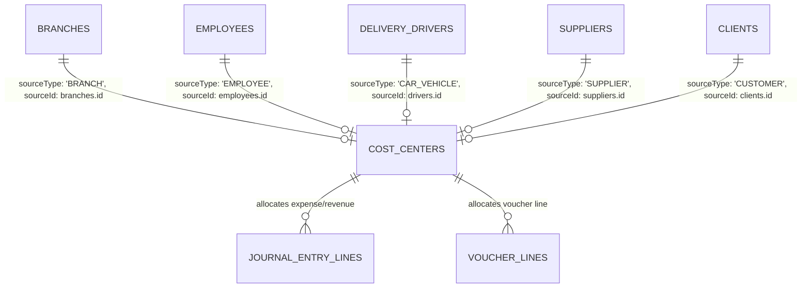

# Cost Center Matching with Source Tables Specification

**Module:** Financial Accounting & General Ledger  
**Component:** Polymorphic Source-Linked Cost Centers & Analytical Dimensions  
**Status:** Implemented  
**Target Stack:** Node.js / Next.js / TypeScript / Drizzle ORM / SQLite  

---

## 1. Overview & Business Definition

In enterprise ERP accounting (SAP CO, Microsoft Dynamics, NetSuite), Cost Centers must not be isolated, static labels. They represent real, operational entities that incur costs or generate revenues across the business:

- **Branches**: Retail stores, regional outlets, central warehouses.
- **Employees**: Staff members, sales representatives, logistics drivers.
- **Suppliers**: Raw material vendors, freight forwarders.
- **Customers**: Key commercial clients, accounts with marketing agreements.
- **Dealers**: Distribution agencies, franchise partners.
- **Cars / Fleet**: Company delivery vans, trucks, passenger vehicles.

By linking Cost Centers directly to their source records:
1. **Zero Redundant Data Entry**: Adding a new vehicle, store, or employee automatically creates or links a Cost Center.
2. **Granular Sub-Ledger Profitability**: Track fuel, maintenance, and insurance per vehicle plate number; track travel expenses and revenue per employee; track store rent and utilities per branch.
3. **Variance to Budget**: Compare actual costs incurred against assigned monthly budgets.

---

## 2. Architecture & Data Model



### Schema Attributes in `cost_centers`

```typescript
export const costCenters = sqliteTable('cost_centers', {
  id: text('id').primaryKey().$defaultFn(() => crypto.randomUUID()),
  tenantId: text('tenant_id').references(() => tenants.id, { onDelete: 'cascade' }).notNull(),
  code: text('code').notNull(), // e.g. CC-BR-001, CC-VEH-004, CC-EMP-012
  name: text('name').notNull(),
  sourceType: text('source_type').default('GENERAL').notNull(), // BRANCH, EMPLOYEE, SUPPLIER, CUSTOMER, DEALER, CAR_VEHICLE, GENERAL
  sourceId: text('source_id'), // UUID of the record in source table
  category: text('category'), // e.g. RETAIL_OUTLET, FLEET_LOGISTICS, STAFF
  monthlyBudget: real('monthly_budget').default(0).notNull(),
  isActive: integer('is_active', { mode: 'boolean' }).default(true).notNull(),
  createdAt: integer('created_at', { mode: 'timestamp' }).defaultNow().notNull(),
  updatedAt: integer('updated_at', { mode: 'timestamp' }).defaultNow().notNull(),
});
```

---

## 3. Systematic Coding Scheme

| Source Entity | Code Prefix | Example Source Entity | Generated Cost Center Code | Cost Center Name | Category Tag |
|---|---|---|---|---|---|
| **Branches** | `CC-BR` | Riyadh Olaya Branch | `CC-BR-001` | `Branch: Riyadh Olaya Branch` | `RETAIL_OUTLET` |
| **Employees** | `CC-EMP` | Ahmed Hassan | `CC-EMP-001` | `Employee: Ahmed Hassan` | `SALES_TEAM` |
| **Cars / Fleet** | `CC-VEH` | Van [ABC-1234] | `CC-VEH-001` | `Vehicle: VAN (Driver Ali) [ABC-1234]` | `FLEET_LOGISTICS` |
| **Suppliers** | `CC-SUP` | Fresh Foods Ltd | `CC-SUP-001` | `Supplier: Fresh Foods Ltd` | `PROCUREMENT` |
| **Customers** | `CC-CUST` | Al-Madina Hyper | `CC-CUST-001` | `Customer: Al-Madina Hypermarket` | `SALES_CLIENT` |
| **Dealers** | `CC-DLR` | Gulf Distribution | `CC-DLR-001` | `Dealer: Gulf Distribution Partner` | `DISTRIBUTION` |

---

## 4. Implemented Services & Endpoints

### 4.1 Sync Engine
- **Service:** `syncAllSourceEntitiesToCostCenters(tenantId)` in [backend/src/lib/accounting/cost_center_source_service.ts](file:///e:/aiprojects/Zatca_website/backend/src/lib/accounting/cost_center_source_service.ts)
- **Endpoint:** `POST /api/v1/accounting/cost-centers/sync`
- Auto-provisions and links missing Cost Centers from all operational tables in one pass.

### 4.2 Query & Analytical Performance Reporting
- **Endpoint:** `GET /api/v1/accounting/cost-centers?sourceType=CAR_VEHICLE`
  - Lists Cost Centers filtered by entity type.
- **Endpoint:** `GET /api/v1/accounting/reports/cost-centers?sourceType=CAR_VEHICLE&startDate=...&endDate=...`
  - Generates turnover, expense vs. revenue, and budget variance per Cost Center.
