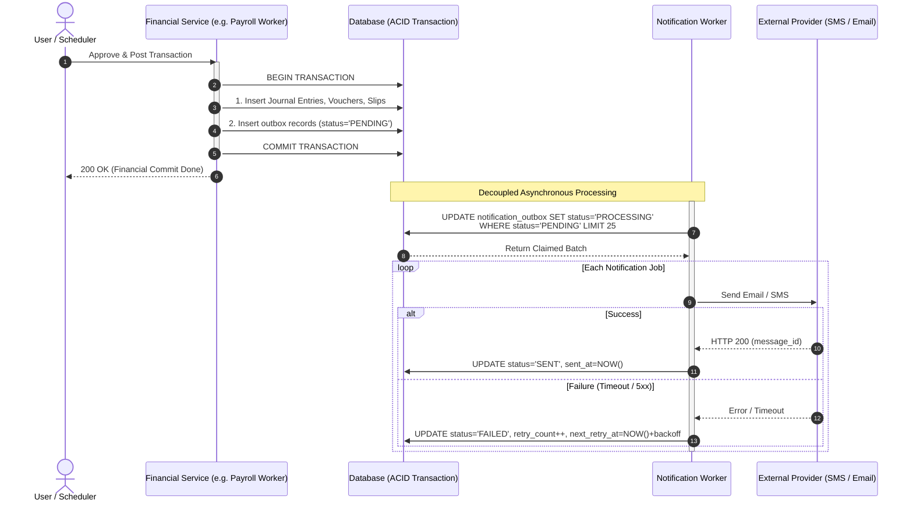

# Financial Transaction Notification Worker Specification

**Module:** Core Notification Engine & Transactional Outbox  
**Component:** Post-Commit Financial Notification Worker (Email, SMS, WhatsApp)  
**Status:** Approved Architecture  
**Target Stack:** Node.js / Next.js / TypeScript / Drizzle ORM / SQLite  

---

## 1. Overview & Problem Statement

In financial ERP applications (e.g. Payroll Runs, Payment Vouchers, POS Invoices, Receipt Vouchers), notifying stakeholders via Email or SMS must adhere to strict consistency rules:
- **No Ghost Notifications**: A notification must never be sent if the underlying financial database transaction is rolled back or fails to commit.
- **No Lost Notifications**: If an external messaging provider (SMTP, Twilio, Taqnyat) is slow or unreachable, or if the server crashes right after the database commit, messages must not be dropped.
- **Non-Blocking Financial Writes**: Third-party messaging API latencies (2–5 seconds) must never block database transactions or hold row locks.

### The Solution: Transactional Outbox Pattern
1. Financial entries and notification event records are written into the database **inside the same atomic database transaction**.
2. An asynchronous **Notification Worker** pulls pending events from `notification_outbox`, dispatches messages with exponential backoff retries, and tracks delivery status.

---

## 2. Architecture & Execution Flow



---

## 3. Database Schema

### Table: `notification_outbox`

```typescript
// backend/src/lib/db/notification_schema.ts
import { sqliteTable, text, integer, check } from 'drizzle-orm/sqlite-core';
import { sql } from 'drizzle-orm';
import { tenants } from './schema';

export const notificationOutbox = sqliteTable('notification_outbox', {
  id: text('id').primaryKey().$defaultFn(() => crypto.randomUUID()),
  tenantId: text('tenant_id').references(() => tenants.id, { onDelete: 'cascade' }).notNull(),
  
  // Channels: EMAIL, SMS, WHATSAPP
  channel: text('channel').notNull(),
  
  // Recipient info
  recipient: text('recipient').notNull(),         // Email or E.164 phone (+966...)
  recipientName: text('recipient_name'),
  
  // Payload & Template
  templateKey: text('template_key').notNull(),   // e.g. 'PAYROLL_SLIP_ISSUED', 'PAYMENT_RECEIVED'
  payload: text('payload').notNull(),            // JSON string with dynamic parameters
  
  // Business Context Linkage
  referenceType: text('reference_type').notNull(), // 'PAYROLL', 'VOUCHER', 'INVOICE'
  referenceId: text('reference_id').notNull(),     // Primary key of source document
  idempotencyKey: text('idempotency_key').unique(), // Prevents duplicate outbox entries
  
  // Worker State: PENDING, PROCESSING, SENT, FAILED, DEAD_LETTER
  status: text('status').default('PENDING').notNull(),
  retryCount: integer('retry_count').default(0).notNull(),
  maxRetries: integer('max_retries').default(3).notNull(),
  nextRetryAt: integer('next_retry_at', { mode: 'timestamp' }),
  
  // Delivery Metadata
  providerMessageId: text('provider_message_id'),
  errorReason: text('error_reason'),
  sentAt: integer('sent_at', { mode: 'timestamp' }),
  createdAt: integer('created_at', { mode: 'timestamp' }).defaultNow().notNull(),
  updatedAt: integer('updated_at', { mode: 'timestamp' }).defaultNow().notNull(),
}, (t) => [
  check('channel_check', sql`${t.channel} IN ('EMAIL','SMS','WHATSAPP')`),
  check('outbox_status_check', sql`${t.status} IN ('PENDING','PROCESSING','SENT','FAILED','DEAD_LETTER')`),
]);
```

---

## 4. In-Transaction Enqueue Helper

### File: `backend/src/lib/services/notification_outbox.ts`

```typescript
import { notificationOutbox } from '@/lib/db/notification_schema';

export interface EnqueueNotificationParams {
  tenantId: string;
  channel: 'EMAIL' | 'SMS' | 'WHATSAPP';
  recipient: string;
  recipientName?: string;
  templateKey: string;
  payload: Record<string, any>;
  referenceType: string;
  referenceId: string;
  idempotencyKey?: string;
}

/**
 * Inserts outbox entries inside an active database transaction.
 * If the outer transaction rolls back, all outbox entries roll back too.
 */
export async function enqueueNotification(
  tx: any,
  params: EnqueueNotificationParams
) {
  const idempotencyKey =
    params.idempotencyKey ||
    `${params.referenceType}_${params.referenceId}_${params.channel}_${params.recipient}`;

  await tx
    .insert(notificationOutbox)
    .values({
      tenantId: params.tenantId,
      channel: params.channel,
      recipient: params.recipient,
      recipientName: params.recipientName,
      templateKey: params.templateKey,
      payload: JSON.stringify(params.payload),
      referenceType: params.referenceType,
      referenceId: params.referenceId,
      idempotencyKey,
      status: 'PENDING',
    })
    .onConflictDoNothing(); // Guarantees zero duplicate queue entries
}
```

---

## 5. Notification Worker Service

### File: `backend/src/lib/services/notification_worker.ts`

```typescript
import { db } from "@/lib/db";
import { notificationOutbox } from "@/lib/db/notification_schema";
import { eq, and, sql, lte, or } from "drizzle-orm";
import nodemailer from "nodemailer";

// --- Gateway Integrations ---

async function sendSmsGateway(phone: string, text: string) {
  // Saudi/UAE SMS Provider (e.g. Taqnyat, Unifonic, or Twilio)
  // Example provider call:
  // const res = await fetch('https://api.taqnyat.sa/v1/messages', { ... });
  console.log(`[SMS Gateway] Sent to ${phone}: ${text}`);
  return { messageId: `sms_${Date.now()}` };
}

async function sendEmailGateway(to: string, subject: string, html: string) {
  const transporter = nodemailer.createTransport({
    host: process.env.SMTP_HOST || "smtp.gmail.com",
    port: parseInt(process.env.SMTP_PORT || "587", 10),
    auth: {
      user: process.env.SMTP_USER,
      pass: process.env.SMTP_PASS,
    },
  });

  const info = await transporter.sendMail({
    from: process.env.SMTP_FROM || '"Intelligent ERP" <noreply@erp.com>',
    to,
    subject,
    html,
  });

  return { messageId: info.messageId };
}

// --- Worker Batch Processor ---

export async function processNotificationOutboxBatch(batchSize = 25) {
  const now = new Date();

  // 1. Concurrency Claim: Atomically transition up to `batchSize` jobs to 'PROCESSING'
  const jobsToProcess = await db
    .update(notificationOutbox)
    .set({
      status: 'PROCESSING',
      updatedAt: now,
    })
    .where(
      and(
        or(
          eq(notificationOutbox.status, 'PENDING'),
          and(
            eq(notificationOutbox.status, 'FAILED'),
            lte(notificationOutbox.nextRetryAt, now)
          )
        ),
        sql`id IN (
          SELECT id FROM notification_outbox 
          WHERE status = 'PENDING' OR (status = 'FAILED' AND next_retry_at <= ${now.getTime()})
          LIMIT ${batchSize}
        )`
      )
    )
    .returning();

  if (jobsToProcess.length === 0) return { processed: 0 };

  for (const job of jobsToProcess) {
    try {
      const payload = JSON.parse(job.payload);
      let providerMessageId = '';

      // 2. Channel Dispatcher & Template Renderer
      if (job.channel === 'EMAIL') {
        const subject = `Your Salary Slip for ${payload.month}/${payload.year} is Ready`;
        const html = `
          <div style="font-family: Arial, sans-serif; padding: 24px; color: #1e293b;">
            <h2 style="color: #0f172a;">Dear ${payload.employeeName},</h2>
            <p>Your monthly salary for <strong>${payload.month}/${payload.year}</strong> has been processed.</p>
            <p><strong>Net Amount:</strong> SAR ${Number(payload.netSalary).toLocaleString()}</p>
            <div style="margin: 24px 0;">
              <a href="${process.env.NEXT_PUBLIC_APP_URL}/hr/slips/${payload.slipId}" 
                 style="background: #2563eb; color: #ffffff; padding: 12px 24px; text-decoration: none; border-radius: 6px; font-weight: bold;">
                View Official Payslip
              </a>
            </div>
            <p style="font-size: 12px; color: #64748b;">This is an automated system notification.</p>
          </div>
        `;
        const res = await sendEmailGateway(job.recipient, subject, html);
        providerMessageId = res.messageId;
      } else if (job.channel === 'SMS') {
        const messageText = `Dear Employee, your salary for ${payload.period} (SAR ${payload.amount}) has been credited. Check your portal for the full payslip.`;
        const res = await sendSmsGateway(job.recipient, messageText);
        providerMessageId = res.messageId;
      }

      // 3. Mark SENT
      await db
        .update(notificationOutbox)
        .set({
          status: 'SENT',
          providerMessageId,
          sentAt: new Date(),
          errorReason: null,
          updatedAt: new Date(),
        })
        .where(eq(notificationOutbox.id, job.id));

    } catch (err: any) {
      console.error(`[NotificationWorker] Job ${job.id} failed:`, err);
      const nextRetryCount = job.retryCount + 1;

      if (nextRetryCount >= job.maxRetries) {
        // Exceeded retries -> Move to Dead Letter Queue (DLQ)
        await db
          .update(notificationOutbox)
          .set({
            status: 'DEAD_LETTER',
            errorReason: err.message,
            retryCount: nextRetryCount,
            updatedAt: new Date(),
          })
          .where(eq(notificationOutbox.id, job.id));
      } else {
        // Exponential backoff retry: 1 min (1st), 4 mins (2nd), 9 mins (3rd)
        const backoffMinutes = Math.pow(nextRetryCount, 2);
        const nextRetryDate = new Date(Date.now() + backoffMinutes * 60 * 1000);

        await db
          .update(notificationOutbox)
          .set({
            status: 'FAILED',
            errorReason: err.message,
            retryCount: nextRetryCount,
            nextRetryAt: nextRetryDate,
            updatedAt: new Date(),
          })
          .where(eq(notificationOutbox.id, job.id));
      }
    }
  }

  return { processed: jobsToProcess.length };
}
```

---

## 6. Trigger Mechanisms

To combine immediate responsiveness with failure resilience, use a **Dual-Trigger Pattern**:

### 6.1 Immediate Fire-and-Forget (Post-Commit Trigger)
In the financial API route, immediately following transaction commit:

```typescript
// Inside API route (e.g. Payroll Process Route)
await processApprovedPayrollRun({ runId, tenantId, processedByUserId });

// Trigger worker asynchronously without blocking HTTP response
setImmediate(() => {
  processNotificationOutboxBatch().catch((err) =>
    console.error("Outbox immediate tick error:", err)
  );
});

return NextResponse.json({ success: true });
```

### 6.2 Scheduled Cron / Heartbeat (Resilience Guard)
A periodic background cron (every 1 to 2 minutes) executes:
```typescript
await processNotificationOutboxBatch(50);
```
This guarantees:
1. Retries are picked up as their `nextRetryAt` window opens.
2. Messages queued during system restarts or crashes are never stranded.

---

## 7. Production Guardrails & Compliance

1. **Information Security in SMS**:
   - Never send sensitive bank account details (IBAN) or full deduction breakdowns over plain SMS.
   - Send only high-level alerts with a tokenized, authenticated link to the employee portal.
2. **Carrier Quiet Hours (KSA & UAE)**:
   - For non-emergency notifications, configure scheduling to deliver promotional/informational SMS only between 09:00 and 21:00 local time.
3. **Dead-Letter Auditing (DLQ)**:
   - Records marked `DEAD_LETTER` surface on the HR/Accounting administrative dashboard, enabling staff to correct invalid phone numbers or email addresses without system crashes.
