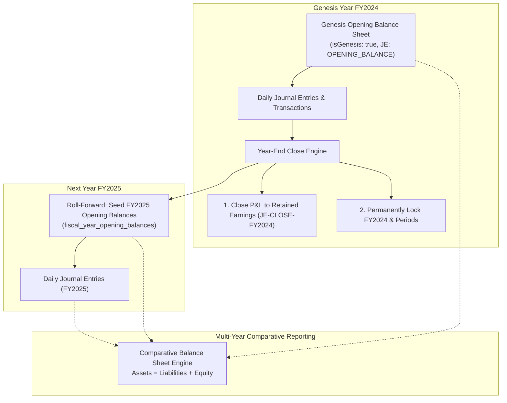

# Multi-Year Balance Sheet & Opening Balance Preservation Specification

**Module:** Financial Accounting (General Ledger)  
**Component:** Multi-Year Balance Sheet Maintenance & Annual Roll-Forward Engine  
**Status:** Implemented  
**Target Stack:** Node.js / Next.js / TypeScript / Drizzle ORM / SQLite  

---

## 1. Overview & Business Requirements

In modern enterprise ERP accounting:
1. **Preservation of the Genesis Opening Year**: The inaugural Day-1 opening balance sheet must be immutably preserved and tagged (`isGenesis: true`, `referenceType: 'OPENING_BALANCE'`).
2. **Permanent vs. Temporary Account Separation**:
   - **Temporary Accounts (Revenue & Expense)**: Closed at fiscal year-end into **Retained Earnings** (Equity) via a Year-End Closing Journal Entry (`referenceType: 'YEAR_END_CLOSE'`).
   - **Permanent Accounts (Assets, Liabilities & Equity)**: Never zeroed out. Cumulative closing balances are rolled forward into the **Opening Balance of the next fiscal year**.
3. **High-Performance Multi-Year Comparative Reporting**:
   - Instead of scanning millions of ledger transactions across 10+ years, the system maintains annual frozen snapshots in `fiscal_year_opening_balances`.
   - Comparative multi-year balance sheets (e.g., FY2024 vs. FY2025 vs. FY2026 side-by-side) are generated in milliseconds.
4. **Period Lock & Immutability**:
   - When a fiscal year is closed, `financialYears.isClosed = true` and all associated `financialPeriods.isLocked = true` are locked, preventing retroactive mutations.

---

## 2. Architecture & Data Flow



---

## 3. Database Schema

### 3.1 `fiscal_year_opening_balances`
Preserves the frozen opening position for every permanent account for each fiscal year.

```typescript
export const fiscalYearOpeningBalances = sqliteTable('fiscal_year_opening_balances', {
  id: text('id').primaryKey().$defaultFn(() => crypto.randomUUID()),
  tenantId: text('tenant_id').references(() => tenants.id, { onDelete: 'cascade' }).notNull(),
  financialYearId: text('financial_year_id').references(() => financialYears.id, { onDelete: 'cascade' }).notNull(),
  accountId: text('account_id').references(() => accounts.id, { onDelete: 'cascade' }).notNull(),
  openingDebit: real('opening_debit').default(0).notNull(),
  openingCredit: real('opening_credit').default(0).notNull(),
  openingNet: real('opening_net').default(0).notNull(),
  isGenesis: integer('is_genesis', { mode: 'boolean' }).default(false).notNull(),
  createdAt: integer('created_at', { mode: 'timestamp' }).defaultNow().notNull(),
  updatedAt: integer('updated_at', { mode: 'timestamp' }).defaultNow().notNull(),
}, (t) => [
  unique('uq_tenant_fy_account_ob').on(t.tenantId, t.financialYearId, t.accountId)
]);
```

### 3.2 `year_end_closing_audit`
Maintains an immutable record of each closing execution.

```typescript
export const yearEndClosingAudit = sqliteTable('year_end_closing_audit', {
  id: text('id').primaryKey().$defaultFn(() => crypto.randomUUID()),
  tenantId: text('tenant_id').references(() => tenants.id, { onDelete: 'cascade' }).notNull(),
  financialYearId: text('financial_year_id').references(() => financialYears.id).notNull(),
  closingJournalEntryId: text('closing_journal_entry_id').notNull(),
  netIncomeAmount: real('net_income_amount').notNull(),
  closedByUserId: text('closed_by_user_id').notNull(),
  closedAt: integer('closed_at', { mode: 'timestamp' }).defaultNow().notNull(),
});
```

---

## 4. Implemented Services

| Service | File Path | Responsibilities |
|---|---|---|
| **Opening Balance Service** | `backend/src/lib/accounting/opening_balance_service.ts` | Sets/preserves opening balances, ensures double-entry invariant ($\sum \text{Dr} = \sum \text{Cr}$), flags genesis status, and posts `OPENING_BALANCE` journal entries. |
| **Year-End Close Service** | `backend/src/lib/accounting/year_end_close_service.ts` | Calculates Net Income, zeroes P&L accounts to Retained Earnings, seeds next year's opening balances, and locks closed periods. |
| **Balance Sheet Service** | `backend/src/lib/accounting/balance_sheet_service.ts` | Generates comparative multi-year balance sheets side-by-side with automatic $\text{Assets} = \text{Liabilities} + \text{Equity}$ equation validation. |

---

## 5. REST API Endpoints

### 5.1 Opening Balances Management
- **`GET /api/v1/accounting/opening-balances?financialYearId={id}`**
  - Returns accounts with their stored opening debit, credit, net balance, and balance equation status.
- **`POST /api/v1/accounting/opening-balances`**
  - Payload: `{ financialYearId, lines: [{ accountId, debit, credit }], isGenesis }`
  - Validates double-entry balance and saves opening balances.

### 5.2 Year-End Close & Roll-Forward
- **`POST /api/v1/accounting/financial-years/:id/close`**
  - Payload: `{ nextYearId, retainedEarningsAccountId }`
  - Closes the year, zeroes revenue/expenses, rolls forward permanent balances to `nextYearId`, and locks periods.

### 5.3 Multi-Year Comparative Balance Sheet
- **`GET /api/v1/accounting/reports/balance-sheet?yearIds={id1,id2,id3}&asOfDate={ISO}`**
  - Returns side-by-side comparative balance sheets across the requested financial years.
