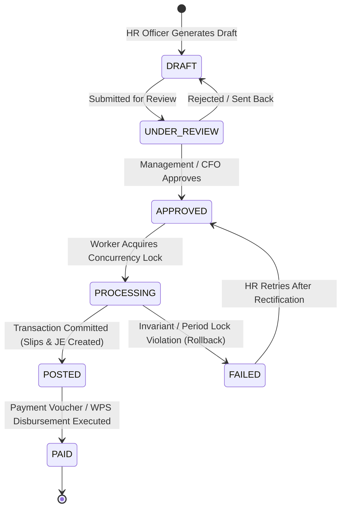

# Payroll Worker Implementation Specification

**Module:** HRM & Accounting Core Integration  
**Component:** Approved Payroll Run Worker & General Ledger Auto-Poster  
**Status:** Approved Architecture  
**Target Stack:** Node.js / Next.js / TypeScript / Drizzle ORM / SQLite  

---

## 1. Overview & Core Objectives

The **Payroll Worker** executes the transition of a payroll cycle from **APPROVED** to **POSTED/COMPLETED**. It guarantees:
1. **Strict Idempotency & Exactly-Once Semantics**: Zero duplicate payslips, zero duplicate general ledger entries, and zero duplicate deductions against employee staff loans.
2. **ACID Transaction Boundary**: All operations (status updates, immutable slip generation, loan installment clearing, balanced journal entry posting) succeed or fail as a single atomic unit.
3. **Double-Entry Invariant Compliance**: Debit totals (gross salary expenses, allowances, employer social contributions) must exactly match credit totals (accrued salaries payable, social insurance payable, loan receivable reductions).
4. **Auditability & Traceability**: Comprehensive recording of macro batch totals, employee counts, payment method breakdowns, and general ledger journal links.

---

## 2. Payroll Run State Machine



### State Definitions
- **`DRAFT`**: Calculations based on attendance, overtime, salary scale, and loan schedules. Editable.
- **`APPROVED`**: Locked against manual editing; awaiting worker execution.
- **`PROCESSING`**: Locked by worker thread; prevents duplicate concurrent processing.
- **`POSTED`**: Immutable payslips stamped, GL journal entry posted, loan balances decremented.
- **`FAILED`**: Execution failed due to locked accounting period, unbalanced lines, or unmapped accounts.
- **`PAID`**: Bank disbursement / WPS file generated or cash settlement confirmed.

---

## 3. Database Schema

### 3.1 Payroll Run Header (`payroll_runs`)
Tracks the macro batch properties, totals, and links to the accounting general ledger.

```typescript
// backend/src/lib/db/hr_schema.ts
import { sqliteTable, text, integer, real } from 'drizzle-orm/sqlite-core';
import { tenants } from './schema';
import { journalEntries, vouchers } from './accounting_schema';

export const payrollRuns = sqliteTable('payroll_runs', {
  id: text('id').primaryKey().$defaultFn(() => crypto.randomUUID()),
  tenantId: text('tenant_id').references(() => tenants.id, { onDelete: 'cascade' }).notNull(),
  runNumber: text('run_number').notNull(), // e.g. PR-2026-10
  month: integer('month').notNull(),       // 1 - 12
  year: integer('year').notNull(),
  departmentName: text('department_name'), // null for all departments
  paymentMethod: text('payment_method').default('ALL').notNull(), // 'BANK', 'CASH', 'ALL'
  
  // Status: DRAFT, APPROVED, PROCESSING, POSTED, FAILED, PAID
  status: text('status').default('DRAFT').notNull(),
  
  // Aggregated Totals
  employeeCount: integer('employee_count').default(0).notNull(),
  totalBasicSalary: real('total_basic_salary').default(0).notNull(),
  totalAllowances: real('total_allowances').default(0).notNull(),
  totalOvertimePay: real('total_overtime_pay').default(0).notNull(),
  totalGosiEmployee: real('total_gosi_employee').default(0).notNull(),
  totalGosiEmployer: real('total_gosi_employer').default(0).notNull(),
  totalLoanDeductions: real('total_loan_deductions').default(0).notNull(),
  totalOtherDeductions: real('total_other_deductions').default(0).notNull(),
  totalNetSalary: real('total_net_salary').default(0).notNull(),

  // Accounting Linkage
  journalEntryId: text('journal_entry_id').references(() => journalEntries.id),
  voucherId: text('voucher_id').references(() => vouchers.id),
  
  // Audit Trail
  approvedBy: text('approved_by'),
  approvedAt: integer('approved_at', { mode: 'timestamp' }),
  processedAt: integer('processed_at', { mode: 'timestamp' }),
  errorReason: text('error_reason'),
  createdAt: integer('created_at', { mode: 'timestamp' }).defaultNow().notNull(),
  updatedAt: integer('updated_at', { mode: 'timestamp' }).defaultNow().notNull(),
});
```

---

## 4. Accounting Entry Pattern (Double-Entry Invariant)

When the worker finishes processing an approved payroll run, it automatically posts an accrual Journal Entry (`referenceType: 'PAYROLL'`) to the general ledger:

| Type | Account Name | Standard Code | Account Classification | Description |
|---|---|---|---|---|
| **Debit (Dr)** | Basic Salaries Expense | `5.20.02.001.001` | Expense | Total basic pay accrued for the period |
| **Debit (Dr)** | Staff Allowances & OT Expense | `5.20.02.001.002` | Expense | Housing, transport, mobile, and overtime pay |
| **Debit (Dr)** | Employer Social Security (GOSI) | `5.20.02.001.003` | Expense | 11.75% employer contribution for eligible nationals |
| **Credit (Cr)** | Net Salaries Accrued Payable | `2.10.04.001.001` | Current Liability | Net cash/bank liability payable to workforce |
| **Credit (Cr)** | Social Security (GOSI) Payable | `2.10.04.001.002` | Current Liability | Combined employee (9.75%) + employer (11.75%) share |
| **Credit (Cr)** | Staff Loans & Advances Receivable | `1.20.03.001.001` | Current Asset | Deduction reduces outstanding staff loan balance |
| **Credit (Cr)** | Disciplinary Fines & Penalties | `4.30.01.001.001` | Other Income | Deductions retained by company (if applicable) |

$$\sum \text{Debits} = \sum \text{Credits}$$

---

## 5. End-to-End Worker Implementation

### File: `backend/src/lib/services/payroll_worker.ts`

```typescript
import { db } from "@/lib/db";
import { payrollRuns, payroll, loans } from "@/lib/db/hr_schema";
import { journalEntries, journalEntryLines } from "@/lib/db/accounting_schema";
import { resolveMappedAccountId } from "@/lib/accounting/account_resolver";
import { enforcePeriodLock } from "@/lib/accounting/period_lock";
import { eq, and } from "drizzle-orm";

export interface ProcessPayrollRunOptions {
  runId: string;
  tenantId: string;
  processedByUserId: string;
}

export async function processApprovedPayrollRun({
  runId,
  tenantId,
  processedByUserId,
}: ProcessPayrollRunOptions) {
  // =========================================================================
  // STEP 1: Concurrency Lock & Idempotency Guard (Zero Duplicate Executions)
  // =========================================================================
  const [lockedRun] = await db
    .update(payrollRuns)
    .set({
      status: 'PROCESSING',
      updatedAt: new Date(),
    })
    .where(
      and(
        eq(payrollRuns.id, runId),
        eq(payrollRuns.tenantId, tenantId),
        eq(payrollRuns.status, 'APPROVED') // Guaranteed atomic lock
      )
    )
    .returning();

  if (!lockedRun) {
    throw new Error(
      `Payroll Run ${runId} cannot be processed. It is either already processed, currently processing, or not yet approved.`
    );
  }

  try {
    const postingDate = new Date();

    // =========================================================================
    // STEP 2: Accounting Pre-Flight Validation
    // =========================================================================
    await enforcePeriodLock(tenantId, postingDate);

    const [
      salaryExpenseAccountId,
      allowanceExpenseAccountId,
      gosiExpenseAccountId,
      payrollPayableAccountId,
      gosiPayableAccountId,
      loansReceivableAccountId,
    ] = await Promise.all([
      resolveMappedAccountId(db, tenantId, 'PAYROLL', 'SALARY_EXPENSE', '5.20.02.001.001'),
      resolveMappedAccountId(db, tenantId, 'PAYROLL', 'ALLOWANCES_EXPENSE', '5.20.02.001.002'),
      resolveMappedAccountId(db, tenantId, 'PAYROLL', 'GOSI_EMPLOYER_EXPENSE', '5.20.02.001.003'),
      resolveMappedAccountId(db, tenantId, 'PAYROLL', 'SALARIES_PAYABLE', '2.10.04.001.001'),
      resolveMappedAccountId(db, tenantId, 'PAYROLL', 'GOSI_PAYABLE', '2.10.04.001.002'),
      resolveMappedAccountId(db, tenantId, 'PAYROLL', 'STAFF_LOANS_RECEIVABLE', '1.20.03.001.001'),
    ]);

    if (!salaryExpenseAccountId || !payrollPayableAccountId) {
      throw new Error(
        "Essential Chart of Accounts mappings for payroll are missing (Salary Expense or Salaries Payable)."
      );
    }

    // =========================================================================
    // STEP 3: Atomic Database Execution
    // =========================================================================
    const result = await db.transaction(async (tx) => {
      // 3.1 Fetch individual employee payroll records
      const employeeRecords = await tx
        .select()
        .from(payroll)
        .where(
          and(
            eq(payroll.tenantId, tenantId),
            eq(payroll.month, lockedRun.month),
            eq(payroll.year, lockedRun.year)
          )
        );

      if (employeeRecords.length === 0) {
        throw new Error("No payroll line items found for this payroll period.");
      }

      let totalBasic = 0;
      let totalAllowances = 0;
      let totalOvertime = 0;
      let totalGosiEmployee = 0;
      let totalGosiEmployer = 0;
      let totalLoanDeductions = 0;
      let totalOtherDeductions = 0;
      let totalNet = 0;

      // 3.2 Process Each Employee Slip & Update Active Loans
      for (const rec of employeeRecords) {
        totalBasic += rec.basicSalary || 0;
        totalAllowances += (rec.housingAllowance || 0) + (rec.transportAllowance || 0) + (rec.otherAllowance || 0);
        totalOvertime += rec.overtimePay || 0;
        totalGosiEmployee += rec.gosiDeduction || 0;

        // Employer GOSI: 11.75% based on Basic + Housing for eligible employees
        const gosiBase = (rec.basicSalary || 0) + (rec.housingAllowance || 0);
        const empGosiEmployer = rec.gosiDeduction > 0 ? Math.round(gosiBase * 0.1175 * 100) / 100 : 0;
        totalGosiEmployer += empGosiEmployer;

        totalLoanDeductions += rec.loanDeduction || 0;
        totalOtherDeductions += rec.finesPenalties || 0;
        totalNet += rec.netSalary;

        // Apply loan installment deductions to active loans
        if (rec.loanDeduction && rec.loanDeduction > 0) {
          const activeLoans = await tx
            .select()
            .from(loans)
            .where(
              and(
                eq(loans.tenantId, tenantId),
                eq(loans.employeeId, rec.employeeId),
                eq(loans.status, 'APPROVED')
              )
            );

          let deductionToDistribute = rec.loanDeduction;
          for (const loan of activeLoans) {
            if (deductionToDistribute <= 0) break;
            const deductionAmount = Math.min(deductionToDistribute, loan.remainingAmount);
            const newRemaining = Math.max(0, loan.remainingAmount - deductionAmount);
            const newStatus = newRemaining === 0 ? 'COMPLETED' : 'APPROVED';

            await tx
              .update(loans)
              .set({
                remainingAmount: newRemaining,
                status: newStatus,
                updatedAt: new Date(),
              })
              .where(eq(loans.id, loan.id));

            deductionToDistribute -= deductionAmount;
          }
        }

        // Finalize individual slip status
        await tx
          .update(payroll)
          .set({
            status: 'APPROVED',
            updatedAt: new Date(),
          })
          .where(eq(payroll.id, rec.id));
      }

      // Round calculations
      const round = (num: number) => Math.round(num * 100) / 100;
      totalBasic = round(totalBasic);
      totalAllowances = round(totalAllowances + totalOvertime);
      totalGosiEmployee = round(totalGosiEmployee);
      totalGosiEmployer = round(totalGosiEmployer);
      totalLoanDeductions = round(totalLoanDeductions);
      totalOtherDeductions = round(totalOtherDeductions);
      totalNet = round(totalNet);

      // =========================================================================
      // 3.3 Post Double-Entry Journal Entry
      // =========================================================================
      const entryNumber = `JE-PR-${lockedRun.year}-${String(lockedRun.month).padStart(2, '0')}`;

      const [je] = await tx
        .insert(journalEntries)
        .values({
          tenantId,
          entryNumber,
          referenceType: 'PAYROLL',
          referenceId: lockedRun.id,
          entryDate: postingDate,
          description: `Accrued Payroll for Period ${lockedRun.month}/${lockedRun.year} (${employeeRecords.length} employees)`,
          status: 'POSTED',
        })
        .returning();

      const jeLines: Array<{
        journalEntryId: string;
        accountId: string;
        debit: number;
        credit: number;
        description: string;
      }> = [];

      // Debits
      if (totalBasic > 0) {
        jeLines.push({
          journalEntryId: je.id,
          accountId: salaryExpenseAccountId,
          debit: totalBasic,
          credit: 0,
          description: `Gross Basic Salaries for ${lockedRun.month}/${lockedRun.year}`,
        });
      }

      if (totalAllowances > 0 && allowanceExpenseAccountId) {
        jeLines.push({
          journalEntryId: je.id,
          accountId: allowanceExpenseAccountId,
          debit: totalAllowances,
          credit: 0,
          description: `Allowances & Overtime for ${lockedRun.month}/${lockedRun.year}`,
        });
      }

      if (totalGosiEmployer > 0 && gosiExpenseAccountId) {
        jeLines.push({
          journalEntryId: je.id,
          accountId: gosiExpenseAccountId,
          debit: totalGosiEmployer,
          credit: 0,
          description: `Employer GOSI Contribution for ${lockedRun.month}/${lockedRun.year}`,
        });
      }

      // Credits
      jeLines.push({
        journalEntryId: je.id,
        accountId: payrollPayableAccountId,
        debit: 0,
        credit: totalNet,
        description: `Net Salaries Payable to Staff for ${lockedRun.month}/${lockedRun.year}`,
      });

      const totalGosiPayable = round(totalGosiEmployee + totalGosiEmployer);
      if (totalGosiPayable > 0 && gosiPayableAccountId) {
        jeLines.push({
          journalEntryId: je.id,
          accountId: gosiPayableAccountId,
          debit: 0,
          credit: totalGosiPayable,
          description: `Total GOSI Payable (Employee + Organization Contribution)`,
        });
      }

      if (totalLoanDeductions > 0 && loansReceivableAccountId) {
        jeLines.push({
          journalEntryId: je.id,
          accountId: loansReceivableAccountId,
          debit: 0,
          credit: totalLoanDeductions,
          description: `Staff Loan Deductions Cleared via Payroll`,
        });
      }

      // Assert Double-Entry Invariant
      const totalDebits = round(jeLines.reduce((acc, line) => acc + line.debit, 0));
      const totalCredits = round(jeLines.reduce((acc, line) => acc + line.credit, 0));

      if (Math.abs(totalDebits - totalCredits) > 0.05) {
        throw new Error(
          `Payroll Journal Entry unbalanced! Debits: ${totalDebits}, Credits: ${totalCredits}. Difference: ${round(totalDebits - totalCredits)}`
        );
      }

      await tx.insert(journalEntryLines).values(jeLines);

      // =========================================================================
      // 3.4 Record Totals & Finalize Run Status
      // =========================================================================
      const [finalRun] = await tx
        .update(payrollRuns)
        .set({
          status: 'POSTED',
          employeeCount: employeeRecords.length,
          totalBasicSalary: totalBasic,
          totalAllowances: totalAllowances,
          totalOvertimePay: totalOvertime,
          totalGosiEmployee,
          totalGosiEmployer,
          totalLoanDeductions,
          totalOtherDeductions,
          totalNetSalary: totalNet,
          journalEntryId: je.id,
          processedAt: new Date(),
          updatedAt: new Date(),
        })
        .where(eq(payrollRuns.id, lockedRun.id))
        .returning();

      return { run: finalRun, journalEntry: je };
    });

    return {
      success: true,
      message: `Payroll run ${lockedRun.runNumber} processed successfully.`,
      ...result,
    };
  } catch (error: any) {
    console.error(`[PayrollWorker] Failure processing run ${runId}:`, error);

    // Rollback to FAILED status with error reason for auditing
    await db
      .update(payrollRuns)
      .set({
        status: 'FAILED',
        errorReason: error.message || 'Unknown processing error',
        updatedAt: new Date(),
      })
      .where(eq(payrollRuns.id, lockedRun.id));

    throw error;
  }
}
```

---

## 6. API Route Integration

### File: `backend/src/app/api/v1/hr/payroll/runs/[id]/process/route.ts`

```typescript
import { NextRequest, NextResponse } from "next/server";
import { verifySession } from "@/lib/auth/session";
import { processApprovedPayrollRun } from "@/lib/services/payroll_worker";

export async function POST(
  req: NextRequest,
  { params }: { params: { id: string } }
) {
  try {
    const session = await verifySession(req);
    if (!session) {
      return NextResponse.json({ error: "Unauthorized" }, { status: 401 });
    }

    const result = await processApprovedPayrollRun({
      runId: params.id,
      tenantId: session.tenantId as string,
      processedByUserId: session.userId as string,
    });

    return NextResponse.json(result, { status: 200 });
  } catch (err: any) {
    return NextResponse.json({ error: err.message }, { status: 400 });
  }
}
```

---

## 7. Operational Best Practices & Guardrails

1. **Idempotency Keys on Payment Voucher Trigger**:
   - When transitioning from `POSTED` to `PAID`, payment vouchers must reference `referenceId: payrollRun.id` to prevent double-disbursement via bank transfer or cash drawer.
2. **Reversals over Deletions**:
   - Once a payroll run is `POSTED`, individual payslips and the journal entry must never be deleted. To adjust or void, create an explicit **Reversal Journal Entry** and generate an adjustment payroll run for the next cycle.
3. **Cash vs Bank Segregation**:
   - Maintain separate runs (`paymentMethod: 'BANK'` vs `paymentMethod: 'CASH'`). Bank runs generate standard Mudad/WPS SIF files, while cash runs create petty cash disbursement vouchers.
