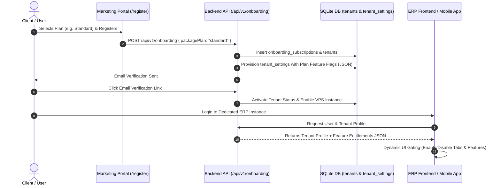
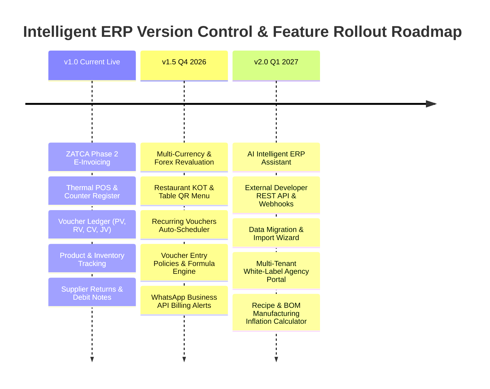

# 🚀 Intelligent ERP: Plan-Wise Feature Matrix, Automated SaaS Entitlements & Version Control Roadmap

> **Author**: Core Systems Architecture & Product Strategy Team  
> **Target System**: Intelligent ERP (Next.js 15 Backend + SQLite/Drizzle + Flutter Desktop/Web + Marketing Portal)  
> **Last Updated**: October 2026  
> **Document Status**: Approved / Master Reference  

---

## 1. Executive Summary & Core Architectural Vision

Intelligent ERP is a multi-tenant, SaaS-driven Enterprise Resource Planning and ZATCA Phase 2 E-Invoicing platform tailored for Saudi Arabia (GCC) and international markets.

To maximize SaaS revenue growth, client conversion, and low-friction onboarding:
1. **Plan-Based Entitlement Enforcer**: Features are partitioned into **Free**, **Basic**, **Standard**, **Premium**, and **Agency / Enterprise** plans.
2. **Automated Feature Provisioning**: When a user registers or upgrades their plan via the onboarding/payment portal, feature flags and quota limits are automatically calculated and committed to the client's `tenant_settings` without requiring manual administrative intervention.
3. **Version-Gated Release Strategy**: Features are tagged with release versions (**v1.0 Current Live**, **v1.5 Next Release**, **v2.0 Advanced AI/Enterprise**) so product development and marketing teams align on current vs. upcoming rollouts.

---

## 2. ERP Feature Analysis & Module Breakdown

Intelligent ERP comprises over 60 distinct features categorized across 6 core operational pillars:

```mermaid
graph TD
    A[Intelligent ERP Core Platform] --> B[1. Accounting & Finance]
    A --> C[2. Sales, POS & Invoicing]
    A --> D[3. Inventory & Manufacturing]
    A --> E[4. Purchasing & Suppliers]
    A --> F[5. HR, Payroll & Staff]
    A --> G[6. AI, API & Integrations]

    B --> B1[GL, PV/RV/CV/JV Vouchers]
    B --> B2[Multi-Currency & Forex Revalue]
    B --> B3[Recurring Vouchers & Voucher Policies]

    C --> C1[ZATCA Phase 2 E-Invoicing & B2B XML]
    C --> C2[Thermal POS & Offline Mode]
    C --> C3[Restaurant KOT & Table QR Menu]

    D --> D1[Multi-Branch Stock Transfers]
    D --> D2[Batch, Expiry & Serial/Warranty]
    D --> D3[Recipe / BOM Manufacturing]

    E --> E1[Purchase Orders & GRN]
    E --> E2[Supplier Returns & Debit Notes]

    F --> F1[Staff Directory & Attendance]
    F --> F2[Payroll & WPS Export]
    F --> F3[Sales Commission & Incentives]

    G --> G1[AI ERP Assistant]
    G --> G2[WhatsApp Business API]
    G --> G3[REST API & Webhooks]
```



---

## 3. Comprehensive Marketing Plan-Wise Feature Matrix

The table below outlines feature inclusions, exclusions, and quotas across all pricing tiers.

| # | Feature / Service Name | Free Plan | Basic Plan | Standard Plan | Premium Plan | Enterprise / Agency |
|---|------------------------|:---:|:---:|:---:|:---:|:---:|
| **Pricing & Quotas** | | | | | |
| 1 | **Base Price (SAR / Year)** | **0 SAR** | **1,800 SAR** | **6,000 SAR** | **6,000 SAR (Sale)** | **Custom Quote** |
| 2 | **Monthly Invoices / Bills** | 300 / mo | Unlimited | Unlimited | Unlimited | Unlimited |
| 3 | **Max Included Branches** | 1 | 1 | 3 | 5 | Unlimited |
| 4 | **Max Staff Users** | 2 | 5 | 15 | 30 | Unlimited |
| 5 | **Image Storage / Item** | 500 KB | 1 MB | 5 MB | Unlimited | Unlimited |
| **Sales, POS & Invoicing** | | | | | |
| 6 | **ZATCA Phase 2 B2C & B2B E-Invoicing** | ✅ | ✅ | ✅ | ✅ | ✅ |
| 7 | **Thermal POS Billing Interface** | ✅ | ✅ | ✅ | ✅ | ✅ |
| 8 | **Quotations & Estimates** | ❌ | ✅ | ✅ | ✅ | ✅ |
| 9 | **Delivery Challans & Gate Passes** | ❌ | ✅ | ✅ | ✅ | ✅ |
| 10 | **Installment Sales (EMI Management)** | ❌ | ✅ | ✅ | ✅ | ✅ |
| 11 | **Restaurant KOT & Table Management** | ❌ | ❌ | ✅ | ✅ | ✅ |
| 12 | **Table QR Digital Menu & Prep Times** | ❌ | ❌ | ✅ | ✅ | ✅ |
| 13 | **Discount Coupons & Promo Tracking** | ❌ | ✅ | ✅ | ✅ | ✅ |
| 14 | **Customer Web Portal** | ❌ | ✅ | ✅ | ✅ | ✅ |
| 15 | **Loyalty Points System** | ❌ | ✅ | ✅ | ✅ | ✅ |
| 16 | **Quick Dues Entry & Credit Register** | ❌ | ✅ | ✅ | ✅ | ✅ |
| 17 | **Delivery Areas & Area-wise Collection** | ❌ | ✅ | ✅ | ✅ | ✅ |
| 18 | **Courier / Delivery Tracking** | ❌ | ✅ | ✅ | ✅ | ✅ |
| 19 | **Counter Session & Cashier Closure Report**| ❌ | ❌ | ✅ | ✅ | ✅ |
| **Inventory & Manufacturing** | | | | | |
| 20 | **Multi-Branch & Stock Transfer Orders** | ❌ | ❌ | ✅ | ✅ | ✅ |
| 21 | **Serial Number & Warranty Tracking** | ❌ | ❌ | ✅ | ✅ | ✅ |
| 22 | **Batch Tracking & Expiry Dates** | ❌ | ❌ | ✅ | ✅ | ✅ |
| 23 | **RMA, Customer & Supplier Returns** | ❌ | ❌ | ✅ | ✅ | ✅ |
| 24 | **Product Sizes & Colors (Variants)** | ❌ | ✅ | ✅ | ✅ | ✅ |
| 25 | **Stock Audits & Reconciliation** | ❌ | ✅ | ✅ | ✅ | ✅ |
| 26 | **Barcode Label Printing** | ❌ | ✅ | ✅ | ✅ | ✅ |
| 27 | **Stock Register & Stock Statement** | ❌ | ✅ | ✅ | ✅ | ✅ |
| 28 | **Warehouse Location Tracking** | ❌ | ✅ | ✅ | ✅ | ✅ |
| 29 | **Weighed Intake with Deductions** | ❌ | ✅ | ✅ | ✅ | ✅ |
| 30 | **Lot Traceability & Product Recall List** | ❌ | ✅ | ✅ | ✅ | ✅ |
| 31 | **Bill of Materials (BOM / Recipe)** | ❌ | ✅ | ✅ | ✅ | ✅ |
| 32 | **Daily Production Entry (WIP to Finished)**| ❌ | ✅ | ✅ | ✅ | ✅ |
| 33 | **Production Planning & Ingredient Request**| ❌ | ✅ | ✅ | ✅ | ✅ |
| 34 | **Margin Protection on Ingredient Inflation**| ❌ | ✅ | ✅ | ✅ | ✅ |
| 35 | **Paint Shade Formulas & Re-mixing Code** | ❌ | ✅ | ✅ | ✅ | ✅ |
| 36 | **Clothing Hang Tags (Size, Color, Price)** | ❌ | ✅ | ✅ | ✅ | ✅ |
| 37 | **Paint Estimator Calculator** | ❌ | ✅ | ✅ | ✅ | ✅ |
| **Accounting & Finance** | | | | | |
| 38 | **Chart of Accounts (COA)** | Basic | Full | Full | Full | Custom |
| 39 | **Payment, Receipt, Cash & Journal Vouchers**| Basic | ✅ | ✅ | ✅ | ✅ |
| 40 | **Voucher Entry Policies & Sequencers** | ❌ | ✅ | ✅ | ✅ | ✅ |
| 41 | **Cheque Register & Bank Reconciliation** | ❌ | ✅ | ✅ | ✅ | ✅ |
| 42 | **Capital, Investors & Shareholder Register**| ❌ | ✅ | ✅ | ✅ | ✅ |
| 43 | **Loan & Debt Register** | ❌ | ✅ | ✅ | ✅ | ✅ |
| 44 | **Expense Budgeting vs. Time Progress** | ❌ | ❌ | ✅ | ✅ | ✅ |
| 45 | **Multi-Currency & Forex Revaluation** | ❌ | ❌ | ✅ | ✅ | ✅ |
| 46 | **Recurring Vouchers Scheduler** | ❌ | ❌ | ✅ | ✅ | ✅ |
| 47 | **Customer Profitability Analysis** | ❌ | ❌ | ✅ | ✅ | ✅ |
| **HR, Staff & Payroll** | | | | | |
| 48 | **Staff Directory & Basic Info** | ✅ | ✅ | ✅ | ✅ | ✅ |
| 49 | **Staff Salary Register** | ❌ | ✅ | ✅ | ✅ | ✅ |
| 50 | **Biometric / Mobile Attendance Tracking** | ❌ | ❌ | ✅ | ✅ | ✅ |
| 51 | **WPS SIF File Export (Saudi Payroll)** | ❌ | ❌ | ✅ | ✅ | ✅ |
| 52 | **Per-Product Commission & Incentives** | ❌ | ✅ | ✅ | ✅ | ✅ |
| 53 | **Tradesman / Referral Standing Commission** | ❌ | ✅ | ✅ | ✅ | ✅ |
| 54 | **Sales Representative Targets & Reviews** | ❌ | ✅ | ✅ | ✅ | ✅ |
| 55 | **Staff Price-Change & Discount Limit Rules**| ❌ | ✅ | ✅ | ✅ | ✅ |
| **AI, Integrations & Advanced** | | | | | |
| 56 | **WhatsApp Business Notifications (Automated)**| ❌ | ❌ | ✅ | ✅ | ✅ |
| 57 | **AI ERP Assistant (Smart Insights & SQL)**| ❌ | ❌ | ✅ | ✅ | ✅ |
| 58 | **External REST API & Webhooks Access** | ❌ | ❌ | ❌ | ✅ | ✅ |
| 59 | **Editable SMS Notification Templates** | ❌ | ❌ | ❌ | ✅ | ✅ |
| 60 | **Old Book / Legacy Records Archive** | ❌ | ❌ | ❌ | ✅ | ✅ |
| 61 | **Bulk Data Migration Import Wizard** | ❌ | ❌ | ❌ | ✅ | ✅ |
| 62 | **Custom Domain Hosting (CNAME / Subdomain)**| Subdomain | Subdomain | Custom | Custom | Custom |

---

## 4. Automated Feature Activation Architecture (SaaS Entitlements)

When a customer registers or upgrades their package on the marketing portal (`/app/register`), the system automatically provisions feature entitlements in `tenant_settings`.

### 4.1 Entitlements Workflow Diagram



### 4.2 Database Schema Enhancement (`tenant_settings`)

In [`backend/src/lib/db/schema.ts`](file:///e:/aiprojects/Zatca_website/backend/src/lib/db/schema.ts), `tenant_settings` stores the feature matrix configuration in `feature_flags`:

```typescript
export const tenantSettings = sqliteTable('tenant_settings', {
  id: text('id').primaryKey().$defaultFn(() => crypto.randomUUID()),
  tenantId: text('tenant_id').references(() => tenants.id, { onDelete: 'cascade' }).notNull().unique(),
  packagePlan: text('package_plan').default('free').notNull(), // 'free', 'basic', 'standard', 'premium', 'agency'
  maxBranches: integer('max_branches').default(1).notNull(),
  maxUsers: integer('max_users').default(2).notNull(),
  monthlyBillLimit: integer('monthly_bill_limit').default(300).notNull(), // 300 or -1 for unlimited
  
  // Dynamic Feature Flags JSON
  featureFlags: text('feature_flags', { mode: 'json' }).$type<{
    multiBranch: boolean;
    zatcaPhase2: boolean;
    posModule: boolean;
    kotRestaurant: boolean;
    tableQrMenu: boolean;
    batchExpiry: boolean;
    serialWarranty: boolean;
    bomManufacturing: boolean;
    forexRevaluation: boolean;
    recurringVouchers: boolean;
    wpsPayroll: boolean;
    aiAssistant: boolean;
    apiAccess: boolean;
    whatsappIntegration: boolean;
  }>().notNull(),

  updatedAt: integer('updated_at', { mode: 'timestamp' }).defaultNow().notNull(),
});
```

### 4.3 Automated Provisioner Helper (`backend/src/lib/entitlements/provisioner.ts`)

```typescript
export const PLAN_FEATURE_PRESETS = {
  free: {
    maxBranches: 1,
    maxUsers: 2,
    monthlyBillLimit: 300,
    featureFlags: {
      multiBranch: false,
      zatcaPhase2: true,
      posModule: true,
      kotRestaurant: false,
      tableQrMenu: false,
      batchExpiry: false,
      serialWarranty: false,
      bomManufacturing: false,
      forexRevaluation: false,
      recurringVouchers: false,
      wpsPayroll: false,
      aiAssistant: false,
      apiAccess: false,
      whatsappIntegration: false,
    },
  },
  basic: {
    maxBranches: 1,
    maxUsers: 5,
    monthlyBillLimit: -1, // Unlimited
    featureFlags: {
      multiBranch: false,
      zatcaPhase2: true,
      posModule: true,
      kotRestaurant: false,
      tableQrMenu: false,
      batchExpiry: false,
      serialWarranty: false,
      bomManufacturing: true,
      forexRevaluation: false,
      recurringVouchers: false,
      wpsPayroll: false,
      aiAssistant: false,
      apiAccess: false,
      whatsappIntegration: false,
    },
  },
  standard: {
    maxBranches: 3,
    maxUsers: 15,
    monthlyBillLimit: -1,
    featureFlags: {
      multiBranch: true,
      zatcaPhase2: true,
      posModule: true,
      kotRestaurant: true,
      tableQrMenu: true,
      batchExpiry: true,
      serialWarranty: true,
      bomManufacturing: true,
      forexRevaluation: true,
      recurringVouchers: true,
      wpsPayroll: true,
      aiAssistant: true,
      apiAccess: false,
      whatsappIntegration: true,
    },
  },
  premium: {
    maxBranches: 5,
    maxUsers: 30,
    monthlyBillLimit: -1,
    featureFlags: {
      multiBranch: true,
      zatcaPhase2: true,
      posModule: true,
      kotRestaurant: true,
      tableQrMenu: true,
      batchExpiry: true,
      serialWarranty: true,
      bomManufacturing: true,
      forexRevaluation: true,
      recurringVouchers: true,
      wpsPayroll: true,
      aiAssistant: true,
      apiAccess: true,
      whatsappIntegration: true,
    },
  },
};
```

### 4.4 Backend API Guard Middleware (`backend/src/middleware/featureGuard.ts`)

```typescript
import { NextResponse } from 'next/server';
import { getTenantSettings } from '@/lib/db/tenant';

export function checkFeatureAccess(featureKey: string) {
  return async (req: Request, tenantId: string) => {
    const settings = await getTenantSettings(tenantId);
    if (!settings || !settings.featureFlags[featureKey]) {
      return NextResponse.json(
        {
          success: false,
          error: `The feature '${featureKey}' is not included in your current subscription plan (${settings?.packagePlan?.toUpperCase()}). Please upgrade your plan to unlock this feature.`,
          upgradeRequired: true,
        },
        { status: 403 }
      );
    }
    return null; // Allowed
  };
}
```

### 4.5 Frontend Flutter Dynamic Feature Guard Widget (`erp-frontend`)

```dart
class FeatureGuard extends StatelessWidget {
  final String featureKey;
  final Widget child;
  final Widget? fallback;

  const FeatureGuard({
    Key? key,
    required this.featureKey,
    required this.child,
    this.fallback,
  }) : super(key: key);

  @override
  Widget build(BuildContext context) {
    final authProvider = Provider.of<AuthProvider>(context);
    final hasAccess = authProvider.hasFeature(featureKey);

    if (hasAccess) return child;

    return fallback ?? LockUpgradeBanner(featureKey: featureKey);
  }
}
```

---

## 5. Version Control & Release Roadmap Tiering

To maintain clean engineering control, features are deployed across three major release versions:



### 5.1 Version Details

#### 📦 Version 1.0 (Current Live Baseline)
- **ZATCA Phase 2 E-Invoicing**: Full XML generation, UBL 2.1 compliance, CSR signing, and QR code generation.
- **Voucher Ledger**: Support for Payment (PV), Receipt (RV), Cash (CV), and Journal (JV) vouchers with dual debit/credit validation.
- **Thermal POS**: Offline-ready cashier station with instant thermal receipt generation.
- **Core Inventory**: Multi-unit products, VAT calculation (15% Saudi / 5% UAE), supplier returns with debit notes.
- **Multi-Tenant Architecture**: Tenant isolation via database schemas and headers.

#### 🚀 Version 1.5 (Next Immediate Rollout - Q4 2026)
- **Multi-Currency & Forex Revaluation**: Auto-fetch exchange rates, multi-currency ledger posting, unrealized gain/loss revaluation routines.
- **Restaurant KOT & Table QR Menu**: Interactive table layouts, kitchen order ticket printing, photo-based QR menu.
- **Recurring Vouchers Scheduler**: Automated monthly/weekly voucher posting for rent, subscriptions, and retainers.
- **Voucher Entry Policies**: Configurable voucher numbering formulas (`{TYPE}-{YYYY}-{MM}-{SEQ}`), cashier approval gates, reset intervals.
- **WhatsApp Integration**: Instant PDF receipt sending directly to buyer's WhatsApp number.

#### 🤖 Version 2.0 (Next-Gen AI & Enterprise - Q1 2027)
- **AI Intelligent ERP Assistant**: Natural language database querying ("What was our top profit item last week?"), anomaly detection, and automated audit flags.
- **External REST API & Webhooks**: Secure API keys with rate-limiting for third-party e-commerce platforms (Shopify, WooCommerce, Salla, Zid).
- **Bulk Data Migration Import Wizard**: Automated CSV/Excel importer for legacy tally/books data.
- **Advanced BOM & Inflation Calculator**: Recipe manufacturing with margin auto-recalculation when ingredient prices fluctuate.
- **Agency White-Label Portal**: Multi-tenant reseller dashboard for accounting firms and IT agencies.

---

## 6. Actionable AI Prompts

Use these copy-pasteable prompts with AI coding tools or marketing generators to implement and promote these features.

### 💻 Prompt 1: Developer Implementation (Backend Feature Flag Guard)
```text
Role: Principal Backend Architect (Next.js 15, Drizzle ORM, SQLite)
Task: Implement an automated SaaS entitlement helper and Next.js API route middleware.

Requirements:
1. Create `src/lib/entitlements/provisioner.ts` containing plan definitions for 'free', 'basic', 'standard', 'premium'.
2. Create a function `provisionTenantFeatures(tenantId: string, plan: string)` that updates `tenant_settings` with maxBranches, maxUsers, monthlyBillLimit, and featureFlags JSON.
3. Write a route middleware `requireFeature(featureKey: string)` that inspects the requesting tenant's `tenant_settings.featureFlags`. If false, return a 403 JSON response with { success: false, error: "Upgrade required", upgradeUrl: "/billing/upgrade" }.
4. Ensure full TypeScript strict mode compliance and error handling.
```

### 🎨 Prompt 2: Frontend Flutter Widget (Dynamic UI Feature Gate)
```text
Role: Senior Flutter Developer
Task: Create a reusable `FeatureGuard` widget and `UpgradeModal` sheet in Flutter.

Requirements:
1. Create a `FeatureGuard` widget taking `featureKey`, `child`, and optional `fallback`.
2. Access `AuthProvider` / `TenantProvider` to check if `featureFlags[featureKey]` is true.
3. If false and no fallback is supplied, render a sleek glassmorphic container with a lock icon, feature title, and an "Upgrade to Standard/Premium to Unlock" button.
4. When tapped, launch a modern bottom sheet displaying plan comparison prices in SAR/BDT with a direct "Upgrade Now" action button.
```

### 📣 Prompt 3: Marketing Copywriting (Pricing Page Comparison Table)
```text
Role: SaaS Conversion Copywriter & Product Marketing Manager
Task: Write high-converting sales landing page copy for Intelligent ERP's pricing section targeting Saudi & GCC business owners.

Requirements:
1. Structure into 4 columns: Free (0 SAR), Basic (1,800 SAR/yr), Standard (6,000 SAR/yr), Premium (6,000 SAR/yr Special Sale).
2. Emphasize "Zero Risk Free Forever Plan (300 invoices/mo, ZATCA Phase 2 Included)".
3. Highlight key differentiators for Standard: Multi-Branch, Restaurant KOT, Multi-Currency, WhatsApp PDF Invoices, and Automated Payroll.
4. Add micro-copy for 40% Annual Discount savings and 0 SAR Annual Maintenance Charge (AMC).
5. Include call-to-action buttons for each plan.
```

### 🤝 Prompt 4: Sales Objection Handling (Feature Upgrade Script)
```text
Role: SaaS Enterprise Sales Manager
Task: Create a sales representative script for handling feature upgrade objections.

Scenario: A customer on the Free or Basic plan wants Multi-Branch stock transfers and WhatsApp receipt sending, but hesitates to upgrade to the Standard plan.

Script Requirements:
1. Emphasize ROI: Explain how 1 stock discrepancy between branches costs more than the monthly Standard subscription.
2. WhatsApp Advantage: Show how instant WhatsApp receipt delivery increases customer repeat visits by 25% and saves paper printing costs.
3. Limited Time Offer: Highlight the 40% annual discount (saving 4,000 SAR/year).
4. Provide a 30-second elevator pitch and follow-up objection handling responses.
```

---

## 7. Conclusion & Action Plan

1. **Database Schema**: Ensure `tenant_settings` includes the `feature_flags` JSON column (already integrated in SQLite schema).
2. **Onboarding Integration**: When `POST /api/v1/onboarding` executes, call `provisionTenantFeatures(tenantId, packagePlan)` so new tenants immediately inherit their plan's limits.
3. **Frontend Lock Strategy**: Wrap advanced screens (KOT, Multi-Currency, Multi-Branch, WPS Payroll) with `<FeatureGuard>` widgets.
4. **Documentation Location**: Saved persistently at [`e:\aiprojects\Zatca_website\docs\plan_wise_feature_matrix_and_entitlements.md`](file:///e:/aiprojects/Zatca_website/docs/plan_wise_feature_matrix_and_entitlements.md).
