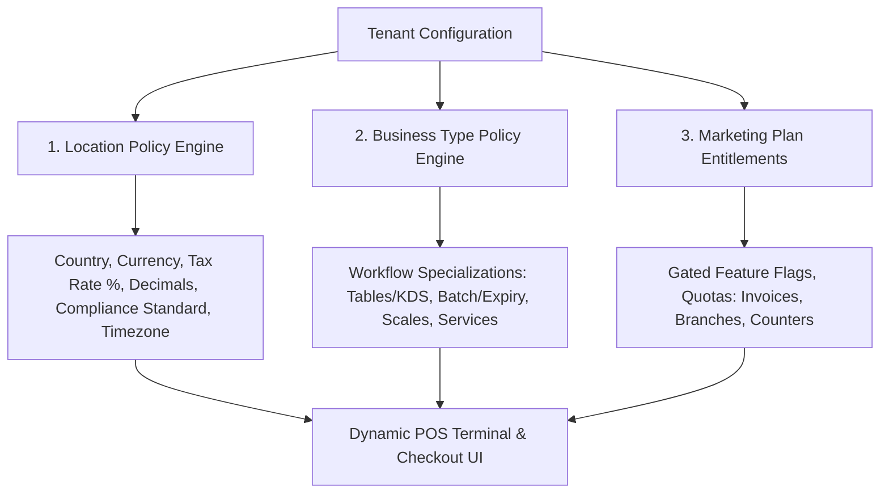
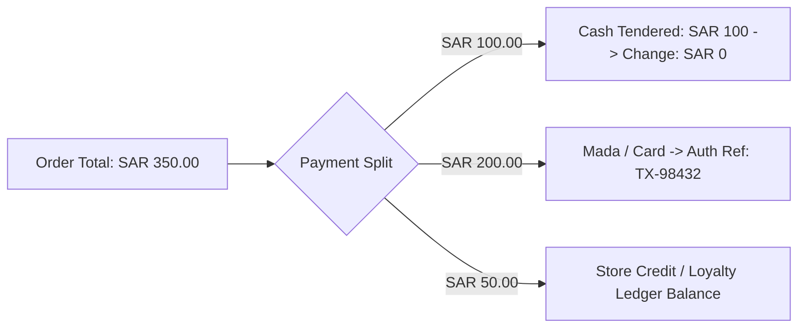
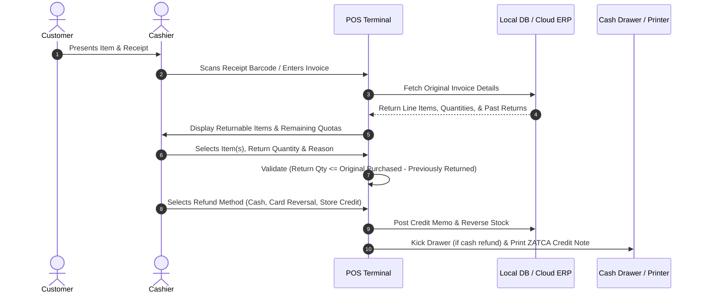
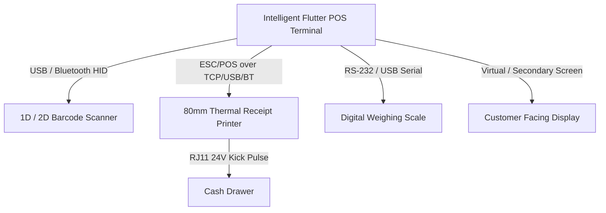

# POS Screen Features & Operational Specification

---

## 1. Executive Overview & System Architecture
The **Intelligent POS Terminal** is a high-speed, local-first point-of-sale interface engineered for retail counters, supermarkets, pharmacies, and service desks. It enables cashiers to execute sub-5-second checkout workflows while ensuring strict accounting integrity and full compliance with Saudi ZATCA (Phase 1 & Phase 2 e-Invoicing) and regional tax mandates.

### Core Architectural Pillars
- **Local-First Reliability**: Operates seamlessly offline using local SQLite caching; syncs asynchronously with the central ERP backend via an idempotent outbox queue (`syncQueue`).
- **Zero-Trust Financial Verification**: Calculations (line totals, tax brackets, discounts) are computed on the client for zero-latency UI rendering and re-verified server-side upon receipt ingestion.
- **Bilingual Legal Compliance**: Native English and Arabic (RTL) interface and bilingual receipt generation meeting ZATCA e-invoicing standards.
- **Automated Accounting Integration**: Instant posting of balanced double-entry General Ledger vouchers (`Receipt Vouchers` / `Journal Vouchers`) for inventory depletion, cash/bank debit, VAT payable credit, and revenue recognition.

---

## 2. Dynamic Tenant Policy Engine: Location, Business Type & Entitlements

The POS and ERP frontend automatically adapt workflows, taxes, compliance rules, and UI features based on a **Triad Policy Engine**:



### 2.1 Regional Compliance & Location Presets (7 Countries)

| Country & Code | Legal Compliance Framework | Currency & Symbol | Decimals | Default Tax Rate & Type | Default Timezone & Date Pattern | Language Priority |
|---|---|---|---|---|---|---|
| **Saudi Arabia (`SA`)** | **ZATCA (Phase 1 & 2)** | `SAR` (ر.س) | **2** | 15.0% (`VAT / ضريبة القيمة المضافة`) | `Asia/Riyadh` (`YYYY-MM-DD`) | Arabic (1st), English (2nd) |
| **United Arab Emirates (`AE`)** | **UAE FTA** | `AED` (د.إ) | **2** | 5.0% (`VAT / ضريبة القيمة المضافة`) | `Asia/Dubai` (`DD/MM/YYYY`) | Arabic (1st), English (2nd) |
| **Oman (`OM`)** | **Oman Tax Authority (OTA)** | `OMR` (ر.ع.) | **3** | 5.0% (`VAT / ضريبة القيمة المضافة`) | `Asia/Muscat` (`DD/MM/YYYY`) | Arabic (1st), English (2nd) |
| **Bahrain (`BH`)** | **Bahrain NBR** | `BHD` (د.ب) | **3** | 10.0% (`VAT / ضريبة القيمة المضافة`) | `Asia/Bahrain` (`DD/MM/YYYY`) | Arabic (1st), English (2nd) |
| **Qatar (`QA`)** | **Qatar GTA** | `QAR` (ر.ق) | **2** | 0.0% (Exempt / No VAT) | `Asia/Qatar` (`DD/MM/YYYY`) | Arabic (1st), English (2nd) |
| **Kuwait (`KW`)** | **Kuwait MOF** | `KWD` (د.ك) | **3** | 0.0% (Exempt / No VAT) | `Asia/Kuwait` (`DD/MM/YYYY`) | Arabic (1st), English (2nd) |
| **Bangladesh (`BD`)** | **NBR (Mushuk 6.3)** | `BDT` (৳) | **2** | 15.0% (`VAT / মূসক`) | `Asia/Dhaka` (`DD-MM-YYYY`) | Bengali (1st), English (2nd) |

#### Automated Tenant Setup Attributes:
- **Country Code**: ISO alpha-2 country selection.
- **Dynamic Currency**: Auto-sets code and native symbol (`SAR`, `AED`, `OMR`, `BHD`, `QAR`, `KWD`, `BDT`).
- **Dynamic Decimal Places**: Enforces 2 decimal places for SAR/AED/QAR/BDT and 3 decimal places for OMR/BHD/KWD across all cart calculations.
- **Tax Rate & Tax Label**: Automatically applies statutory default rates while permitting tax-exempt overrides.
- **Timezone & Date/Number Formats**: Localized timestamp generation and number group separators.
- **Multilingual Support**: Supports Arabic-first (RTL), English-first, and Bengali-first layouts with on-the-fly switching.

---

### 2.2 Business Type Product Policy & POS Automation

The POS terminal dynamically displays contextual controls based on the tenant's registered business category:

| Business Type | Specialized POS & Product Policy Features |
|---|---|
| **Retail POS** | Service vs. physical products, standard barcode scanning, multi-attribute variants (Color/Size), store credit & layaway. |
| **Pharmacy POS** | **Medicine Expiry Date Alert**, **Batch & Lot Management**, strip/box unit conversion, prescription attachments. |
| **Grocery POS** | **RS-232/USB Digital Weighing Scale integration**, price-embedded barcodes (Prefix `20`/`02`), fast perishable low-stock alerts. |
| **Beauty & Salon POS** | **Service-based billing**, **Staff/Beautician commission tracking**, **Appointment booking calendar**, treatment packages. |
| **Restaurant POS** | **Table Management & Floor Layouts**, **Kitchen Display System (KDS)**, **Order Types (Dine-in, Takeaway, Delivery)**, **Waiter Registration & Table Assignment**, **Recipe / BOM Management**, Modifiers, Set Menus, Loyalty & Gift Cards. |
| **Laundry POS** | Service-type items (Wash/Iron/Dry Clean), garment tagging with bag barcodes, scheduled pickup & delivery times. |
| **Shoe Store POS** | Matrix grid (Brand $\times$ Size $\times$ Color), single-box barcode scanning, sizing replacement workflows. |

---

### 2.3 Marketing Plan SaaS Entitlements & Version Control

Features and operational quotas are dynamically restricted or unlocked based on the active subscription tier:
- **Starter Plan**: 1 Branch, 1 Counter, 500 Invoices/mo, Core POS & Thermal Printing.
- **Standard Plan**: 3 Branches, 3 Counters, 2,000 Invoices/mo, WhatsApp Receipts, Category Navigation.
- **Pro Plan**: Unlimited Branches, Unlimited Counters, Unlimited Invoices, Restaurant KDS, Multi-Warehouse Transfers.
- **Agency / Enterprise**: White-label branding, Custom domains, Full API & Webhook Access, Multi-tenant management.

---

```
+----------------------------------------------------------------------------------------------------+
| [Status: OPEN]  Register: POS-01 | Branch: Main Showroom | Cashier: Ahmed | [ONLINE] [Sync: OK]    |
| Quick Actions: [Lock F11] [Pay In/Out F5] [Held Carts (2) F4] [Returns] [X-Report F10] [Help F1]  |
+----------------------------------------------------+-----------------------------------------------+
| LEFT PANEL: Catalog & Search (60% Width)           | RIGHT PANEL: Cart & Tender (40% Width)        |
+----------------------------------------------------+-----------------------------------------------+
| 🔍 Search Bar (F1) [ Barcode / SKU / Item Name ]    | 👤 Customer: [ Walk-in Customer (F2)        ] |
| Categories: [All] [Drinks] [Snacks] [Household] ...|    Balance: SAR 0.00 | Credit Limit: SAR 0.00|
+----------------------------------------------------+-----------------------------------------------+
| +---------------+ +---------------+ +---------------+ | Itemized Cart Lines:                          |
| | Product A     | | Product B     | | Product C     | | 1. Fresh Milk 1L     x2   SAR 12.00  [x]    |
| | SAR 6.00      | | SAR 14.50     | | SAR 25.00     | |    VAT 15%: SAR 1.80                        |
| | Stock: 48     | | Stock: 12     | | Stock: Out    | | 2. Whole Wheat Bread x1   SAR 5.50   [x]    |
| +---------------+ +---------------+ +---------------+ |    Discount: 10% (-SAR 0.55)                  |
| +---------------+ +---------------+ +---------------+ |-----------------------------------------------|
| | Product D     | | Product E     | | Product F     | | Subtotal (Excl. Tax):          SAR 14.74      |
| | SAR 8.00      | | SAR 19.99     | | SAR 45.00     | | Promotional Discount:         -SAR  0.55      |
| | Stock: 110    | | Stock: 5      | | Stock: 22     | | Output VAT (15% ZATCA):        SAR  2.21      |
| +---------------+ +---------------+ +---------------+ | TOTAL PAYABLE:                 SAR 16.95      |
+----------------------------------------------------+-----------------------------------------------+
| Action Bar: [Clear Cart F9] [Hold Sale F3] [Discount F6] | [ >>> PAY / CHECKOUT (F12 / SPACE) <<< ]|
+----------------------------------------------------------------------------------------------------+
```

### 2.1 Top Status Header
- **Session State**: Shows current register state (`OPEN`, `SUSPENDED`, `CLOSED`), terminal ID (e.g., `REG-01`), and active branch/outlet.
- **Cashier Identity**: Logged-in cashier name, active role, and shift start time.
- **Connectivity & Sync Beacon**: Real-time indicator (`ONLINE` green / `OFFLINE` amber / `SYNCING` blue) and pending sync transaction count.
- **Quick Controls**: One-touch triggers for Session Lock, Pay-In / Pay-Out, Held Carts drawer, Returns module, and X-Report reading.

### 2.2 Left Catalog & Search Panel
- **Auto-Focused Search Input**: Default focus target; accepts rapid barcode scanning (USB/Bluetooth HID) or manual alphanumeric search (SKU, Arabic name, English name).
- **Category Filter Carousel**: Scrollable tabs for fast catalog segmentation (`All`, `Beverages`, `Bakery`, `Dairy`, `Produce`, `Dry Goods`, `Personal Care`).
- **Product Card Grid**: Responsive touch-friendly tiles displaying thumbnail, product title, selling price, tax-inclusive badge, real-time stock availability pill (`In Stock`, `Low Stock <10`, `Out of Stock`), and multi-variant trigger.

### 2.3 Right Cart & Checkout Panel
- **Customer Identity Banner**: Defaults to `Walk-in Customer` with instant switch (`F2`); reveals corporate name, tax identification number (VAT TRN), current ledger balance, and available credit limit.
- **Itemized Cart Table**:
  - Sequential index, item title, and variant tag.
  - Interactive quantity stepper (`[-]`, `[+]`, and editable number field).
  - Base unit price, applicable tax rate (15% standard, 0% exempt/zero-rated), line discount percentage/fixed value, and line total.
  - One-click line void action (trash icon).
- **Financial Summary Block**:
  - Subtotal (Net of VAT).
  - Total Order Discounts.
  - Total VAT Amount (ZATCA/NBR compliant).
  - Grand Total Payable (high-visibility typography).
- **Cart Bottom Actions**:
  - `[Clear Cart]` (`F9`): Empties active cart (triggers confirmation or Manager PIN if non-empty).
  - `[Hold Sale]` (`F3`): Suspends cart to local SQLite cache with customer tag.
  - `[Discount]` (`F6`): Applies cart-level percentage or fixed reduction.
  - `[PAY / CHECKOUT]` (`F12` / `Space`): Launches multi-tender payment modal.

---

## 3. Keyboard Shortcuts Matrix (High-Velocity Operation)

| Shortcut | Function | Context / Action |
|---|---|---|
| **F1** | Focus Product Search / Barcode Input | Returns cursor to main search field from any panel |
| **F2** | Customer Selection & Account Lookup | Opens customer lookup modal with credit ledger details |
| **F3** | Hold / Suspend Active Cart | Saves active order with note/timestamp and resets cart |
| **F4** | Recall Held Carts | Displays modal of held carts with one-click restore |
| **F5** | Cash Drawer Float (Pay-In / Pay-Out) | Opens petty cash and float management dialog |
| **F6** | Order-Level Discount | Opens discount dialog (Percentage / Fixed Value) |
| **F7** | Reprint Last Receipt | Prints duplicate receipt of previous successful invoice |
| **F8** | Add Order Note / Delivery Instructions | Attaches customer instructions or delivery notes |
| **F9** | Clear / Void Entire Cart | Clears cart; triggers Manager PIN if items exceed threshold |
| **F10** | Mid-Shift Reading (X-Report) | Prints non-resetting mid-shift cash and tender summary |
| **F11** | Lock POS Terminal | Locks screen without closing shift; requires cashier PIN to resume |
| **F12** / **Space** | Trigger Payment Modal | Launches checkout tender window |
| **Esc** | Close / Cancel Modal | Dismisses current overlay or cancels search dropdown |
| **Up / Down** | Navigate Dropdowns / Tables | Selects search items, customer records, or cart rows |
| **Enter** | Confirm / Accept Action | Adds selected search item or submits modal form |
| **+ / -** | Increment / Decrement Quantity | Adjusts quantity of highlighted line item in cart |
| **Del / Backspace** | Delete Line Item | Removes selected row from cart |

---

## 4. Payment Methods & Multi-Tender Engine

The checkout engine supports flexible single-tender and split-tender payment allocations across multiple payment rails:



### 4.1 Supported Payment Methods
1. **Cash**:
   - Cashier enters tendered cash amount or uses quick cash chips (`SAR 10`, `20`, `50`, `100`, `500`, `Exact`).
   - Automatically computes **Change Due** in real time.
   - Prevents finalizing transaction if tendered cash is less than remaining payable.
2. **Card / Mada / Apple Pay / Visa / MasterCard**:
   - Supports integrated or standalone payment terminals (EFT-POS).
   - Records Card Type, Terminal Auth Reference Number, and Masked PAN (last 4 digits).
3. **Store Credit / Customer Account (A/R)**:
   - Available only when a named corporate or loyalty customer is selected.
   - Validates that `Store Credit Balance >= Tendered Amount` or that `(Outstanding Balance + Sale Amount) <= Credit Limit`.
   - Prevents checkout with clear warning if credit limit is exceeded (overridable only via Manager PIN).
4. **Split Tender**:
   - Enables combining arbitrary tender amounts (e.g., SAR 100 Cash + SAR 150 Card + SAR 50 Store Credit).
   - Checkout button remains disabled until `Total Tendered == Grand Total Payable`.

---

## 5. Manager Override & Role-Based Access Control (RBAC)

To prevent revenue leakage, inventory shrinkage, and unauthorized discounts, high-risk actions are intercepted by the **Manager Override Gatekeeper**:

```
+-------------------------------------------------------+
|  ⚠️ MANAGER OVERRIDE REQUIRED                         |
+-------------------------------------------------------+
|  Action: Apply Discount (15% exceeds cashier max 10%) |
|  Requested By: Cashier Ahmed (ID: USR-04)             |
|  Item / Cart: Whole Order Discount                    |
|                                                       |
|  Enter Manager Security PIN:                          |
|  [ * * * * ]                                          |
|                                                       |
|  [ Cancel (Esc) ]            [ Approve Action (Enter) ]|
+-------------------------------------------------------+
```

### 5.1 Intercepted Actions Requiring Manager Approval
- **Line Item Void**: Removing a line item after it has been scanned or previously held.
- **Cart Clear / Complete Void**: Erasing a cart with total value exceeding `SAR 100` (configurable).
- **Excessive Discounts**: Applying line-item or order-level discounts exceeding the cashier's authorized limit (default: > 10%).
- **Manual Price Override**: Modifying the retail selling price of a product below standard retail price.
- **Credit Limit Bypass**: Completing a credit sale for a customer whose balance exceeds approved credit limit.
- **Negative Stock Sale**: Adding out-of-stock items when tenant policy mandates approval.
- **Reprint Past Receipt**: Printing duplicate tax receipts for closed shifts or non-consecutive transactions.

### 5.2 Offline Manager PIN Validation & Security
- To ensure resilience during internet outages, Manager PINs are not validated via remote API calls exclusively.
- Salted and hashed Manager credentials (Argon2 / PBKDF2) are cached locally in encrypted SQLite storage.
- Every successful or rejected override generates a cryptographic audit record in `manager_override_logs` with timestamp, manager ID, cashier ID, action type, original value, modified value, and invoice UUID.

---

## 6. Returns, Refunds & Item Exchanges

The POS terminal enforces a strict, receipt-referenced return and exchange policy to prevent fraudulent returns.



### 6.1 Return Validation Rules
- **No Blind Returns**: All returns must reference an original tax invoice ID or barcode.
- **Quantity Cap Enforcement**: The system tracks previously refunded quantities and blocks attempts to refund more than original purchase quantity.
- **Price Integrity**: Line refund value defaults to the exact price paid at the time of purchase (including any discounts applied during original sale).
- **ZATCA Credit Note Generation**: Issues a legal ZATCA-compliant Credit Note referencing the original invoice UUID and sequential counter.

### 6.2 Item Exchange Workflow
- Cashier enters the return items into the active exchange session.
- Replacement items are scanned into the same cart.
- Cart computes the net financial difference:
  - **Customer Owes Balance**: Cashier collects the difference via standard checkout (`F12`).
  - **Store Owes Customer**: System issues Store Credit voucher or refunds cash.
  - **Even Exchange**: Zero-value transaction generated with stock transfer adjustments and inventory rebalancing.

---

## 7. Shift Management: X-Report vs. Z-Report

Accurate end-of-day reconciliation guarantees cash drawer control and simplifies auditing.

| Feature / Metric | X-Report (Mid-Shift Reading) | Z-Report (End-of-Shift Closing) |
|---|---|---|
| **Primary Purpose** | Mid-shift financial snapshot | Formal shift closing & drawer reconciliation |
| **Reset Shift State?** | ❌ No (Counters keep accumulating) | ✅ Yes (Locks session & resets active shift) |
| **Drawer Cash Audit** | Blind / informational preview | Mandatory physical cash count entry |
| **Variance Calculation**| Not calculated | $\text{Variance} = \text{Counted Cash} - \text{Expected Cash}$ |
| **GL Posting** | None | Closes shift register and locks shift voucher |
| **Reprint Policy** | Can be run multiple times | Generated once per shift; reprints marked `DUPLICATE` |

### 7.1 Expected Cash Mathematical Formula
$$\text{Expected Drawer Cash} = \text{Opening Cash Float} + \sum \text{Cash Sales} + \sum \text{Pay-Ins} - \sum \text{Pay-Outs} - \sum \text{Cash Refunds}$$

### 7.2 Z-Report Shift Closing Workflow
1. Cashier triggers **Close Shift** (`F10`).
2. **Blind Cash Declaration**: Cashier counts physical cash in drawer and enters breakdown by denomination (SAR 500, 100, 50, 20, 10, 5, coins).
3. System calculates expected cash and reveals cash variance ($\pm$).
4. Cashier must enter an explanatory note if variance exceeds tenant variance tolerance (e.g., > SAR 5.00).
5. Terminal prints bilingual **Z-Report** receipt containing:
   - Shift ID, Register ID, Cashier Name, Opening Time, Closing Time.
   - Gross Sales, Net Sales, Total Tax Collected (15%).
   - Breakdown by Payment Tender (Cash, Mada, Visa, Store Credit).
   - Total Refunds & Voids.
   - Opening Float, Counted Cash, Expected Cash, Variance Amount.
6. System locks terminal and logs out cashier.

---

## 8. Hardware Peripherals Integration

The POS terminal communicates with point-of-sale hardware peripherals via standard local interfaces:



### 8.1 Hardware Specifications
1. **Barcode Scanners (1D & 2D)**:
   - Operates as USB/Bluetooth HID Keyboard Wedge.
   - Configured with `Enter` (`CR/LF`) suffix for zero-click instant item addition.
   - Supports GS1 DataBar, EAN-13, QR codes, and weight-embedded barcodes (e.g., prefix `20` or `02` with encoded weight/price).
2. **Receipt Printers (ESC/POS)**:
   - Supports 80mm (standard) and 58mm thermal rolls via USB, Ethernet (TCP/IP 9100), or Bluetooth.
   - Encodes Arabic text into CP864, Windows-1256, or raster bitmap for crisp typography on standard thermal heads.
   - Embedded support for GS1/ZATCA QR code printing via native raster command (`GS v 0` or `ESC *`).
3. **Cash Drawer**:
   - Standard RJ11/RJ12 connector plugged into printer drawer kick port (`DK Port`).
   - Triggered via ESC/POS pulse command (`ESC p 0 25 250`) on invoice confirmation or manual Pay-Out.
4. **Electronic Weighing Scale**:
   - Connects via RS-232 serial or USB virtual COM port (continuous or poll command mode).
   - Transmits tare, net, and gross weight directly into active cart row for produce priced per kilogram.
5. **Customer Facing Display (CFD)**:
   - Supports secondary HDMI/USB monitors or VFD pole displays (ESC/POS / CD522).
   - Real-time display of scanned items, prices, running total, and dynamic promotional slides.

---

## 9. ZATCA E-Invoicing & Regional Compliance

For Saudi Arabia operations, the POS generates Simplified Tax Invoices meeting all ZATCA Phase 1 & Phase 2 regulations:

### 9.1 Bilingual Receipt Standard Layout
Every printed or digital receipt must contain:
1. **Seller Header**: Legal Business Name, Branch Name, Branch Address, and Seller's 15-digit Tax Identification Number (VAT TRN).
2. **Invoice Metadata**: Document Title (`Simplified Tax Invoice` / `فاتورة ضريبية مبسطة`), Sequential Invoice Number, Date & Time stamp (ISO 8601 with timezone).
3. **Line Items**: Description in Arabic and English, Quantity, Unit Price, Line Discount, Applicable VAT Rate (15%), and Line Total (Tax Inclusive).
4. **Summary Totals**: Total Taxable Amount (Excl. VAT), Total Order Discount, Total VAT Amount, Grand Total Payable (Inclusive of VAT).
5. **ZATCA Phase 2 QR Code**: Compliant Base64 TLV (Tag-Length-Value) encoded QR code:
   - **Tag 1**: Seller's Name
   - **Tag 2**: Seller's VAT Registration Number
   - **Tag 3**: Time Stamp (YYYY-MM-DDTHH:mm:ssZ)
   - **Tag 4**: Invoice Total (with VAT)
   - **Tag 5**: Total VAT Amount
   - **Tag 6**: Cryptographic Hash of the Invoice (Phase 2)
   - **Tag 7**: ECDSA Public Key / Cryptographic Stamp (Phase 2)
   - **Tag 8**: ECDSA Signature (Phase 2)

---

## 10. Offline Resilience, Local Caching & Sync Protocol

To maintain zero downtime during internet outages:

1. **Local Data Store**: All master catalogs (products, prices, categories, barcodes, customers, cached manager PIN hashes) are stored in an encrypted local SQLite database.
2. **Idempotent Ingestion**: Every checkout transaction generates a client-side UUID (`idempotency_key`). When reconnected, the backend verifies the key to prevent duplicate ledger postings or stock deductions.
3. **Outbox Pattern (`syncQueue`)**:
   - Checkouts completed offline are marked `sync_status = 'pending'` and enqueued into `pos_sync_queue`.
   - A background sync worker monitors network reachability. Once connection is restored, records are pushed in FIFO batches.
   - Server responds with official cloud invoice IDs and ZATCA Phase 2 compliance certificates.
4. **Conflict Resolution**:
   - Stock counts locally operate on optimistic decrements.
   - If central ERP detects negative inventory during offline sync, a Reconciliation Journal Entry (`RJE`) is flagged for store manager review without blocking transaction processing.

---

## 11. Marketing Plan Entitlements & SaaS Feature Guarding

The POS screen enforces a multi-tier SaaS monetization engine where advanced features and quota boundaries are conditionally unlocked according to the tenant's purchased subscription plan:

| Feature / Quota | Starter Tier (`STARTER`) | Standard Tier (`STANDARD`) | Pro / Enterprise (`PRO`, `AGENCY`) |
| :--- | :---: | :---: | :---: |
| **Branch Limit** | 1 Branch | 3 Branches | Unlimited Multi-Branch |
| **Counter Limit** | 1 Active Counter | 3 Active Counters | Unlimited Counters |
| **Monthly Invoices** | 500 Invoices / mo | 2,000 Invoices / mo | Unlimited Invoices |
| **Hold / Resume Multiple Carts** | ❌ Locked | ✅ Unlocked | ✅ Unlocked |
| **Dine-In & Table Layouts** | ❌ Locked | ✅ Unlocked (Restaurants) | ✅ Unlocked (Restaurants) |
| **Waiter Assignment** | ❌ Locked | ✅ Unlocked | ✅ Unlocked |
| **Kitchen Display System (KDS)** | ❌ Locked | ❌ Locked | ✅ Unlocked |
| **Third-Party Aggregator Sync** *(Jahez, HungerStation, Talabat)* | ❌ Locked | ❌ Locked | ✅ Unlocked |
| **Custom Receipt Template Designer** | ❌ Locked | ❌ Locked | ✅ Unlocked |
| **Customer Loyalty & Points Redemption** | ❌ Locked | ❌ Locked | ✅ Unlocked |
| **Manager PIN Security Overrides** | Basic | Advanced Audit | Full Cryptographic Audit |

### 11.1 Client-Side Gatekeeper UX (`PlanGuardModal`)
- When cashiers attempt to access a feature not entitled by their current plan (e.g. clicking a locked Hold cart or Aggregator chip), the POS does not crash or silently fail.
- Instead, the interactive `PlanGuardModal` dialog appears:
  - Displays the locked feature name and current subscription tier
  - Explains the target tier required to unlock it
  - Outlines the high-value perks included in the target plan
  - Provides a 1-click CTA button to navigate directly to the subscription management dashboard.

---

*Document Reference: INTELLIGENT-POS-SPEC-V2.1*  
*Target Environments: Intelligent ERP Web POS & Flutter Desktop/Tablet POS*

