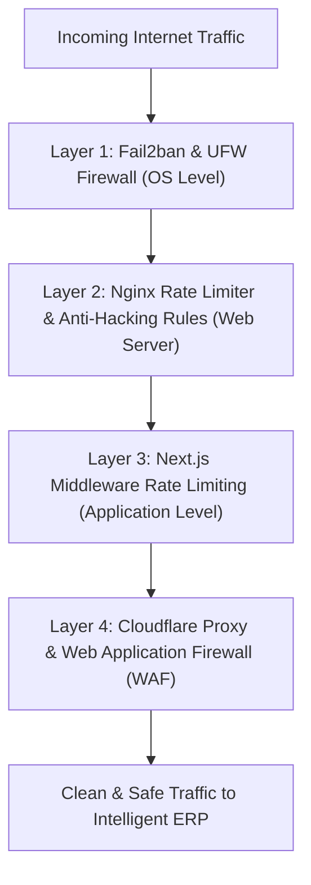

# Multi-Layer VPS Security & Anti-Hacking Protection Plan

This document outlines the **4-layer security hardening strategy** to protect your VPS (`165.73.244.224`), Nginx web server, and Intelligent ERP APIs against DDoS, rate-limit abuse, brute-force, SQL injection, path traversal, and malicious bots.

---

## Security Architecture



---

## 1. Nginx Security Hardening File (`/etc/nginx/conf.d/security.conf`)

Run this command on your VPS terminal to create global Nginx rate limiting and hacking protection:

```bash
sudo tee /etc/nginx/conf.d/security.conf << 'EOF'
# ==========================================
# 1. Rate Limiting & Connection Limits
# ==========================================
limit_req_zone $binary_remote_addr zone=api_limit:10m rate=10r/s;
limit_req_zone $binary_remote_addr zone=auth_limit:10m rate=3r/s;
limit_conn_zone $binary_remote_addr zone=conn_limit:10m;

# Limit connections per IP (max 20 concurrent connections)
limit_conn conn_limit 20;

# ==========================================
# 2. Block Common Hacking Requests & Exploits
# ==========================================

# Block SQL Injection & Script Injection
if ($query_string ~* "(eval\(|concat\(|union.*select|insert.*into|drop.*table|select.*from)") {
    return 403;
}

# Block Directory Traversal & Sensitive File Scans
if ($request_uri ~* "(\.env|\.git|\.htaccess|wp-config\.php|etc/passwd|phpinfo\.php|eval-stdin)") {
    return 403;
}

# Block Known Malicious Hacking Bots & Vulnerability Scanners
if ($http_user_agent ~* (nikto|sqlmap|nmap|wpscan|masscan|zgrab|acunetix|dirbuster|harvest|autoemailspider)) {
    return 403;
}

# ==========================================
# 3. Security Response Headers
# ==========================================
add_header X-Frame-Options "SAMEORIGIN" always;
add_header X-XSS-Protection "1; mode=block" always;
add_header X-Content-Type-Options "nosniff" always;
add_header Referrer-Policy "strict-origin-when-cross-origin" always;
add_header Permissions-Policy "camera=(), microphone=(), geolocation=()" always;
EOF
```

---

## 2. Apply Rate Limiting to Specific Nginx Server Blocks

In your domain server blocks (`/etc/nginx/sites-available/intelligentdive.com.conf`):

```nginx
server {
    listen 80;
    server_name intelligentdive.com www.intelligentdive.com;

    # Protect Login & Register against Brute Force Attacks
    location ~* ^/(login|register|api/v1/onboarding) {
        limit_req zone=auth_limit burst=5 nodelay;
        proxy_pass http://127.0.0.1:3000;
        proxy_set_header Host $host;
    }

    # General API Protection
    location /api/ {
        limit_req zone=api_limit burst=20 nodelay;
        proxy_pass http://127.0.0.1:3000;
        proxy_set_header Host $host;
    }

    location / {
        proxy_pass http://127.0.0.1:3000;
        proxy_set_header Host $host;
    }
}
```

---

## 3. Install Fail2ban (Auto-Ban Malicious IPs)

Fail2ban monitors your Nginx logs and **automatically bans any IP address** that attempts brute-force attacks or spams your server with 403/404 errors.

### Commands to Install Fail2ban on VPS:

```bash
sudo apt update
sudo apt install -y fail2ban
```

### Create Fail2ban Nginx Jail Configuration:

```bash
sudo tee /etc/fail2ban/jail.local << 'EOF'
[DEFAULT]
bantime = 1h
findtime = 10m
maxretry = 5

[nginx-http-auth]
enabled = true
filter = nginx-http-auth
port = http,https
logpath = /var/log/nginx/error.log

[nginx-botsearch]
enabled = true
port = http,https
logpath = /var/log/nginx/error.log
maxretry = 2
bantime = 24h

[nginx-req-limit]
enabled = true
filter = nginx-limit-req
port = http,https
logpath = /var/log/nginx/error.log
maxretry = 10
bantime = 1h
EOF
```

Restart Fail2ban:
```bash
sudo systemctl restart fail2ban
sudo fail2ban-client status
```

---

## 4. Enable VPS UFW Firewall

Restrict access so only necessary ports (SSH, HTTP, HTTPS) are reachable:

```bash
sudo ufw default deny incoming
sudo ufw default allow outgoing
sudo ufw allow 22/tcp       # SSH
sudo ufw allow 80/tcp       # HTTP
sudo ufw allow 443/tcp      # HTTPS
sudo ufw allow 8090/tcp     # CyberPanel Admin (Optional)
sudo ufw --force enable
```
