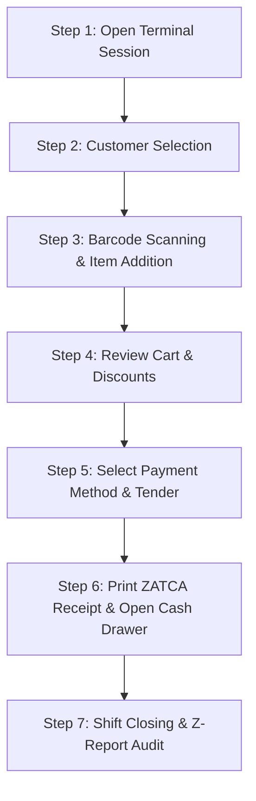

# POS Terminal Cashier Training Manual & Operation Reference Guide

---

## 1. Overview & Core Purpose
The **Intelligent POS Terminal** is a high-speed, local-first over-the-counter cash register interface designed for supermarket checkout counters, retail stores, and service desks. It enables cashiers to process transactions in under 5 seconds, supports offline operation with automatic SQLite caching, prints ZATCA-compliant bilingual tax receipts, and auto-posts balanced GL vouchers to the General Ledger.

---

## 2. Screen Panels Clarification & Layout Blueprint

### 2.1 Top Header & Status Bar
- **Counter Session Status (`OPEN` / `CLOSED`)**: Displays active session timer, current register ID (e.g., `POS-01`), and outlet branch name.
- **Cashier Badge**: Shows logged-in Cashier/Manager name and role permissions.
- **Network & Sync Indicator**: Shows `ONLINE` (green) or `OFFLINE` (orange) local sync status.
- **Quick Action Buttons**:
  - **Lock Session**: Suspends terminal while cashier steps away.
  - **Pay In / Pay Out**: Opens Cash Drawer transaction modal to log float additions or petty cash expenses.
  - **Hold Carts**: Displays count of suspended customer carts.
  - **Help (`?`)**: Opens the POS Interactive Quick Guide modal (`F1` / `F12`).

### 2.2 Left Panel: Product Search & Master Catalog
- **Barcode & Keyword Search Bar**: Auto-focused input accepting USB/Bluetooth HID scanner inputs or manual text search (Name, Barcode, SKU).
- **Category Navigation Tabs**: Filters catalog by category (`All`, `Beverages`, `Snacks`, `Household`, `Fresh Produce`, `Personal Care`).
- **Product Card Grid**: Each product card displays:
  - Product Image Thumbnail & Item Title.
  - Retail Selling Price (including/excluding VAT).
  - Real-time Stock Badge: `In Stock (142)`, `Low Stock (<10)`, or `Out of Stock`.
  - Variant Indicator (opens size/weight selector if applicable).
  - Quick Tap: Single tap adds 1 unit directly to active cart.

### 2.3 Right Panel: Cart & Checkout Line Items
- **Customer Selection Card**:
  - Displays selected customer (`Walk-in Customer` by default or Named Corporate Customer).
  - Shows Account Balance (positive = credit balance, negative = due amount) and Credit Limit.
- **Itemized Cart Table**:
  - **Line Number**: Sequential item counter.
  - **Description**: Product name & variant description.
  - **Qty Control**: `[-]` and `[+]` quick adjustment buttons + direct quantity text box.
  - **Unit Price**: Base unit price.
  - **VAT Tax**: Applicable ZATCA/NBR tax percentage and calculated tax amount.
  - **Discount**: Line-item discount percentage or fixed value.
  - **Line Total**: Net total for the line item.
  - **Line Void (Trash Icon)**: Removes item line from cart.
- **Cart Summary & Subtotals**:
  - Subtotal Amount (excluding VAT).
  - Total Promotional Discount.
  - Total Output VAT (15% ZATCA / 5% NBR).
  - **Grand Total Payable (Large Text)**.
- **Checkout Action Bar**:
  - `[Clear Cart]` (F9): Erases current cart.
  - `[Hold Sale]` (F3): Suspends active cart.
  - `[Discount]` (F6): Applies order-level discount.
  - `[PAY / CHECKOUT]` (F12 / Space): Opens payment & tender window.

---

## 3. Complete Keyboard Shortcuts Matrix (Cashier Quick Map)

| Shortcut | Function / Action | Panel / Context |
|---|---|---|
| **F1** | Focus Barcode Scanner / Product Search Field | Global POS Screen |
| **F2** | Open Customer Selection & Credit Lookup Modal | Global POS Screen |
| **F3** | Suspend / Hold Active Sale Cart | Active Cart Panel |
| **F4** | Open Suspended Carts List (Resume Cart) | Header / Cart Panel |
| **F5** | Open Cash Drawer Pay-In / Pay-Out Modal | Header Bar |
| **F6** | Apply Order-Level Promotional Discount | Cart Summary Panel |
| **F7** | Print Last Receipt / Duplicate Tax Invoice | Header Bar |
| **F8** | Add Order Note / Delivery Instructions | Cart Panel |
| **F9** | Clear / Void Entire Cart (requires confirmation) | Cart Panel |
| **F10** | Print Shift Reading (X-Report / Mid-Shift Summary) | Header Bar |
| **F12** or **Space** | Trigger Payment & Checkout Screen | Cart Summary / Global |
| **Esc** | Close Active Modal / Dismiss Search | Any Overlay Modal |
| **Up / Down** | Navigate Product Search Results / Customer List | Search Dropdowns |
| **Enter** | Add Highlighted Item / Confirm Selection | Search / Modals |
| **+ / -** | Increase / Decrease Selected Item Quantity | Itemized Cart Table |
| **Del / Backspace** | Delete Selected Item Line from Cart | Itemized Cart Table |

---

## 4. All Buttons & Controls Clarifications

| Button / Control | Icon / Color | Functional Description & Cashier Guideline |
|---|---|---|
| **Search Input** | 🔍 Search Bar | Always active. Scans barcodes instantly without clicking. Type minimum 2 characters to filter by product name. |
| **Category Tab** | 🏷️ Pill Button | Click any category tab to narrow product catalog. Click 'All' to restore complete product list. |
| **Product Card** | 📦 Card Widget | Single click adds 1 unit to cart. If product has variants (e.g. 500g vs 1kg), opens variant picker modal. |
| **Select Customer** | 👤 User Icon | Opens customer directory modal. Search by phone number or name. Shows available credit balance and credit limit. |
| **Qty + / -** | ➕ ➖ Buttons | Increments or decrements item line count. You can also click the quantity text box to type exact quantity (e.g. 24). |
| **Line Delete** | 🗑️ Red Trash Icon | Erases specific item from cart. Requires Manager PIN if single line value exceeds ৳1,000 / SAR 100. |
| **Hold Sale** | ⏸️ Orange Button | Saves current cart state under customer name/timestamp. Allows serving next customer without losing cart items. |
| **Resume Sale** | ▶️ Blue Button | Reopens list of held carts. Click 'Restore' to load cart back onto main checkout screen. |
| **Pay In / Pay Out** | 💵 Cash Icon | Record cash added to drawer (e.g., additional float) or cash removed (e.g., supplier payment). Updates expected cash calculation. |
| **Clear Cart** | ❌ Dark Red | Erases all line items in active cart. Asks for cashier confirmation before clearing. |
| **PAY / CHECKOUT** | 💳 Large Green | Opens payment tender modal. Select tender methods (Cash, Card, Mobile Wallet, Credit), enter received amount, and view calculated change. |
| **Give Change & Print**| 🖨️ Blue/Green | Finalizes sale, opens cash drawer via RJ11 trigger, prints ZATCA QR receipt, auto-posts GL voucher, and clears cart. |

---

## 5. Step-by-Step Data Entry & Cashier Workflow (New Employee Onboarding)

### Step 1: Terminal Session Opening
1. Log into ERP using your **Cashier PIN / Credentials**.
2. Click **Open Terminal Session** on POS screen.
3. Count physical cash float in drawer and enter **Opening Balance** (e.g., ৳5,000 / SAR 500).
4. System validates opening float and unlocks POS register.

### Step 2: Customer Identification
1. Default customer is set to **Walk-in Customer**.
2. For regular or corporate customers, press `F2` or click **Select Customer**.
3. Search by customer phone number or name.
4. **Credit Warning Check**: If customer pays on credit, system displays available credit limit. If customer balance exceeds credit limit, Manager PIN approval is required.

### Step 3: Item Scanning & Addition
1. Ensure cursor is in Search Bar (press `F1`).
2. Point barcode scanner at product barcode. Scanner reads barcode and adds item to cart instantly.
3. For non-barcoded items (e.g., fresh produce), click product category tab or search by item name.
4. If product is marked `Out of Stock`, system displays a warning message. If tenant policy allows negative stock sales, item can still be added.

### Step 4: Discounts & Quantity Adjustments
1. Adjust quantities using `+` / `-` buttons or type quantity directly.
2. To apply item-level discount, click discount field on line item.
3. To apply promotional cart discount, press `F6` and enter discount percentage or fixed amount.

### Step 5: Payment Processing (Multi-Tender)
1. Press `F12` or `Space` to open Payment Modal.
2. Select payment method:
   - **CASH**: Type received cash amount (e.g., ৳1,000). System calculates and displays **Change to Give** (e.g., ৳150).
   - **CARD / MADA / APPLE PAY**: Tap card on POS terminal device. Enter transaction reference ID.
   - **CREDIT / ACCOUNT**: Posts balance to customer AR ledger (requires corporate customer selection).
   - **SPLIT PAYMENT**: Combine Cash + Card in a single transaction (e.g., ৳500 Cash + ৳650 Card).

### Step 6: Receipt Printing & GL Auto-Posting
1. Click **Confirm & Print Invoice**.
2. System automatically:
   - Triggers RJ11 signal to open physical cash drawer.
   - Generates and prints ZATCA Phase 1 / Phase 2 bilingual (Arabic/English) QR code receipt.
   - Auto-generates balanced double-entry GL Voucher (`RV` / `JV`) in Accounting General Ledger.
   - Enqueues outbox sync entry in `syncQueue` for cloud backup.
   - Sends automated WhatsApp PDF tax receipt if customer phone number is registered.

### Step 7: Shift Closing (Z-Report & Cash Audit)
1. At end of shift, press `F10` or click **Close Terminal Session**.
2. Perform physical cash count of drawer contents.
3. Enter counted cash breakdown into Closing Screen.
4. System calculates:
   $$\text{Expected Cash} = \text{Opening Float} + \text{Cash Sales} + \text{Pay Ins} - \text{Pay Outs} - \text{Refunds}$$
5. Calculates **Variance** ($\text{Actual Counted} - \text{Expected}$).
6. Logs variance audit note, prints **Z-Report**, and locks register session.

---

## 6. Returns, Refunds & Exchange Workflows

### 6.1 Product Return & Cash Refund
1. Click **Refund / Return** button on POS screen.
2. Scan original receipt barcode or type Invoice Number.
3. System loads original invoice line items and verified quantities.
4. Select item(s) and return quantity (system prevents refunding more than original quantity).
5. Select Refund Method (**Cash**, **Card Reversal**, or **Store Credit**).
6. System generates **Credit Memo**, auto-posts GL Reversal Voucher, updates inventory stock, and prints Return Receipt.

### 6.2 Item Exchange Workflow
1. Open Return window and scan original receipt.
2. Select item being returned.
3. Add new replacement item(s) to active cart.
4. System calculates price difference:
   - If new items cost more: Collect price difference from customer via F12 checkout.
   - If new items cost less: Refund remaining balance or issue Store Credit.

---

## 7. Hardware Setup & Integration Guidelines

- **Barcode Scanner**: Plug USB scanner or connect Bluetooth HID scanner. Set scanner suffix to `Enter` (`CR/LF`) so scanned items add automatically.
- **ESC/POS Thermal Receipt Printer**: Connect via USB, Ethernet, or Bluetooth. Supports 80mm and 58mm thermal paper rolls.
- **Cash Drawer**: Connect drawer RJ11 cable directly to thermal printer drawer kick-out port (`DK Port`). Printer automatically kicks drawer open upon invoice confirmation.
- **Scale / Weighing Machine**: Connect serial RS232 / USB weighing scale for weight-based produce (e.g. 1.45 kg apples).

---

## 8. Offline Mode & Local-First Reliability Rules
- POS operates 100% offline using local SQLite storage.
- If internet connection drops:
  - Checkout speed is unaffected (0 ms latency).
  - Receipts, invoices, and GL vouchers are saved locally in SQLite.
  - Sync indicator switches to `OFFLINE` mode.
- When network reconnects:
  - Sync worker automatically pushes pending `syncQueue` records to cloud Postgres server in background.

---

*Document Version: 2.0 (Updated for Intelligent POS & ERP & ZATCA Compliance)*  
*Target Audience: Cashiers, Store Managers, Systems Trainers*